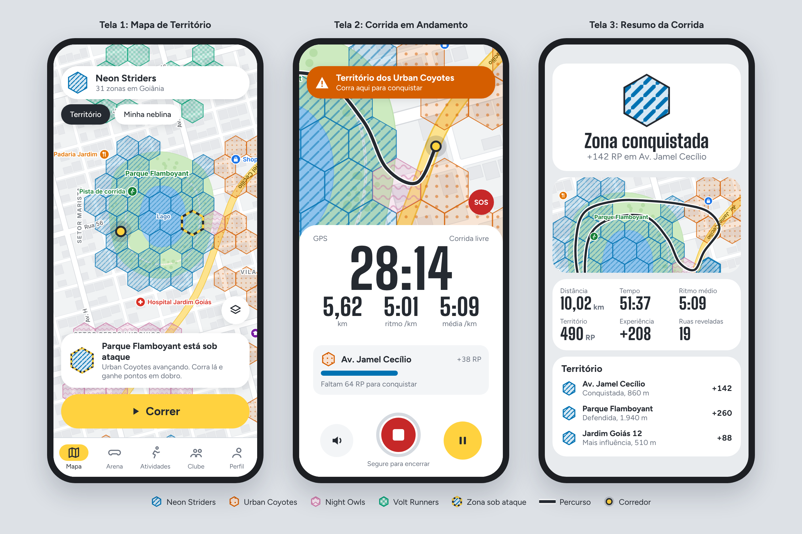
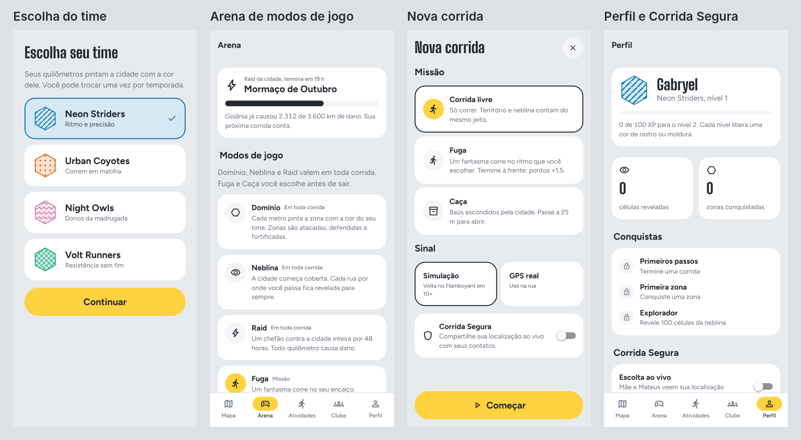

::: capa
# ESPECIFICAÇÃO DE REQUISITOS DE SOFTWARE (ERS) {.unlisted .unnumbered}

## NOMADE RUN: Um Projeto de Gestão e Gamificação de Corridas Urbanas {.unlisted .unnumbered}

**Projeto:** NOMADE RUN: Um Projeto de Gestão e Gamificação de Corridas Urbanas

**Versão:** 1.0 | **Data:** 10/10/2026

**Autores / Analistas de Requisitos:**

- Gabryel Gomes Bahmad Camapum
- Mateus Augusto De Faria Brito
:::

# 1. INTRODUÇÃO

## 1.1 Finalidade e Objetivo do Documento

Este documento apresenta a Especificação de Requisitos de Software (ERS) do sistema **NOMADE RUN**, elaborada a partir da Documentação de Concepção do Projeto. Seu objetivo é descrever, de forma detalhada e inequívoca, tudo o que o sistema deve fazer e as restrições que ele deve obedecer.

O documento tem três finalidades principais:

1. **Estabelecer um acordo** entre a equipe de desenvolvimento, o professor orientador e os demais interessados sobre o comportamento esperado do sistema.
2. **Servir de alicerce para a atividade de Teste de Software**: cada requisito recebe um identificador único (RF, RNF ou RN) e, sempre que possível, um critério de aceite mensurável, permitindo que seja rastreado até os casos de teste.
3. **Orientar o projeto e a implementação**, evitando ambiguidades e retrabalho nas etapas seguintes do Projeto de Desenvolvimento de Software (PDS).

Este documento destina-se à equipe de desenvolvimento, à equipe de testes, ao professor orientador e à banca avaliadora.

## 1.2 Escopo do Sistema

O **NOMADE RUN** é um aplicativo móvel de corrida de rua para Android e iOS. Ele reúne as funções tradicionais dos aplicativos de monitoramento de atividade física, como registro do percurso por GPS, distância, tempo, ritmo e histórico, e acrescenta como diferencial um **jogo de disputa de território sobre o mapa real da cidade**.

O mapa é dividido em pequenas áreas hexagonais (zonas). Quando o usuário corre fisicamente dentro de uma zona, ele acumula pontos para si e para a sua equipe (facção). A facção com mais pontos em uma zona passa a dominá-la, e as demais podem tentar conquistá-la correndo no local. O jogo funciona em qualquer cidade, permitindo a competição entre corredores de uma mesma cidade e entre cidades diferentes.

**O sistema FAZ:**

- Cadastro, autenticação e gestão do perfil do corredor.
- Registro de corridas em tempo real (percurso, distância, tempo, ritmo e parciais por quilômetro), inclusive com a tela bloqueada e sem conexão com a internet.
- Exibição do mapa da cidade, no padrão dos aplicativos de navegação, com os territórios de cada facção destacados por cima.
- Cálculo de pontos por zona e controle de território por facção (conquista, ataque, defesa e fortificação).
- Uma **Arena de modos de jogo** sobre o mapa: Domínio (território), Neblina (exploração), Raid (desafio coletivo da cidade), Fuga (corrida contra um fantasma) e Caça (baús espalhados pela cidade), além de Liga do Bairro semanal.
- Corrida Segura: compartilhamento da localização ao vivo com contatos escolhidos, botão SOS e alerta de parada prolongada.
- Guia por voz, que anuncia cada quilômetro e os eventos de jogo durante a corrida.
- Envio de notificações quando um território da facção do usuário estiver sendo conquistado por outra facção.
- Facções, grupos de corrida (Crews), feed de atividades, rankings, missões, medalhas e temporadas.
- Rankings por bairro, cidade, estado, país e geral, além de um placar de competição entre cidades.
- Detecção de fraudes, como uso de bicicleta, carro ou GPS falsificado.
- Painel web para a equipe de moderação revisar atividades suspeitas.

**O sistema NÃO FAZ:**

- **Não é um aplicativo de acompanhamento médico ou de saúde.** Não realiza diagnósticos, não prescreve treinos, não interpreta dados cardíacos para fins clínicos e não substitui a orientação de profissionais de saúde ou de educação física.
- Não registra ciclismo, natação ou deslocamentos motorizados. Essas atividades são justamente bloqueadas pelo sistema antifraude.
- Não oferece navegação por rotas de trânsito ("vire à direita em 200 m").
- Não realiza vendas, pagamentos ou qualquer transação financeira na versão 1.0.
- Não se integra a relógios inteligentes nem importa dados de outros aplicativos na versão 1.0.
- Não incentiva corridas em rodovias, áreas privadas ou áreas de risco: essas regiões são marcadas como zonas bloqueadas e não geram pontos.

## 1.3 Definições, Acrônimos e Abreviaturas

| Termo | Definição |
|---|---|
| **GPS** | *Global Positioning System*. Sistema de navegação por satélite usado para obter a posição do aparelho. |
| **Pace (ritmo)** | Tempo gasto para percorrer um quilômetro, expresso em minutos por quilômetro (ex.: 5:30 min/km). Quanto menor, mais rápido. |
| **Parcial (split)** | Tempo gasto em cada quilômetro completo de uma corrida. |
| **Atividade** | Registro de uma corrida, do início ao fim, contendo os pontos de GPS e os dados dos sensores. |
| **Zona** | Área hexagonal do mapa com aproximadamente 0,1 km² (cerca de 200 m de lado). É a menor unidade de território que pode ser conquistada. |
| **Distrito** | Agrupamento de zonas vizinhas, com aproximadamente 5 km², usado para o título de "Prefeito". |
| **H3** | Sistema público de divisão do globo terrestre em hexágonos, utilizado para gerar as zonas e os distritos. |
| **Zona bloqueada** | Zona localizada sobre rodovia, lago, rio, aeroporto ou área de risco, que não gera pontos. |
| **Run Points (RP)** | Pontos gerados para cada metro corrido de forma válida dentro de uma zona (RN-001). |
| **Influência** | Soma dos RP acumulados por uma facção em uma zona, sujeita a redução diária. |
| **Facção** | Uma das quatro equipes globais do jogo: Neon Striders, Urban Coyotes, Night Owls e Volt Runners. |
| **Crew** | Grupo de até 30 corredores de uma mesma facção, normalmente amigos ou assessorias esportivas. |
| **Dono da zona** | Facção com a maior influência em uma zona, desde que essa influência seja igual ou superior a 100. |
| **Sob ataque** | Situação em que uma facção adversária atinge 50% ou mais da influência do dono da zona. |
| **Escudo (fortificação)** | Nível de 0 a 3 que reduz os pontos que as facções adversárias conseguem ganhar em uma zona (RN-004). |
| **Arena** | Conjunto dos modos de jogo do NOMADE RUN. Alguns valem em toda corrida (Domínio, Neblina e Raid); outros são **missões** escolhidas antes de sair (Fuga e Caça). |
| **Missão** | Modo de jogo opcional escolhido antes de iniciar uma corrida. |
| **Neblina** | Camada pessoal do mapa que começa "coberta" e é revelada nas células por onde o usuário corre (RN-016). |
| **Fuga (Modo Fantasma)** | Missão em que o usuário corre contra um fantasma num ritmo escolhido ou no melhor tempo de alguém (RN-019). |
| **Caça** | Missão em que o usuário abre baús virtuais ao passar perto deles (RN-017). |
| **Raid** | Desafio coletivo de 48 horas em que todos os corredores de uma cidade somam quilômetros contra um "chefão" (RN-018). |
| **Esforço relativo** | Comparação entre o ritmo da corrida e o ritmo habitual do próprio usuário, usada na pontuação (RN-001). |
| **Liga do Bairro** | Ranking semanal em grupos de 30 corredores com volume parecido (RN-015). |
| **Sequência semanal** | Número de semanas seguidas com pelo menos duas corridas válidas (RN-014). |
| **Escolta** | Compartilhamento da localização ao vivo com contatos escolhidos durante a corrida (RF-024). |
| **Mapa de calor (heatmap)** | Camada do mapa que indica, por cores, a intensidade de corridas e disputas em cada região. |
| **Cidade natal** | Cidade que o usuário escolhe representar no placar entre cidades. |
| **Antifraude (anti-cheat)** | Conjunto de verificações que identificam atividades que não foram realizadas correndo a pé. |
| **GPS spoofing / localização simulada** | Uso de recurso do sistema operacional ou de aplicativo de terceiros para informar uma posição falsa. |
| **Índice de Confiança** | Nota de 0 a 100 atribuída a cada usuário, reduzida a cada indício de fraude (RN-009). |
| **Temporada** | Ciclo mensal de competição, ao final do qual os rankings são encerrados e premiados. |
| **Notificação push** | Mensagem enviada ao celular mesmo com o aplicativo fechado. |
| **API** | *Application Programming Interface*. Interface que permite a comunicação entre sistemas. |
| **SDK** | *Software Development Kit*. Conjunto de bibliotecas fornecido por terceiros. |
| **JWT** | *JSON Web Token*. Padrão de token de autenticação assinado digitalmente. |
| **HMAC** | *Hash-based Message Authentication Code*. Assinatura que garante que os dados não foram alterados no caminho. |
| **LGPD** | Lei Geral de Proteção de Dados Pessoais (Lei nº 13.709/2018). |
| **WCAG** | *Web Content Accessibility Guidelines*. Diretrizes internacionais de acessibilidade. |
| **p95** | Percentil 95: valor abaixo do qual estão 95% das medições de tempo de resposta. |
| **E2E** | *End-to-End*. Teste que simula o uso completo do sistema pelo usuário. |
| **RF / RNF / RN** | Requisito Funcional / Requisito Não Funcional / Regra de Negócio. |
| **UC** | *Use Case* (Caso de Uso). |

## 1.4 Visão Geral do Documento

O documento está organizado da seguinte forma:

- **Seção 1 (Introdução):** finalidade, escopo, definições e organização do documento.
- **Seção 2 (Descrição Geral):** contexto do produto, principais funções, perfis de usuários, restrições, suposições e dependências.
- **Seção 3 (Requisitos Funcionais):** o que o sistema deve fazer.
- **Seção 4 (Requisitos Não Funcionais):** critérios de qualidade e restrições técnicas, com metas mensuráveis.
- **Seção 5 (Regras de Negócio):** regras do jogo, fórmulas de pontuação e regras antifraude.
- **Seção 6 (Casos de Uso e Interfaces):** diagrama e descrição dos casos de uso, protótipos das telas e interfaces com hardware e sistemas externos.
- **Seção 7 (Aprovação e Controle de Revisões):** histórico de versões e aprovação do documento.

# 2. DESCRIÇÃO GERAL

## 2.1 Perspectiva do Produto

O NOMADE RUN é um produto novo e independente, formado por três componentes:

1. **Aplicativo móvel** (Android 8.0 ou superior e iOS 15 ou superior): é a interface utilizada pelo corredor para registrar corridas, visualizar o mapa, acompanhar os territórios e interagir com outros usuários.
2. **Servidor em nuvem**: armazena os dados, recalcula os pontos de cada corrida, aplica as regras de território e antifraude e envia as notificações. É a fonte oficial de todas as pontuações.
3. **Painel web administrativo**: utilizado pela equipe de moderação para acompanhar o mapa em tempo real e revisar atividades suspeitas.

O produto se posiciona entre os aplicativos de monitoramento de corrida, como Strava e Nike Run Club, e os jogos baseados em localização, como Pokémon GO. Dos primeiros, herda o registro esportivo; dos segundos, a motivação de explorar a cidade e competir.

## 2.2 Funções do Produto (Resumo de Alto Nível)

- **Registrar corridas:** gravação do percurso por GPS, com métricas em tempo real, funcionamento sem internet e resumo ao final.
- **Disputar território (principal diferencial):** cada metro corrido gera pontos na zona onde foi percorrido. A facção com mais influência domina a zona. Zonas podem ser conquistadas, atacadas, defendidas e fortificadas, e a influência diminui com o tempo quando ninguém corre no local.
- **Jogar em equipe:** escolha de facção, criação de Crews, bônus para corridas em grupo e rankings.
- **Receber alertas de invasão:** notificação quando um território da facção estiver sendo conquistado, com prazo de 24 horas para a defesa.
- **Jogar na Arena:** além do território, revelar a Neblina, enfrentar o Raid da cidade, fugir do fantasma (Fuga) e abrir baús (Caça).
- **Competir entre cidades:** o jogo funciona em qualquer cidade, e os pontos de cada corredor somam para a sua cidade natal no placar entre cidades.
- **Progredir:** níveis, missões, medalhas, título de "Prefeito" de um distrito e temporadas mensais.
- **Interagir socialmente:** feed de atividades, curtidas ("Respect"), comentários e compartilhamento do resumo da corrida.
- **Garantir partidas justas:** verificação automática de fraudes e revisão manual pela moderação.

## 2.3 Perfil dos Usuários

| Perfil | Descrição | Conhecimento técnico | Uso principal |
|---|---|---|---|
| **Corredor iniciante** | Pessoa a partir de 16 anos que corre de 1 a 3 vezes por semana e busca motivação. | Básico: utiliza aplicativos comuns de celular. | Registrar corridas e conquistar zonas próximas de casa. |
| **Corredor frequente** | Treina várias vezes por semana e acompanha ritmo e recordes pessoais. | Intermediário. | Dominar distritos, subir no ranking e usar o Modo Fantasma. |
| **Líder de Crew** | Organiza grupos de corrida de amigos ou de assessorias esportivas. | Intermediário. | Gerenciar a Crew, definir metas e organizar corridas em grupo. |
| **Moderador** | Membro da equipe do NOMADE RUN. | Avançado. | Revisar atividades suspeitas no painel web. |
| **Administrador** | Responsável técnico pelo sistema. | Avançado. | Configurar temporadas, zonas bloqueadas e parâmetros do jogo. |

## 2.4 Restrições Gerais

- **Precisão do GPS:** em regiões com prédios altos, túneis ou muitas árvores, o erro de posição pode passar de 30 metros. Pontos com precisão pior que 30 m são descartados (RN-007), o que pode reduzir a distância registrada.
- **Consumo de bateria:** o uso contínuo do GPS é o principal consumidor de energia. O aplicativo deve respeitar o limite definido no RNF-004.
- **Execução em segundo plano:** Android e iOS limitam aplicativos que rodam com a tela desligada. O usuário precisa permitir o acesso à localização "o tempo todo" e, no Android, desativar a otimização de bateria para o aplicativo.
- **Sensores do aparelho:** celulares sem sensor de passos (pedômetro) funcionam normalmente, mas suas corridas longas passam por revisão (RN-008).
- **Conectividade:** a gravação da corrida não pode depender de internet. A pontuação só é confirmada após a sincronização com o servidor.
- **Legislação:** o sistema deve cumprir a LGPD (consentimento, finalidade e exclusão de dados). A idade mínima de uso é de 16 anos.
- **Tecnologia:** o aplicativo será desenvolvido em React Native com Expo e o servidor utilizará PostgreSQL com a extensão PostGIS (dados geográficos).
- **Prazo e equipe:** trata-se de um projeto acadêmico desenvolvido por dois integrantes, dentro do calendário da disciplina.

## 2.5 Suposições e Dependências

- Disponibilidade do **Mapbox** (SDK de mapas para Android/iOS e biblioteca para web) no plano gratuito para fins acadêmicos. A **Google Maps Platform** é a alternativa caso haja mudança nas condições de uso.
- Disponibilidade de um serviço de banco de dados e autenticação em nuvem (Supabase), com PostgreSQL, PostGIS e notificações em tempo real.
- Disponibilidade dos serviços de notificação **Firebase Cloud Messaging** (Android) e **Apple Push Notification service** (iOS).
- Uso dos dados do **OpenStreetMap** para identificar rodovias, rios, lagos e aeroportos (zonas bloqueadas).
- Uso da **malha municipal do IBGE** para identificar a qual cidade cada zona pertence. Fora do Brasil, são usados os limites administrativos do OpenStreetMap.
- Supõe-se que o usuário corre com o celular junto ao corpo (bolso, braçadeira ou mão).
- Supõe-se que a maioria dos aparelhos possui GPS, acelerômetro e pedômetro.

# 3. REQUISITOS FUNCIONAIS (RF)

| ID | Nome do Requisito | Descrição Detalhada | Prioridade |
|---|---|---|---|
| RF-001 | Autenticação | O sistema deve permitir cadastro e login por e-mail e senha ou por conta Google/Apple, gerando um token JWT com validade de 1 hora e renovação automática. Deve permitir a recuperação de senha por e-mail e exigir, no cadastro, a confirmação de idade mínima de 16 anos e o aceite dos termos de uso e da política de privacidade. | Alta |
| RF-002 | Gestão de Usuários | O usuário deve poder editar nome de usuário (único, de 3 a 20 caracteres), foto, cidade natal, unidade de medida (km ou milhas) e preferências de notificação. Deve poder exportar seus dados e solicitar a exclusão da conta. O administrador deve poder inativar contas. | Média |
| RF-003 | Escolha de Facção | No primeiro acesso, o usuário deve escolher uma das quatro facções. A troca de facção é permitida uma vez por temporada e zera a contribuição pessoal do usuário na temporada atual. | Alta |
| RF-004 | Registro de Corrida | O sistema deve registrar a posição GPS a cada 1 segundo, com precisão, velocidade e altitude, além dos dados de passos e movimento, inclusive com a tela bloqueada. Durante a corrida, deve exibir tempo, distância, ritmo atual, ritmo médio e a zona atual. Deve permitir pausar, retomar e finalizar a corrida, e pausar automaticamente quando a velocidade ficar abaixo de 1 km/h por 10 segundos. | Alta |
| RF-005 | Gravação sem Internet | Sem conexão, o aplicativo deve armazenar os pontos da corrida no próprio celular e enviá-los automaticamente quando a conexão voltar, sem perda e sem duplicação de dados. | Alta |
| RF-006 | Resumo e Histórico | Ao finalizar a corrida, o sistema deve exibir o mapa do percurso, distância, tempo em movimento, ritmo médio, parciais por quilômetro, gráfico de ritmo, recordes pessoais e a lista de zonas afetadas, com os pontos ganhos e as zonas conquistadas ou defendidas. Trechos invalidados pelo antifraude devem aparecer destacados e com explicação. O histórico deve listar todas as corridas, com filtro por período. | Alta |
| RF-007 | Mapa de Território | O sistema deve exibir o mapa da cidade no padrão dos aplicativos de navegação (ruas, nomes, parques e pontos de referência), com as zonas sobrepostas como hexágonos semitransparentes na cor da facção dona, sem esconder as ruas. Zonas neutras não são preenchidas, zonas bloqueadas aparecem hachuradas e zonas sob ataque aparecem com contorno em faixa de sinalização (amarelo e asfalto alternados). Cada facção, além da cor, tem um padrão de hachura próprio, para que pessoas com daltonismo também diferenciem os territórios. Ao tocar em uma zona, o sistema deve exibir nome, facção dona, influência de cada facção, nível de escudo, os três maiores corredores e os últimos eventos. | Alta |
| RF-008 | Conquista de Zona | Ao receber uma corrida válida, o servidor deve calcular os pontos de cada zona percorrida (RN-001), atualizar a influência das facções e aplicar as regras de conquista (RN-002). Em caso de conquista, o aplicativo deve exibir o aviso "Zona conquistada" e registrar o evento. | Alta |
| RF-009 | Alerta de Invasão | Quando uma zona ficar sob ataque (RN-003), o sistema deve enviar notificação aos membros da facção dona que correram nela nos últimos 30 dias, com o texto: "Alerta de Invasão! Seu território em {zona} está sendo conquistado pelos {facção}. Corra lá nas próximas 24h para defender." Ao tocar na notificação, o aplicativo deve abrir o mapa centralizado na zona. | Alta |
| RF-010 | Defesa e Fortificação | Durante as 24 horas seguintes ao alerta, as corridas da facção dona na zona atacada devem receber pontuação em dobro (RN-001). Corridas em dias seguidos da facção dona devem aumentar o escudo da zona (RN-004). | Alta |
| RF-011 | Crews | O usuário deve poder criar uma Crew (nome e sigla de 3 a 5 letras), convidar membros por link ou código e acompanhar o ranking interno, as metas semanais e os membros que estão correndo no momento. O líder pode aceitar e remover membros. Limite de 30 membros, todos da mesma facção. | Média |
| RF-012 | Fuga (Modo Fantasma) | Antes de iniciar a corrida, o usuário deve poder escolher a missão Fuga e o ritmo do fantasma (ou o melhor tempo de um amigo ou do dono da zona). Durante a corrida, o sistema deve mostrar a cada segundo a distância entre o usuário e o fantasma e avisar por voz a cada 100 m de diferença. Ao terminar à frente do fantasma, o usuário recebe o bônus de pontos da RN-001. | Média |
| RF-013 | Mapa de Calor | O sistema deve oferecer uma camada de mapa de calor com a intensidade de corridas e de trocas de dono nas últimas 24 horas, 7 dias ou na temporada, no aplicativo e no painel web. | Média |
| RF-014 | Feed Social | O usuário deve poder seguir outros corredores, visualizar as corridas de quem segue e da sua Crew, curtir ("Respect") e comentar. As atividades devem respeitar a zona de privacidade do usuário (RN-010). | Média |
| RF-015 | Rankings | O sistema deve exibir rankings individuais, por Crew e por facção, com filtros por distrito, cidade, estado, país, geral e temporada, atualizados no máximo a cada 5 minutos. | Média |
| RF-016 | Missões, Medalhas e Temporadas | O sistema deve oferecer missões diárias e semanais, conceder medalhas por conquistas (ex.: "Prefeito de {distrito}" e "Muralha: 10 defesas") e executar o ciclo de temporadas mensais (RN-006). | Baixa |
| RF-017 | Compartilhar Corrida | O usuário deve poder gerar uma imagem do resumo da corrida, com o mapa do percurso e as zonas conquistadas, e compartilhá-la em redes sociais. | Baixa |
| RF-018 | Moderação de Atividades | No painel web, o moderador deve visualizar a lista de corridas em revisão, com o percurso no mapa, os gráficos de velocidade e de passos e os alertas de fraude detectados. Deve poder aprovar ou rejeitar cada corrida, com justificativa obrigatória. A decisão recalcula a pontuação e notifica o usuário. | Alta |
| RF-019 | Central de Notificações | O aplicativo deve manter uma lista das notificações recebidas (invasões, conquistas, missões e moderação), indicando as lidas e não lidas, e permitir escolher os tipos de notificação desejados. | Baixa |
| RF-020 | Competição entre Cidades | O sistema deve funcionar em qualquer cidade sem configuração prévia: as zonas são criadas automaticamente na primeira corrida em uma região nova. Os pontos que o usuário ganha em qualquer lugar somam para a sua cidade natal no placar entre cidades da temporada (RN-013). O perfil deve mostrar as cidades onde o usuário já conquistou zonas. Correr pela primeira vez em uma nova cidade concede a medalha "Nômade" (1, 5 e 10 cidades). | Média |
| RF-021 | Arena de Modos de Jogo | O sistema deve ter uma tela Arena com todos os modos de jogo e suas regras resumidas. Domínio, Neblina e Raid valem em qualquer corrida, sem escolha prévia. Antes de iniciar uma corrida, o usuário deve poder escolher uma missão: Corrida livre, Fuga ou Caça. | Alta |
| RF-022 | Neblina | O sistema deve manter, para cada usuário, o conjunto de células do mapa já reveladas (RN-016), exibir esse conjunto como camada opcional no mapa e mostrar no perfil o total de células reveladas. | Média |
| RF-023 | Caça | Na missão Caça, o sistema deve exibir baús no mapa e no painel da corrida (distância até o mais próximo), abrir automaticamente o baú quando o usuário passar perto dele (RN-017) e mostrar a recompensa recebida. | Média |
| RF-024 | Corrida Segura | O usuário deve poder cadastrar até 5 contatos e, em cada corrida, ligar a Escolta para que eles acompanhem sua localização ao vivo. A tela de corrida deve ter um botão SOS sempre visível, que envia a localização atual aos contatos. Se o usuário ficar parado por mais de 10 minutos, o sistema deve perguntar se está tudo bem e, sem resposta em 60 segundos, avisar os contatos. | Alta |
| RF-025 | Guia por Voz | Durante a corrida, o sistema deve anunciar por voz cada quilômetro completado com o ritmo atual e os eventos de jogo (território rival, baú aberto, fantasma se aproximando). O usuário deve poder silenciar o Guia com um toque. | Média |
| RF-026 | Raid da Cidade | O sistema deve exibir o Raid ativo da cidade, com barra de vida coletiva, tempo restante e ranking de Crews por dano, e somar automaticamente os quilômetros válidos de cada corrida ao dano (RN-018). | Baixa |
| RF-027 | Liga do Bairro | O sistema deve colocar cada usuário num grupo semanal (RN-015), exibir sua posição e indicar se ele está na zona de subida, de permanência ou de queda. | Média |

# 4. REQUISITOS NÃO FUNCIONAIS (RNF)

| ID | Categoria | Descrição do Requisito / Critério de Aceite |
|---|---|---|
| RNF-001 | Desempenho | O serviço que recebe os pontos de GPS deve suportar **5.000 usuários correndo ao mesmo tempo**, cada um enviando dados a cada 5 segundos, com tempo de resposta **p95 inferior a 300 ms** e **taxa de erro inferior a 0,5%**. A verificação será feita com testes de carga (ferramenta k6) nos cenários de carga normal, estresse, pico repentino e longa duração (2 horas). |
| RNF-002 | Desempenho | A tela do mapa deve ser exibida em **menos de 2,5 segundos** em um celular Android intermediário (4 GB de RAM) com rede 4G e deve continuar fluida (**no mínimo 55 quadros por segundo**) ao arrastar e aproximar o mapa com até 2.000 zonas visíveis. |
| RNF-003 | Desempenho | Uma troca de dono de zona deve aparecer no mapa dos demais usuários que visualizam a região em **até 3 segundos**. A notificação de invasão deve ser enviada em **até 60 segundos** após o processamento da corrida. |
| RNF-004 | Eficiência | Uma hora de corrida com a tela desligada deve consumir **no máximo 8% da bateria** de um aparelho com bateria de 4.000 mAh ou mais. |
| RNF-005 | Confiabilidade | **Nenhum ponto de GPS pode ser perdido** em corridas gravadas sem internet de até 3 horas. O servidor deve ter **disponibilidade mínima de 99,5%** ao mês. A distância medida deve ter **erro máximo de 3%** em um percurso aferido de 5 km a céu aberto. |
| RNF-006 | Segurança | Os pontos de GPS enviados pelo aplicativo devem ser **assinados digitalmente (HMAC-SHA256)** com uma chave exclusiva de cada aparelho. O servidor deve rejeitar dados com assinatura inválida, fora de ordem ou reenviados. **Toda a pontuação é recalculada pelo servidor**: nenhum ponto calculado pelo aplicativo é aceito. Em caso de erro na validação, a corrida não pontua. |
| RNF-007 | Segurança | Senhas armazenadas com **hash bcrypt (custo ≥ 10)**; comunicação exclusivamente por **HTTPS (TLS 1.2 ou superior)**; controle de acesso no banco de dados garantindo que cada usuário acesse apenas os próprios dados privados; limite de 10 tentativas de login a cada 15 minutos por endereço IP; nenhuma senha ou chave de acesso gravada no código-fonte. O sistema deve atender às recomendações do OWASP Top 10. |
| RNF-008 | Manutenibilidade | As regras de pontuação, conquista e antifraude devem ficar em um módulo separado da interface e do banco de dados, com **cobertura mínima de 90% por testes unitários**. O código deve passar por análise estática automática a cada alteração, sem falhas de severidade alta. |
| RNF-009 | Escalabilidade | O recebimento dos pontos de GPS deve ser assíncrono (o aplicativo não espera o processamento completo). A consulta das zonas visíveis na tela deve responder em **menos de 150 ms (p95)** para até 2.000 zonas, utilizando índices geográficos. |
| RNF-010 | Usabilidade | O usuário deve conseguir iniciar uma corrida com **no máximo 2 toques** a partir da tela inicial. O mapa deve seguir o padrão visual dos aplicativos de navegação, com **tema claro durante o dia e tema escuro automático à noite** (ou conforme a preferência do usuário). Todos os textos em português do Brasil. |
| RNF-011 | Acessibilidade | Contraste mínimo de **4,5:1 (WCAG 2.1 nível AA)** para textos; botões com área de toque de no mínimo **44 × 44 pontos**; todos os controles com descrição para leitores de tela (TalkBack e VoiceOver). Com a opção "Reduzir movimento" do sistema ativada, nenhuma animação de piscar ou pulsar deve ser exibida. |
| RNF-012 | Testabilidade | Todo elemento interativo deve possuir um identificador de teste fixo. Os casos de uso UC-01, UC-02 e UC-03 devem ser cobertos por testes automatizados de ponta a ponta no aplicativo (ferramenta Maestro). O painel web deve ter testes automatizados com comparação de imagem (ferramenta Playwright, tolerância máxima de 0,2% de diferença) nos estados: zona neutra, zona dominada, zona sob ataque e mapa de calor ativo. |
| RNF-013 | Privacidade | Consentimento separado e explícito para localização e notificações, com explicação da finalidade antes do pedido de permissão. Pedidos de exportação e exclusão de dados atendidos em **até 30 dias** (LGPD). Percursos públicos nunca exibem pontos dentro da zona de privacidade do usuário. |
| RNF-014 | Compatibilidade | Android 8.0 ou superior e iOS 15 ou superior, telas de 4,7" a 6,9". Painel web compatível com Chrome, Edge, Firefox e Safari (duas últimas versões). |
| RNF-015 | Usabilidade (tela de corrida) | A tela de corrida deve mostrar no máximo 3 métricas principais, com números de pelo menos 48 pt (tempo com pelo menos 72 pt) e algarismos de largura fixa, legíveis sob sol. Os controles devem ter área de toque de pelo menos 56 pt, e o encerramento da corrida deve exigir manter o botão pressionado por **600 ms**, para evitar o fim acidental com o celular no bolso. |

# 5. REGRAS DE NEGÓCIO (RN)

| ID | Regra | Detalhamento |
|---|---|---|
| RN-001 | Cálculo de Pontos (Esforço × Distância) | Para cada zona percorrida em uma corrida válida: **RP = metros válidos × 0,1 × M_esforço × M_sequência × M_fantasma × M_grupo × M_defesa**, arredondado para número inteiro. **M_esforço** = ritmo-base ÷ ritmo da corrida, limitado entre **0,8 e 1,3**. O ritmo-base é a mediana do ritmo das últimas 10 corridas válidas do próprio usuário; sem histórico, vale 6:00 min/km. Assim, correr no próprio limite vale o mesmo para iniciantes e atletas. **M_sequência** = 1 + 0,05 × semanas da sequência semanal (RN-014), até o máximo de 10 semanas (1,50). **M_fantasma** = 1,5 se o usuário venceu o fantasma, senão 1,0. **M_grupo** = 1,25 se 3 ou mais membros da mesma Crew correram a até 50 m entre si em pelo menos 60% do trecho, senão 1,0. **M_defesa** = 2,0 se a zona pertence à facção do usuário e está sob ataque, senão 1,0. **Limite:** 300 RP por usuário, por zona, por dia. *Exemplo:* 800 m a 5:00 min/km, ritmo-base de 6:00 e sequência de 4 semanas: 800 × 0,1 × 1,20 × 1,20 = **115 RP**. |
| RN-002 | Conquista de Zona | Uma zona neutra passa a pertencer à primeira facção que atingir **influência igual ou superior a 30** (cerca de 300 m corridos dentro dela), para que a primeira corrida de um iniciante já conquiste algo. Uma zona com dono só muda de dono quando **a influência da facção desafiante for igual ou superior a 110% da influência do dono** (e de pelo menos 30). Em caso de empate, o dono atual é mantido. Zonas bloqueadas nunca têm dono. |
| RN-003 | Zona Sob Ataque | Uma zona fica **sob ataque** quando uma facção adversária atinge **50% ou mais** da influência do dono. Nesse momento é aberto um **prazo de defesa de 24 horas** e enviado o alerta do RF-009. Cada usuário recebe no máximo **1 alerta por zona a cada 6 horas** e no máximo **5 alertas de invasão por dia**. A zona deixa de estar sob ataque quando essa proporção cai abaixo de 40% ou quando a zona muda de dono. |
| RN-004 | Fortificação (Escudo) | Cada dia seguido em que a facção dona soma **500 m ou mais** corridos na zona aumenta o escudo em 1 nível (máximo 3). O escudo reduz os pontos das facções adversárias na zona em **10%, 20% ou 30%** (níveis 1, 2 e 3). Um dia sem corridas da facção dona reduz o escudo em 1 nível. |
| RN-005 | Redução Diária de Influência | Todos os dias, às 03:00 (horário de Brasília), a influência de todas as facções em todas as zonas é multiplicada por **0,90**. Valores abaixo de 5 são zerados. Se a influência do dono ficar abaixo de 30, a zona volta a ser **neutra**. |
| RN-006 | Temporadas | Cada temporada dura um mês. No encerramento, os rankings são arquivados, as medalhas da temporada são entregues (10 primeiros corredores, 3 primeiras Crews, facção e cidade campeãs) e a influência de todas as zonas é multiplicada por **0,30**. A troca de facção (RF-003) é liberada novamente. |
| RN-007 | Antifraude: Validação do GPS | As verificações são aplicadas nesta ordem: (a) pontos com precisão pior que 30 m são descartados; (b) **qualquer ponto acima de 40 km/h** invalida o trecho; (c) **velocidade média acima de 25 km/h por mais de 30 segundos** invalida o trecho (suspeita de veículo); (d) **deslocamento maior que 50 m em até 1 segundo** invalida o trecho (salto de posição); (e) qualquer ponto identificado pelo sistema operacional como **localização simulada** invalida a corrida inteira. Trechos inválidos não geram pontos nem contam distância para os rankings. |
| RN-008 | Antifraude: Passos × Velocidade | Quando a velocidade do GPS estiver entre **8 e 20 km/h**, a cadência medida pelo sensor de passos deve estar entre **120 e 220 passos por minuto**. Cadência **abaixo de 60 passos por minuto por mais de 60 segundos** nessa faixa de velocidade invalida o trecho, pois indica que o celular está em um veículo. O acelerômetro também deve registrar a vibração típica da passada; sinal sem vibração com velocidade acima de 12 km/h indica suspeita de veículo. Em aparelhos sem sensor de passos, corridas acima de 10 km são enviadas para revisão. |
| RN-009 | Índice de Confiança | Todo usuário começa com Índice de Confiança 100. Penalidades: localização simulada −30; salto de posição −10; suspeita de veículo −10; ausência de passos −10. Recuperação: +2 por corrida totalmente válida, até o máximo de 100. Com **índice abaixo de 40**, todas as corridas passam por **revisão manual** (RF-018) e só pontuam após aprovação. Com **índice abaixo de 10**, o usuário é suspenso da competição por 30 dias. |
| RN-010 | Zona de Privacidade | Os pontos dentro do raio de privacidade definido pelo usuário (padrão de 200 m em torno dos endereços marcados) **geram pontos normalmente**, mas **nunca** são exibidos no feed, no perfil público, no compartilhamento ou no painel web. |
| RN-011 | Facção e Crew | Cada usuário pertence a exatamente uma facção e a no máximo uma Crew. A Crew deve ser da mesma facção do usuário. Ao trocar de facção, o usuário sai automaticamente da Crew. |
| RN-012 | Título de Prefeito | O usuário com a maior soma de pontos em um distrito na temporada recebe o título e a medalha "Prefeito de {distrito}", desde que a sua facção domine pelo menos 30% das zonas desse distrito. |
| RN-013 | Placar entre Cidades | A pontuação de cada cidade na temporada é a **soma dos pontos válidos dos usuários que têm aquela cidade natal, dividida pela raiz quadrada do número de corredores ativos** (com pelo menos uma corrida válida na temporada). A divisão permite que cidades menores concorram com as capitais. Só participam do placar cidades com 20 ou mais corredores ativos. A cidade natal pode ser trocada uma vez por temporada. |
| RN-014 | Sequência Semanal | A semana conta para a sequência quando o usuário faz **pelo menos 2 corridas válidas** entre segunda e domingo. O usuário tem **1 congelamento grátis por mês**, que mantém a sequência numa semana com menos de 2 corridas. Sem congelamento disponível, a sequência volta a zero. Não existe sequência diária, para não punir o descanso. |
| RN-015 | Liga do Bairro | Cada semana, os usuários são agrupados em grupos de 30 com volume de corrida parecido, em 5 divisões (Calçada, Rua, Avenida, Rodovia e Maratona). Ao fim da semana, os **5 primeiros sobem** de divisão e os **5 últimos descem**. Ninguém desce da primeira divisão nem sobe da última. |
| RN-016 | Neblina | O mapa é dividido em células menores que as zonas (cerca de 15.000 m²). Cada célula cujo centro fique a **até 30 m** de um trecho válido percorrido é revelada para sempre para aquele usuário. Cada célula nova vale **10 XP**; revelar a mesma célula de novo não vale nada. |
| RN-017 | Caça | Todos os dias são sorteados de 5 a 8 baús por usuário num raio de 3 km da última corrida, sempre em ruas e parques e nunca em zonas bloqueadas. Um baú abre quando o usuário passa a **até 25 m** dele correndo. Raridades e recompensas: comum (70%, 20 XP), raro (25%, 60 XP) e lendário (5%, 150 XP). Cada baú abre uma única vez. |
| RN-018 | Raid | O chefão da cidade tem vida igual a **1 km × 30% dos corredores ativos** da cidade e dura 48 horas. Cada quilômetro válido de qualquer corredor da cidade causa 1 km de dano. Se a vida chegar a zero no prazo, todos os participantes recebem a recompensa. |
| RN-019 | Fuga | O fantasma corre em ritmo constante. A diferença é calculada por: distância do usuário − (tempo em movimento ÷ ritmo do fantasma). Diferença maior que 5 m: usuário à frente; entre −5 m e 5 m: lado a lado; menor que −5 m: o fantasma passou. Terminar a corrida à frente dá o multiplicador de 1,5 da RN-001 e 50 XP. |

# 6. CASOS DE USO E INTERFACES

## 6.1 Diagramas de Casos de Uso

**Atores:** Corredor (ator principal); Líder de Crew (especialização do Corredor); Moderador; Administrador; Sistema Antifraude (ator secundário, automático); Serviço de Notificações (sistema externo); Provedor de Mapas (sistema externo).

### UC-01: Correr e Conquistar

| Campo | Descrição |
|---|---|
| **Ator principal** | Corredor |
| **Atores secundários** | Sistema Antifraude, Provedor de Mapas, Serviço de Notificações |
| **Requisitos relacionados** | RF-004, RF-005, RF-006, RF-007, RF-008; RN-001, RN-002, RN-007, RN-008, RN-009 |
| **Pré-condições** | Usuário autenticado, com facção escolhida e permissão de localização concedida. |
| **Pós-condições** | Corrida salva como válida, pontos creditados, influência atualizada e conquistas registradas. |
| **Fluxo principal** | 1. O corredor toca em **Correr** na tela do mapa e escolhe a missão (Corrida livre, Fuga ou Caça) e, se quiser, liga a Corrida Segura. 2. O sistema verifica o sinal de GPS e exibe uma contagem regressiva de 3 segundos. 3. O sistema inicia a gravação e exibe tempo, distância, ritmo e a zona atual com a barra de influência. 4. O corredor percorre uma ou mais zonas, e o sistema mostra uma estimativa dos pontos ganhos em cada uma. 5. O corredor finaliza a corrida. 6. O aplicativo envia os pontos restantes ao servidor. 7. O servidor executa as verificações antifraude (RN-007 e RN-008) e calcula os pontos de cada zona (RN-001). 8. O servidor aplica as regras de conquista (RN-002) e registra os eventos. 9. O aplicativo exibe o resumo da corrida com as zonas afetadas e o aviso "Zona conquistada" para cada conquista. |
| **Fluxo alternativo A1: sem internet** | No passo 6, sem conexão, os pontos ficam armazenados no celular. O resumo é exibido como "provisório" e confirmado automaticamente após a sincronização (RF-005). |
| **Fluxo alternativo A2: pausa** | Entre os passos 3 e 5, o corredor pausa a corrida (manual ou automaticamente). O tempo parado não é contado como tempo em movimento. |
| **Fluxo de exceção E1: trecho inválido** | No passo 7, os trechos reprovados pelo antifraude aparecem em cinza no resumo, com a explicação "velocidade incompatível com corrida a pé". Apenas os trechos válidos geram pontos. |
| **Fluxo de exceção E2: localização simulada** | No passo 7, se for detectada localização simulada, a corrida é rejeitada, o Índice de Confiança é reduzido e o usuário é informado. |
| **Fluxo de exceção E3: GPS fraco** | No passo 2, se a precisão ficar pior que 30 m por mais de 15 segundos, o sistema exibe um aviso e permite iniciar mesmo assim. |

### UC-02: Defender Território

| Campo | Descrição |
|---|---|
| **Ator principal** | Corredor (membro da facção dona da zona) |
| **Atores secundários** | Serviço de Notificações, Sistema Antifraude |
| **Requisitos relacionados** | RF-007, RF-009, RF-010; RN-001, RN-003, RN-004 |
| **Pré-condições** | A facção do corredor é dona da zona; a zona está sob ataque; o corredor correu na zona nos últimos 30 dias e permite notificações de invasão. |
| **Pós-condições** | A facção dona volta a ter vantagem; a zona deixa de estar sob ataque; o evento "Zona defendida" é registrado. |
| **Fluxo principal** | 1. O sistema identifica que uma facção adversária atingiu 50% da influência do dono (RN-003). 2. O sistema envia a notificação "Alerta de Invasão". 3. O corredor toca na notificação. 4. O aplicativo abre o mapa centralizado na zona, com o contorno em faixa de sinalização, contagem regressiva do prazo de 24 horas e comparação de influência entre dono e atacante. 5. O corredor executa o **UC-01** dentro da zona. 6. O servidor aplica a pontuação em dobro de defesa. 7. Quando a proporção do atacante cai abaixo de 40%, o sistema marca a zona como defendida, notifica a facção e exibe o aviso "Zona defendida". |
| **Fluxo alternativo A1: defesa em grupo** | No passo 5, vários membros da facção correm na zona, e os pontos de todos somam para a defesa. |
| **Fluxo alternativo A2: defesa insuficiente** | No passo 7, se o atacante atingir 110% da influência do dono, a zona muda de dono (RN-002) e os antigos donos recebem a notificação "Território perdido". |
| **Fluxo de exceção E1: prazo encerrado** | Se o corredor abrir a notificação após as 24 horas, o aplicativo informa a situação atual da zona (defendida, perdida ou ainda em disputa). |

### UC-03: Analisar Mapa de Calor

| Campo | Descrição |
|---|---|
| **Ator principal** | Corredor (no aplicativo) ou Moderador/Administrador (no painel web) |
| **Atores secundários** | Provedor de Mapas |
| **Requisitos relacionados** | RF-007, RF-013, RF-015, RF-020; RNF-002, RNF-003 |
| **Pré-condições** | Usuário autenticado e existência de corridas no período consultado. |
| **Pós-condições** | O usuário visualiza as regiões com mais disputa e pode navegar até uma zona de interesse. |
| **Fluxo principal** | 1. O usuário abre o seletor de camadas do mapa. 2. Seleciona **Mapa de calor**. 3. Escolhe o período (24 horas, 7 dias ou temporada). 4. O sistema carrega as zonas da área visível e exibe a camada de calor (cores frias para pouca atividade e quentes para muita disputa). 5. O usuário toca em uma área de alta disputa. 6. O sistema exibe os detalhes da zona: trocas de dono no período, facções envolvidas e corredores mais ativos. 7. O usuário pode tocar em **Ir até lá** para iniciar uma corrida (UC-01) ou em **Desafiar Fantasma** (RF-012). |
| **Fluxo alternativo A1: painel web** | No painel web, o moderador pode filtrar o mapa de calor por facção e exportar os dados da região em planilha (CSV). |
| **Fluxo de exceção E1: sem dados** | Se não houver corridas no período, o sistema exibe "Nenhuma disputa neste período" e sugere ampliar o intervalo. |

## 6.2 Requisitos de Interface com o Usuário (Mockups/Wireframes)

A interface do NOMADE RUN combina duas referências conhecidas pelos usuários: o **mapa dos aplicativos de navegação** (Google Maps e Waze), que ocupa a tela inicial, e o **registro de atividades dos aplicativos de corrida** (Strava). A identidade visual, chamada **"Asfalto & Giz"**, vem do vocabulário da corrida de rua: o mapa tem a cor fria do concreto, os territórios parecem marcações de giz no asfalto (cada time com sua hachura) e a ação principal usa o amarelo da sinalização viária.

| Elemento | Especificação |
|---|---|
| **Mapa base** | Mapa vetorial com ruas, avenidas, nomes de vias, bairros, parques, lagos e pontos de interesse, com cores dessaturadas para que os territórios sejam a única cor forte. Tema claro durante o dia e escuro automaticamente à noite. |
| **Camada de território** | Hexágonos com preenchimento de 20% a 30% de opacidade, borda na cor da facção dona e **padrão de hachura por facção**: Neon Striders listras, Urban Coyotes pontos, Night Owls ondas e Volt Runners xadrez. Zonas neutras sem preenchimento. Zonas sob ataque com contorno em **faixa de sinalização** (amarelo e asfalto). |
| **Cores** | Asfalto `#252A31` (texto), Concreto `#E8EBEE` (fundo), Giz `#FFFFFF` (superfícies), Sinalização `#FFD23F` (ação principal), Meio-fio `#6B7380` (texto secundário) e Alerta `#C62828` (SOS e erros). Facções, em paleta segura para daltônicos: Neon Striders `#0072B2`, Urban Coyotes `#D55E00`, Night Owls `#CC79A7` e Volt Runners `#009E73`. |
| **Posição do corredor e percurso** | Ponto amarelo com borda asfalto. Percurso em linha asfalto com contorno branco, para contraste máximo sobre o mapa. |
| **Tipografia** | Big Shoulders Display (condensada, inspirada em placas de rua) para números e títulos; Figtree para o texto. Números com algarismos de largura fixa. |
| **Navegação** | Barra inferior nativa com 5 abas: Mapa, Arena, Atividades, Clube e Perfil. O botão **Correr** fica em destaque na tela do mapa. A corrida abre em tela cheia e o detalhe da zona abre em folha deslizante. |

**Retorno visual obrigatório:**

| Evento | Retorno ao usuário | Critério de aceite |
|---|---|---|
| Pressionar um botão | O botão encolhe levemente (escala 0,97). | Duração de 120 ms. |
| Início da corrida | Contagem 3-2-1 em tela cheia, com vibração leve em cada número. | Cada número por 0,8 s. |
| Entrar em território adversário | Faixa no topo da tela na cor da facção dona com a mensagem "Território dos {facção}", vibração de alerta e aviso por voz. | Exibido em até 3 segundos após cruzar o limite da zona. |
| Defender o próprio território sob ataque | Faixa amarela "Defendendo seu território: pontos em dobro nesta zona". | Exibida enquanto o usuário estiver na zona atacada. |
| Zona conquistada | O hexágono é "pintado" por seis traços de giz em sequência, o celular vibra e aparece "Zona conquistada, +{RP} RP em {zona}". | Traços com 60 ms de intervalo; exibido em até 1 segundo após a confirmação. |
| Encerrar a corrida | Anel de progresso ao redor do botão enquanto ele é pressionado. | A corrida só termina após 600 ms pressionado. |
| "Reduzir movimento" ativado | Sem deslocamentos, traços ou escalas; apenas mudanças de opacidade e cor. | Verificado em teste automatizado. |

**Protótipos das telas principais:** a Figura 2 apresenta os protótipos de alta fidelidade das três telas principais sobre o mapa da cidade, e a Figura 3 mostra telas do protótipo funcional do aplicativo.

- **Tela 1, Mapa de Território:** tela inicial. Mostra a facção do usuário, os filtros de camada (Território e Minha neblina), os territórios de cada facção, o alerta de zona sob ataque e o botão Correr.
- **Tela 2, Corrida em Andamento:** mapa aproximado com o percurso e o aviso de território adversário; painel com tempo, distância, ritmo atual e médio, zona atual com o progresso de conquista, e os controles (Guia por voz, segurar para encerrar e pausar), além do botão SOS.
- **Tela 3, Resumo da Corrida:** celebração da zona conquistada, mapa do percurso, métricas da corrida e lista de zonas afetadas com os pontos ganhos e o resultado de cada uma.

## 6.3 Interfaces de Hardware e Software (APIs de terceiros)

**Interfaces de hardware (sensores do celular):**

| Recurso | Utilização | Biblioteca / API |
|---|---|---|
| GPS | Posição a cada 1 segundo, com precisão, velocidade e altitude, inclusive com a tela bloqueada. | `expo-location` e `expo-task-manager` (Fused Location Provider no Android e Core Location no iOS) |
| Sensor de passos (pedômetro) | Contagem de passos e cadência para o antifraude (RN-008). | `expo-sensors` (Pedometer) |
| Acelerômetro | Detecção da vibração da passada (RN-008). | `expo-sensors` (Accelerometer) |
| Motor de vibração | Retorno tátil em conquistas e alertas. | `expo-haptics` |
| Alto-falante / fone de ouvido | Avisos por voz durante a corrida. | `expo-speech` |
| Armazenamento seguro | Chave de assinatura do aparelho e tokens de acesso. | `expo-secure-store` (Keystore no Android e Keychain no iOS) |
| Armazenamento local | Fila de pontos gravados sem internet. | `expo-sqlite` |

**Interfaces de software (serviços e APIs de terceiros):**

| Sistema | Finalidade | Interface |
|---|---|---|
| **Mapbox Maps SDK** (Android/iOS) e **Mapbox GL JS** (web) | Exibição do mapa base, da camada de territórios e do mapa de calor. | SDK nativo, com chave de acesso restrita ao aplicativo. Alternativa: Google Maps Platform. |
| **H3** | Conversão de coordenadas geográficas em zonas e distritos hexagonais. | Biblioteca `h3-js` (aplicativo e web) e extensão `h3-pg` (banco de dados). |
| **Supabase Auth** | Cadastro, login social (Google/Apple) e emissão de tokens JWT. | API REST e SDK JavaScript. |
| **PostgreSQL + PostGIS** | Armazenamento de usuários, corridas, zonas e influência, com consultas geográficas. | SQL com controle de acesso por usuário. |
| **API do NOMADE RUN** | Recebimento dos pontos de GPS, antifraude, cálculo de pontos e conquista. | HTTPS/JSON: `POST /ingest-points`, `POST /finish-activity`, `GET /zones?bbox=`, `GET /zone/{id}`, `POST /ghost/{id}/start`. |
| **Supabase Realtime** | Atualização do mapa em tempo real e presença dos membros da Crew. | WebSocket. |
| **Firebase Cloud Messaging / Apple Push Notification service** | Envio das notificações de invasão e demais avisos. | Expo Push API (HTTPS). |
| **OpenStreetMap** | Identificação de rodovias, rios, lagos e aeroportos para as zonas bloqueadas. | Importação periódica de dados (Overpass API). |
| **IBGE: malha municipal** | Associação de cada zona à sua cidade. | Arquivos geográficos públicos do IBGE. |
| **Redes sociais** | Compartilhamento do resumo da corrida. | Menu de compartilhamento nativo do sistema operacional. |

# 7. APROVAÇÃO E CONTROLE DE REVISÕES

| Versão | Data | Autor | Descrição das Alterações |
|---|---|---|---|
| 1.0 | 10/10/2026 | Gabryel Gomes Bahmad Camapum; Mateus Augusto De Faria Brito | Versão inicial do documento: introdução, descrição geral, 27 requisitos funcionais, 15 requisitos não funcionais, 19 regras de negócio, 3 casos de uso detalhados, protótipos de interface e interfaces de hardware e software. |

**Aprovação:**

| Nome | Função | Assinatura | Data |
|---|---|---|---|
| Gabryel Gomes Bahmad Camapum | Analista de Requisitos / Desenvolvedor | | \_\_\_/\_\_\_/\_\_\_\_\_\_ |
| Mateus Augusto De Faria Brito | Analista de Requisitos / Desenvolvedor | | \_\_\_/\_\_\_/\_\_\_\_\_\_ |
| | Professor(a) Orientador(a) | | \_\_\_/\_\_\_/\_\_\_\_\_\_ |
