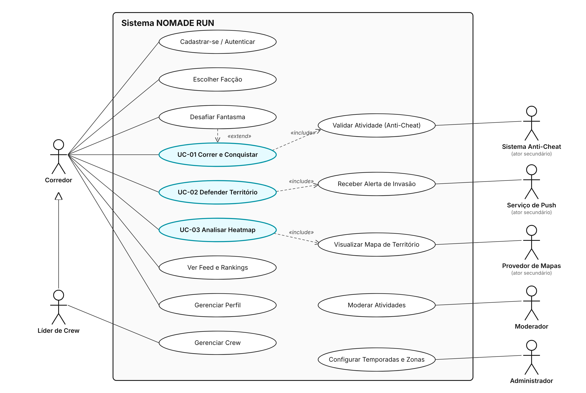
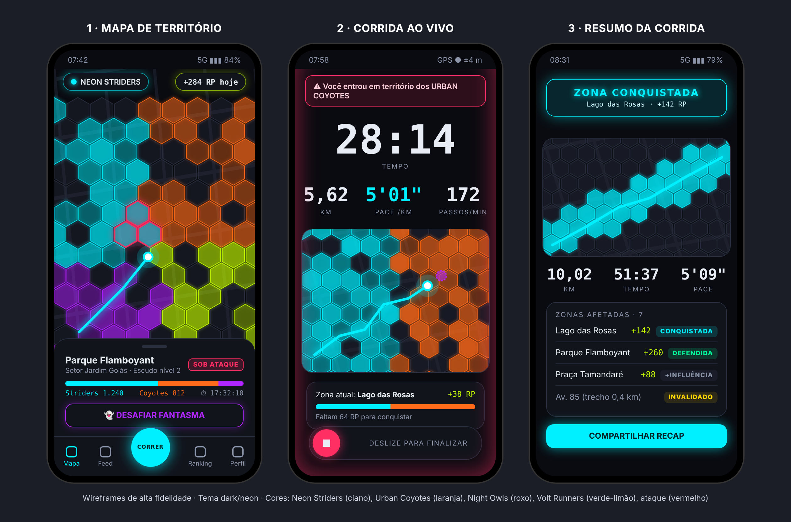

::: capa
# ESPECIFICAÇÃO DE REQUISITOS DE SOFTWARE (ERS) {.unlisted .unnumbered}

## NOMADE RUN: Um Projeto de Gestão e Gamificação de Corridas Urbanas {.unlisted .unnumbered}

**Versão:** 1.0 | **Data:** 10/10/2026

**Autores:**

- Gabryel Gomes Bahmad Camapum
- Mateus Augusto De Faria Brito
:::

# 1. INTRODUÇÃO

## 1.1 Finalidade e Objetivo do Documento

Este documento especifica, de forma detalhada e verificável, os requisitos funcionais, não funcionais, regras de negócio, casos de uso e interfaces do sistema **NOMADE RUN**. Ele foi elaborado a partir da Documentação de Concepção do Projeto e tem três objetivos:

1. Servir de **acordo único** entre a equipe de desenvolvimento e os interessados sobre *o que* o sistema deve fazer e *quais restrições* deve obedecer.
2. Servir de **base de testes** para a disciplina de Teste de Software: todo requisito possui identificador único (RF-xxx, RNF-xxx, RN-xxx) e critério mensurável, permitindo rastreá-lo até casos de teste.
3. Orientar a arquitetura e a implementação, seguindo as diretrizes técnicas das *Agent Skills* do diretório **skills.sh** adotadas como regra do projeto (ver seção 1.3 e Apêndice A).

Público-alvo: equipe de desenvolvimento, equipe de testes, professor orientador e avaliadores.

## 1.2 Escopo do Sistema

O **NOMADE RUN** é um aplicativo móvel (Android e iOS) com painel web de apoio, que combina o **registro de corridas por GPS** (no estilo de aplicativos como o Strava) com um **jogo de conquista de território no mapa real da cidade**. O mapa é dividido em hexágonos; ao correr dentro deles, o usuário acumula pontos para si e para a sua facção, conquistando, defendendo e fortificando territórios.

**O sistema FAZ:**

- Cadastro, autenticação e gestão de perfil de corredores.
- Registro de corridas em tempo real (distância, tempo, pace, splits, trajeto), inclusive com o aplicativo em segundo plano e sem internet.
- Cálculo de Run Points (RP) por zona e controle de território por facção.
- Facções globais, Crews (grupos locais), feed social, rankings, missões, badges e temporadas.
- Notificações em tempo real de territórios sob ataque.
- Modo Fantasma (corrida contra o melhor tempo do dono da zona).
- Mapa interativo com hexágonos 3D, heatmap de disputas e efeitos visuais de conquista.
- **Funcionamento em qualquer cidade** (a grade de hexágonos cobre o mundo inteiro) e **competição entre cidades**: rankings por cidade, estado, país e global, e o placar "Cidade × Cidade".
- Detecção de fraudes (anti-cheat) por validação de velocidade, GPS falso e sensores de movimento.
- Painel web de visualização ao vivo e moderação de atividades suspeitas.

**O sistema NÃO FAZ:**

- **Não é um aplicativo de acompanhamento médico ou de saúde.** Não realiza diagnóstico, não prescreve treinos, não interpreta dados cardíacos para fins clínicos e não substitui orientação de profissionais de saúde ou educação física.
- Não suporta ciclismo, natação ou deslocamentos motorizados — esses são justamente bloqueados pelo anti-cheat.
- Não realiza vendas, pagamentos ou transações financeiras na versão 1.0.
- Não oferece navegação curva a curva (GPS de trânsito).
- Não integra com relógios inteligentes nem importa dados de outras plataformas na versão 1.0.
- Não incentiva corrida em rodovias, áreas privadas ou de risco (essas áreas são zonas bloqueadas).

## 1.3 Definições, Acrônimos e Abreviaturas

| Termo | Definição |
|--------|----------------------------------------------------|
| **GPS** | *Global Positioning System* — sistema de navegação por satélite usado para obter a posição do aparelho. |
| **Pace** | Ritmo de corrida, expresso em minutos por quilômetro (ex.: 5:30 min/km). Quanto menor, mais rápido. |
| **Split** | Tempo gasto em cada quilômetro completo de uma atividade. |
| **Atividade** | Registro de uma corrida, do início ao fim, com todos os pontos de GPS e sensores. |
| **H3** | Sistema de indexação geoespacial hexagonal hierárquico (desenvolvido pela Uber) usado para dividir o mapa. |
| **Hexágono / Zona** | Célula H3 de resolução 9 (≈ 0,1 km², lado ≈ 200 m). Unidade mínima de território que pode ser conquistada. |
| **Distrito** | Célula H3 de resolução 7 (≈ 5 km²), que agrupa zonas. Base do título de "Prefeito". |
| **Cidade** | Município ao qual uma zona pertence (definido pelo limite oficial do IBGE no Brasil ou do OpenStreetMap no exterior). Unidade dos rankings e da competição Cidade × Cidade. |
| **Cidade natal** | Cidade escolhida pelo usuário para representar no placar Cidade × Cidade (troca permitida 1 vez por temporada). |
| **Zona bloqueada** | Zona sobre rodovia, água, aeroporto ou área de risco, que não gera pontos. |
| **RP (Run Points)** | Pontos gerados por metro corrido válido dentro de uma zona (ver RN-001). |
| **Influência** | Soma de RP acumulada por uma facção em uma zona, sujeita a decaimento diário. |
| **Facção** | Um dos quatro times globais: Neon Striders, Urban Coyotes, Night Owls e Volt Runners. |
| **Crew** | Grupo local de até 30 corredores de uma mesma facção. |
| **Dono da zona** | Facção com a maior influência em uma zona, desde que ≥ 100. |
| **Sob ataque** | Estado de uma zona quando uma facção inimiga atinge ≥ 50% da influência do dono. |
| **Escudo / Fortificação** | Nível 0–3 que reduz os RP inimigos recebidos por uma zona (RN-004). |
| **Modo Fantasma (Ghost Run)** | Desafio em que o usuário corre contra a gravação do melhor tempo do dono da zona. |
| **Heatmap** | Mapa de calor que mostra a intensidade de corridas/disputas em uma área num período. |
| **Anti-Cheat** | Conjunto de validações que detectam fraude na atividade. |
| **Anti-Spoofing** | Parte do anti-cheat que detecta localização falsificada (*GPS spoofing* / *mock location*). |
| **Mock location** | Recurso do sistema operacional (ou app de terceiros) que injeta coordenadas falsas. |
| **Trust Score** | Índice de confiança do usuário (0–100) reduzido a cada indício de fraude. |
| **Temporada** | Ciclo mensal de competição, com reset parcial do mapa e premiações. |
| **Push** | Notificação enviada ao aparelho mesmo com o app fechado. |
| **HMAC** | *Hash-based Message Authentication Code* — assinatura que garante a integridade dos dados enviados. |
| **JWT** | *JSON Web Token* — token de autenticação assinado. |
| **RLS** | *Row Level Security* — controle de acesso por linha no banco PostgreSQL. |
| **API** | *Application Programming Interface*. |
| **SDK** | *Software Development Kit*. |
| **LGPD** | Lei Geral de Proteção de Dados (Lei nº 13.709/2018). |
| **WCAG** | *Web Content Accessibility Guidelines* — diretrizes de acessibilidade. |
| **p95 / p99** | Percentil 95 / 99 do tempo de resposta: 95% / 99% das requisições respondem abaixo desse valor. |
| **VU** | *Virtual User* — usuário simulado em teste de carga (k6). |
| **E2E** | *End-to-End* — teste de ponta a ponta simulando o usuário real. |
| **skills.sh** | Diretório aberto de *Agent Skills* (pacotes de instruções procedurais para agentes de IA) mantido pela Vercel. |

## 1.4 Visão Geral do Documento

- **Seção 2** descreve o produto em alto nível: contexto, funções, usuários, restrições e dependências.
- **Seção 3** lista os Requisitos Funcionais (RF).
- **Seção 4** lista os Requisitos Não Funcionais (RNF), com critérios de aceite mensuráveis baseados nas skills do skills.sh.
- **Seção 5** define as Regras de Negócio (RN), incluindo fórmulas de pontuação e regras anti-cheat.
- **Seção 6** apresenta os Casos de Uso, os requisitos de interface com o usuário (com wireframes) e as interfaces de hardware e software.
- **Seção 7** registra a aprovação e o controle de revisões.
- **Apêndice A** relaciona as skills do skills.sh adotadas; **Apêndice B** traz a matriz de rastreabilidade para os testes.

# 2. DESCRIÇÃO GERAL

## 2.1 Perspectiva do Produto

O NOMADE RUN é um produto novo e independente, composto por três partes:

1. **Aplicativo móvel** (Android 8.0+ / iOS 15+), desenvolvido em React Native com Expo — interface principal do corredor.
2. **Back-end em nuvem** (Supabase: PostgreSQL com PostGIS e H3, autenticação, tempo real, funções serverless e armazenamento) — fonte da verdade para pontuação, território e anti-cheat.
3. **Painel web** (Next.js) — mapa ao vivo da cidade e fila de moderação de atividades suspeitas.

O produto se posiciona entre os aplicativos de registro de corrida (Strava, Nike Run Club) e os jogos baseados em localização (Pokémon GO, Ingress), trazendo o *registro esportivo* dos primeiros e a *mecânica de disputa territorial* dos segundos.

## 2.2 Funções do Produto (Resumo de Alto Nível)

- **Registrar corridas:** gravação por GPS com métricas ao vivo, funcionamento offline e resumo detalhado.
- **Disputar território (núcleo do produto):** cada metro corrido gera RP na zona em que foi percorrido; a facção com mais influência domina a zona; zonas são **conquistadas**, **atacadas**, **defendidas** e **fortificadas**, e a influência **decai** se a zona não for patrulhada.
- **Jogar em equipe:** facções globais, Crews locais, bônus de corrida em grupo e rankings.
- **Competir em qualquer lugar:** o jogo funciona em qualquer cidade do mundo; o corredor pode conquistar zonas em várias cidades e representar sua cidade natal no placar Cidade × Cidade.
- **Ser avisado em tempo real:** alertas de invasão com janela de defesa de 24 h.
- **Desafiar o Fantasma:** correr contra o melhor tempo do dono da zona para ganhar multiplicador.
- **Progredir:** níveis, missões, badges, título de Prefeito de distrito e temporadas mensais.
- **Socializar:** feed, "Respect" (curtida), comentários e recap compartilhável.
- **Jogar limpo:** anti-cheat automático com Trust Score e moderação manual.
- **Acompanhar a cidade:** painel web com mapa ao vivo e heatmap.

## 2.3 Perfil dos Usuários

| Perfil | Descrição | Conhecimento técnico | Uso principal |
|---------|--------------------|---------|-----------------------|
| **Corredor casual** | 16+ anos, corre 1–3 vezes por semana, motivado por diversão e metas. | Básico (usa apps comuns de celular). | Registrar corridas, conquistar zonas próximas de casa. |
| **Corredor competitivo** | Treina com frequência, acompanha pace e recordes. | Intermediário. | Dominar distritos, ranking, Modo Fantasma. |
| **Líder de Crew** | Organiza grupos de corrida (assessorias, amigos). | Intermediário. | Gerenciar Crew, metas, corridas em grupo. |
| **Moderador** | Membro da equipe do NOMADE RUN. | Avançado. | Revisar atividades suspeitas no painel web. |
| **Administrador** | Equipe técnica. | Avançado. | Configurar temporadas, zonas bloqueadas, parâmetros do jogo. |

## 2.4 Restrições Gerais

- **Precisão do GPS:** em áreas urbanas densas, túneis e sob árvores, o erro pode passar de 30 m; pontos com precisão pior que 30 m são descartados (RN-007), o que pode reduzir a distância registrada.
- **Bateria:** o GPS contínuo é o maior consumidor de energia; o sistema deve respeitar o limite do RNF-004.
- **Sistema operacional:** Android e iOS limitam execução em segundo plano; o usuário precisa conceder permissão de localização "sempre" e, no Android, desativar a otimização de bateria para o app.
- **Sensores:** aparelhos sem pedômetro/acelerômetro funcionam, mas suas atividades recebem validação reduzida e ficam sujeitas a revisão (RN-008).
- **Conectividade:** a gravação não pode depender de internet; a pontuação só é confirmada após sincronização.
- **Legais:** conformidade com a LGPD (consentimento, finalidade, exclusão de dados); idade mínima de 16 anos.
- **Tecnológicas:** React Native/Expo no app, Supabase no back-end, Mapbox como provedor de mapas.
- **Prazo e equipe:** projeto acadêmico desenvolvido por 2 integrantes.

## 2.5 Suposições e Dependências

- **Mapbox** (Maps SDK para Android/iOS e Mapbox GL JS) disponível no plano gratuito/estudante para renderização do mapa; **Google Maps Platform** é a alternativa caso haja mudança de custo.
- **Supabase** disponível como serviço gerenciado (PostgreSQL 15+ com extensões PostGIS e h3-pg).
- **Expo Push Notification Service**, que depende de **Firebase Cloud Messaging (Android)** e **Apple Push Notification service (iOS)**.
- **OpenStreetMap** como fonte de dados para identificar rodovias, água e aeroportos (zonas bloqueadas).
- **Malha municipal do IBGE** (Brasil) e limites administrativos do OpenStreetMap (exterior) para associar cada zona a uma cidade.
- Supõe-se que o usuário corre com o celular junto ao corpo (bolso, braçadeira ou mão).
- Supõe-se que os aparelhos-alvo possuem GPS, acelerômetro e, na maioria, pedômetro.
- As diretrizes técnicas seguem as skills do **skills.sh** listadas no Apêndice A; mudanças nessas skills não alteram este documento sem nova revisão.

# 3. REQUISITOS FUNCIONAIS (RF)

| ID | Nome | Descrição Detalhada | Prioridade |
|----|-----|-----------------------------------------------------|----|
| RF-001 | Cadastro e Autenticação | O sistema deve permitir cadastro e login por e-mail/senha e por Google/Apple, emitindo token JWT com validade de 1 h e *refresh token*. Deve permitir recuperação de senha por e-mail e exigir confirmação de idade ≥ 16 anos e aceite dos termos e da política de privacidade. | Alta |
| RF-002 | Gestão de Perfil | O usuário deve poder editar nome de usuário (único, 3–20 caracteres), avatar, cidade, unidades (km/mi), raio de privacidade (100–1000 m) e preferências de voz e notificação; deve poder **exportar** seus dados (JSON) e **excluir** a conta. | Média |
| RF-003 | Escolha de Facção | No primeiro acesso, o usuário deve escolher uma das 4 facções. A troca é permitida 1 vez por temporada e zera a contribuição pessoal do usuário na temporada corrente. | Alta |
| RF-004 | Rastreamento de Corrida | O sistema deve gravar a atividade por GPS a cada 1 s (com precisão, velocidade e altitude) e ler pedômetro e acelerômetro, inclusive com tela bloqueada e app em segundo plano. Deve exibir ao vivo: tempo, distância, pace atual, pace médio e zona atual; deve permitir pausar, retomar e finalizar (finalizar por gesto "deslizar" para evitar toque acidental) e pausar automaticamente quando a velocidade ficar < 1 km/h por 10 s. | Alta |
| RF-005 | Gravação Offline e Sincronização | Sem internet, o app deve armazenar os pontos em banco local (SQLite) e sincronizá-los automaticamente em lotes de até 50 pontos quando a conexão voltar, com retentativa exponencial e sem duplicidade (idempotência por atividade + sequência). | Alta |
| RF-006 | Resumo e Histórico de Atividades | Ao finalizar, o sistema deve exibir mapa do trajeto, distância, tempo em movimento, pace médio, splits por km, gráfico de pace, recordes pessoais, **lista de zonas afetadas** (RP ganhos, zonas conquistadas/defendidas), badges e eventuais trechos invalidados pelo anti-cheat com explicação. O histórico deve listar todas as atividades com filtros por período. | Alta |
| RF-007 | Mapa de Território | O sistema deve exibir o mapa da cidade dividido em zonas H3 (res. 9) coloridas pela facção dona, com altura 3D proporcional à influência, zonas neutras em cinza, zonas bloqueadas hachuradas e zonas sob ataque pulsando. Ao tocar numa zona, deve abrir o detalhe: nome, dono, influência por facção, nível de escudo, top 3 corredores e últimos eventos. | Alta |
| RF-008 | Conquista de Zona | Ao processar uma atividade válida, o servidor deve calcular os RP por zona (RN-001), atualizar a influência por facção e aplicar as regras de conquista (RN-002). Em caso de conquista, o app deve exibir o feedback visual de conquista (seção 6.2) e registrar o evento. | Alta |
| RF-009 | Alerta de Invasão (Ataque) | Quando uma zona entrar no estado **sob ataque** (RN-003), o sistema deve enviar push aos membros da facção dona que correram nela nos últimos 30 dias, com o texto: "⚠️ Alerta de Invasão! Seu território em {zona} está sendo conquistado pelos {facção}. Corra lá nas próximas 24h para defender." O toque na notificação deve abrir o mapa centralizado na zona. | Alta |
| RF-010 | Defesa e Fortificação | Durante a janela de defesa de 24 h, corridas da facção dona na zona atacada devem receber o multiplicador de defesa (RN-001). Corridas diárias consecutivas da facção dona devem elevar o escudo da zona (RN-004). | Alta |
| RF-011 | Facções e Crews | O usuário deve poder criar uma Crew (nome, tag de 3–5 letras), convidar por link/código, aceitar/remover membros (líder), ver ranking interno, metas semanais e quem da Crew está correndo agora. Limite de 30 membros, todos da mesma facção. | Média |
| RF-012 | Modo Fantasma | Ao estar dentro de uma zona dominada por outra facção, o usuário deve poder iniciar o desafio contra o fantasma do melhor tempo do dono na zona; o fantasma deve aparecer no mapa em tempo real e o resultado (vitória/derrota) deve ser exibido ao sair da zona. | Média |
| RF-013 | Heatmap de Disputas | O sistema deve oferecer uma camada de heatmap com a intensidade de corridas e trocas de dono nas últimas 24 h, 7 dias ou temporada, no app e no painel web. | Média |
| RF-014 | Feed Social | O usuário deve poder seguir outros corredores, ver o feed de atividades de quem segue e da sua Crew, dar "Respect" (curtida) e comentar. Atividades respeitam as zonas de privacidade (RN-009). | Média |
| RF-015 | Rankings | O sistema deve exibir rankings individual, por Crew e por facção, filtráveis por distrito, cidade, estado, país, global e temporada, atualizados no máximo a cada 5 minutos. | Média |
| RF-016 | Missões, Badges e Temporadas | O sistema deve oferecer missões diárias e semanais, conceder badges por conquistas (ex.: "Prefeito de {distrito}", "Muralha: 10 defesas") e executar o ciclo de temporadas mensais (RN-006). | Baixa |
| RF-017 | Recap Compartilhável | O usuário deve poder gerar uma imagem ou vídeo curto (9:16) da corrida com o trajeto pintando as zonas e compartilhá-lo em redes sociais. | Baixa |
| RF-018 | Moderação Anti-Cheat (Painel Web) | Moderadores devem visualizar a fila de atividades "em revisão", ver trajeto, gráficos de velocidade e cadência e as *flags* detectadas, e **aprovar** ou **rejeitar** cada uma com justificativa obrigatória; a decisão recalcula a pontuação e notifica o usuário. | Alta |
| RF-019 | Central de Notificações | O app deve manter uma lista das notificações recebidas (invasões, conquistas, missões, moderação), marcando lidas/não lidas, e permitir configurar quais tipos o usuário deseja receber. | Baixa |
| RF-020 | Competição entre Cidades | O sistema deve funcionar em qualquer cidade sem configuração prévia (zonas criadas automaticamente na primeira corrida em uma área). Cada usuário define uma **cidade natal**; os RP que ele ganha em **qualquer lugar** somam para a sua cidade natal no placar **Cidade × Cidade** da temporada (normalizado por corredores ativos, RN-013). O perfil deve mostrar as cidades onde o usuário já conquistou zonas e um mapa-múndi pessoal. Correr pela primeira vez em uma nova cidade concede a badge "Nômade" (1, 5 e 10 cidades). | Média |

# 4. REQUISITOS NÃO FUNCIONAIS (RNF)

Os critérios desta seção são **mensuráveis** e foram definidos com base nas skills do skills.sh indicadas na coluna "Categoria" (ver Apêndice A).

| ID | Categoria | Descrição do Requisito / Critério de Aceite |
|----|-----------|------------------------------------------------|
| RNF-001 | Desempenho — Ingestão de GPS *(skill k6-load-testing / k6-perf-test-website)* | O endpoint de ingestão de pontos deve suportar **5.000 VUs simultâneos** enviando 1 lote a cada 5 s com **p95 < 300 ms, p99 < 800 ms e taxa de erro < 0,5%**. Devem existir scripts k6 para os cenários *smoke* (1 VU, 1 min), *load* (rampa até 5.000 VUs, 30 min), *stress* (até 10.000 VUs), *spike* (0→5.000 em 30 s) e *soak* (2.000 VUs por 2 h), com *thresholds* que reprovam o pipeline de CI quando violados. |
| RNF-002 | Desempenho — Mapa *(skills mapbox-web-performance-patterns, react-native-skills)* | A tela de mapa deve renderizar pela primeira vez em **< 2,5 s** em aparelho Android intermediário (4 GB RAM) com 4G, e manter **≥ 55 fps** ao arrastar/zoom com até 2.000 hexágonos visíveis. Animações devem rodar na *UI thread*. |
| RNF-003 | Desempenho — Tempo Real *(skill supabase-realtime)* | Uma mudança de dono de zona deve aparecer no mapa de todos os usuários que visualizam o distrito em **≤ 3 s (p95)**; o push de invasão deve ser disparado em **≤ 60 s** após o processamento da atividade. |
| RNF-004 | Eficiência Energética | Uma hora de corrida com tela desligada deve consumir **≤ 8% da bateria** em aparelho de referência (bateria ≥ 4.000 mAh). |
| RNF-005 | Confiabilidade | **Zero perda de pontos** em corridas gravadas offline de até 3 h; disponibilidade do back-end **≥ 99,5%** mensal; distância medida com erro **≤ 3%** em percurso aferido de 5 km a céu aberto. |
| RNF-006 | Segurança — Integridade dos Dados de Localização *(skills trailofbits insecure-defaults, sharp-edges)* | Cada lote de pontos deve ser assinado com **HMAC-SHA256** usando chave por dispositivo guardada no armazenamento seguro do SO; o servidor deve rejeitar assinatura inválida, sequência fora de ordem, *timestamp* não monotônico e reenvio. **Toda pontuação é recalculada no servidor**; nenhum valor de RP enviado pelo cliente é aceito. O sistema deve falhar de forma segura (*fail-closed*): em caso de erro de validação, a atividade não pontua. |
| RNF-007 | Segurança — Acesso e API *(skills owasp-security, supabase-postgres-best-practices)* | Conformidade com **OWASP ASVS nível 1**; RLS habilitado em **100% das tabelas**; escrita de influência/território apenas pela *service role*; comunicação somente por **HTTPS/TLS 1.2+**; senhas com hash **bcrypt (custo ≥ 10)**; *rate limit* de 1 lote/2 s por usuário na ingestão e 10 tentativas de login/15 min por IP; nenhum segredo no código-fonte; token do Mapbox com escopo mínimo e restrito ao *bundle* do app *(skill mapbox-token-security)*. |
| RNF-008 | Segurança — Análise Contínua *(skills static-analysis, differential-review)* | O pipeline de CI deve executar análise estática (Semgrep) e bloquear *merge* com achados de severidade **alta ou crítica**; toda mudança no módulo anti-cheat deve passar por revisão de segurança diferencial. |
| RNF-009 | Arquitetura e Manutenibilidade *(skill clean-architecture)* | As regras de negócio (pontuação, conquista, anti-cheat) devem ficar em um módulo de domínio **independente de framework** (sem dependência de React, Supabase ou Mapbox), acessando infraestrutura apenas por interfaces. Cobertura de testes unitários do domínio **≥ 90%**; TypeScript em modo *strict* sem uso de `any`. |
| RNF-010 | Escalabilidade *(skills clean-architecture, supabase-postgres-best-practices)* | A ingestão deve ser assíncrona (resposta `202` e processamento em fila); a tabela de pontos deve ser particionada por mês; consultas de zonas por área visível devem usar índice geoespacial e responder em **< 150 ms (p95)** para até 2.000 zonas. |
| RNF-011 | Usabilidade e Interface *(skills frontend-design, building-native-ui, ui-ux-pro-max)* | Interface em **dark mode por padrão**, seguindo o *design system* da seção 6.2; o usuário deve conseguir iniciar uma corrida em **no máximo 2 toques** a partir da tela inicial; textos em português do Brasil. |
| RNF-012 | Acessibilidade *(skill web-design-guidelines)* | Contraste mínimo **WCAG 2.1 AA (4,5:1)**; alvos de toque ≥ 44×44 pt; todos os controles com rótulo para leitor de tela (TalkBack/VoiceOver); com "Reduzir movimento" ativo, nenhuma animação de pulso, onda ou partícula é exibida. |
| RNF-013 | Testabilidade — Critérios Visuais *(skills playwright, maestro-mobile-testing)* | Todo elemento interativo deve ter `testID`/atributo de teste estável. Testes E2E mobile (Maestro) devem cobrir os casos de uso UC-01 a UC-03; testes E2E web (Playwright) devem validar o painel com **comparação visual** (`toHaveScreenshot`, tolerância ≤ 0,2% de pixels) nos estados: zona neutra, zona dominada (cor da facção), zona sob ataque (pulso vermelho) e heatmap ativo. |
| RNF-014 | Privacidade (LGPD) | Consentimento explícito e separado para localização e notificações; finalidade informada antes do pedido de permissão; exportação e exclusão de dados atendidas em **≤ 30 dias**; trajetos públicos nunca mostram pontos dentro do raio de privacidade. |
| RNF-015 | Compatibilidade | Android 8.0 (API 26)+ e iOS 15+; telas de 4,7" a 6,9"; painel web nos navegadores Chrome, Edge, Firefox e Safari (duas últimas versões). |

# 5. REGRAS DE NEGÓCIO (RN)

| ID | Regra | Detalhamento |
|----|----|-------------------------------------------------------|
| RN-001 | Cálculo de Run Points (Pace × Distância) | Para cada zona percorrida em uma atividade válida: **RP = metros_válidos × 0,1 × M_pace × M_streak × M_fantasma × M_grupo × M_defesa**, arredondado para inteiro. **M_pace** = 360 ÷ pace (s/km), limitado entre 0,75 e 1,50 (referência 6:00 min/km; ex.: pace 5:00 → 1,20). **M_streak** = 1 + 0,05 × dias consecutivos de corrida (máx. 10 dias → 1,50). **M_fantasma** = 1,5 se venceu o fantasma, senão 1,0. **M_grupo** = 1,25 se ≥ 3 membros da mesma Crew correram a ≤ 50 m entre si em ≥ 60% do trecho, senão 1,0. **M_defesa** = 2,0 se a zona é da facção do corredor e está sob ataque, senão 1,0. **Teto:** 300 RP por usuário, por zona, por dia. Exemplo: 800 m a 5:00 min/km, streak de 4 dias, sem outros bônus → 800 × 0,1 × 1,20 × 1,20 = **115 RP**. |
| RN-002 | Conquista com Histerese | Zona neutra passa a pertencer à primeira facção que atingir **influência ≥ 100**. Zona com dono só muda de dono quando **influência do desafiante ≥ influência do dono × 1,10**. Empates mantêm o dono atual. Zonas bloqueadas nunca têm dono. |
| RN-003 | Estado "Sob Ataque" e Janela de Defesa | Uma zona entra em **sob ataque** quando alguma facção inimiga atinge **≥ 50%** da influência do dono. Nesse momento abre-se uma **janela de defesa de 24 h** e é disparado o alerta do RF-009. Cada usuário recebe no máximo **1 alerta por zona a cada 6 h** e no máximo **5 alertas de invasão por dia**. A zona sai do estado quando a razão cai abaixo de 40% ou quando muda de dono. |
| RN-004 | Fortificação (Escudo) | Cada dia consecutivo em que a facção dona soma **≥ 500 m** corridos na zona eleva o escudo em 1 nível (máximo 3). O escudo reduz os RP de facções inimigas na zona em **10% / 20% / 30%** (níveis 1/2/3). Um dia sem a facção dona correr ali reduz o escudo em 1 nível. |
| RN-005 | Decaimento de Influência | Diariamente às 03:00 (horário de Brasília) a influência de todas as facções em todas as zonas é multiplicada por **0,90**. Valores abaixo de 5 são zerados. Se a influência do dono ficar abaixo de 100, a zona volta a ser **neutra**. |
| RN-006 | Temporadas | Cada temporada dura um mês civil. No encerramento: rankings são congelados e arquivados, badges de temporada são concedidas (top 10 individual, top 3 Crews, facção campeã) e a influência de todas as zonas é multiplicada por **0,30**. A troca de facção (RF-003) fica liberada novamente. |
| RN-007 | Anti-Cheat — Validação de GPS | São aplicadas, nesta ordem: (a) pontos com precisão > 30 m são descartados; (b) **qualquer ponto com velocidade > 40 km/h** invalida o trecho; (c) **velocidade média > 25 km/h por mais de 30 s** invalida o trecho (*flag* VEHICLE_SUSPECTED); (d) **deslocamento > 50 m com intervalo ≤ 1 s** invalida o trecho (*flag* TELEPORT); (e) qualquer ponto marcado pelo SO como **localização simulada** rejeita a atividade inteira (*flag* MOCK_LOCATION). Trechos inválidos não geram RP nem distância para ranking. |
| RN-008 | Anti-Cheat — Acelerômetro × GPS | Quando a velocidade do GPS estiver entre **8 e 20 km/h**, a cadência medida pelo pedômetro deve estar entre **120 e 220 passos/min**. Cadência **< 60 passos/min por mais de 60 s** nessa faixa de velocidade invalida o trecho (*flag* NO_STEPS — indica celular em veículo). A variância da magnitude do acelerômetro em janelas de 5 s deve ser compatível com o impacto da passada; sinal "liso" com velocidade acima de 12 km/h gera *flag* VEHICLE_SUSPECTED. Aparelhos sem pedômetro têm suas atividades com mais de 10 km enviadas para revisão. |
| RN-009 | Trust Score e Revisão | Todo usuário inicia com Trust Score 100. Penalidades: MOCK_LOCATION −30; TELEPORT −10; VEHICLE_SUSPECTED −10; NO_STEPS −10. Recuperação: +2 por atividade 100% válida (máx. 100). Com **Trust Score < 40**, todas as atividades entram em **revisão manual** (RF-018) e não pontuam até aprovação. Com **< 10**, a conta é suspensa da competição por 30 dias. |
| RN-010 | Privacidade do Trajeto | Pontos dentro do raio de privacidade em torno de endereços marcados pelo usuário (padrão 200 m) **contam RP**, mas **nunca** são exibidos em feed, perfil público, recap ou painel web. |
| RN-011 | Facção e Crew | Um usuário pertence a exatamente 1 facção e a no máximo 1 Crew. A Crew deve ser da mesma facção do usuário. Ao trocar de facção, o usuário sai automaticamente da Crew. |
| RN-012 | Título de Prefeito | O usuário com a maior soma de RP em um distrito (H3 res. 7) na temporada, desde que sua facção domine ≥ 30% das zonas do distrito, recebe o título e a badge "Prefeito de {distrito}". |
| RN-013 | Placar Cidade × Cidade | A pontuação de cada cidade na temporada é **soma dos RP válidos dos usuários com aquela cidade natal ÷ raiz quadrada do número de corredores ativos** (≥ 1 atividade válida na temporada), para que cidades pequenas possam competir com metrópoles. Só entram no placar cidades com ≥ 20 corredores ativos. Ao fim da temporada, a cidade campeã recebe a badge coletiva "Capital Nômade" para todos os seus corredores ativos. |

# 6. CASOS DE USO E INTERFACES

## 6.1 Diagramas de Casos de Uso

**Atores:** Corredor (principal), Líder de Crew (especialização de Corredor), Moderador, Administrador, Sistema Anti-Cheat (ator secundário automático), Serviço de Push (sistema externo), Provedor de Mapas (sistema externo).

### UC-01 — Correr e Conquistar

| Campo | Descrição |
|----------|--------------------------------------------------|
| **Ator principal** | Corredor |
| **Atores secundários** | Sistema Anti-Cheat, Provedor de Mapas, Serviço de Push |
| **Requisitos relacionados** | RF-004, RF-005, RF-006, RF-007, RF-008; RN-001, RN-002, RN-007, RN-008, RN-009 |
| **Pré-condições** | Usuário autenticado, com facção escolhida e permissão de localização concedida. |
| **Pós-condições (sucesso)** | Atividade salva como válida; RP creditados; influência atualizada; conquistas registradas e exibidas. |
| **Fluxo principal** | 1. O corredor toca em **CORRER** na tela de mapa. 2. O sistema verifica o sinal de GPS e exibe contagem regressiva de 3 s. 3. O sistema inicia a gravação e exibe o HUD ao vivo (tempo, distância, pace, zona atual com barra de influência). 4. O corredor percorre uma ou mais zonas; a cada zona, o sistema mostra a prévia de RP (cálculo otimista local). 5. O corredor desliza para finalizar. 6. O sistema envia os pontos restantes ao servidor. 7. O servidor executa o anti-cheat (RN-007, RN-008) e calcula os RP por zona (RN-001). 8. O servidor aplica a regra de conquista (RN-002) e registra os eventos. 9. O sistema exibe o resumo com zonas afetadas e, para cada zona conquistada, o feedback visual de conquista. |
| **Fluxo alternativo A1 — Sem internet** | No passo 6, sem conexão, os pontos ficam na fila local; o resumo é exibido como "provisório" e é confirmado automaticamente ao sincronizar (RF-005). |
| **Fluxo alternativo A2 — Pausa** | Entre os passos 3 e 5, o corredor pausa (manual ou automática); o tempo parado não conta como tempo em movimento. |
| **Fluxo de exceção E1 — Trecho inválido** | No passo 7, se houver trechos inválidos, eles são destacados em cinza no resumo, com explicação ("velocidade incompatível com corrida"); apenas os trechos válidos pontuam. |
| **Fluxo de exceção E2 — Localização simulada** | No passo 7, se for detectado *mock location*, a atividade é rejeitada, o Trust Score é reduzido e o usuário é informado. |
| **Fluxo de exceção E3 — GPS fraco** | No passo 2, se a precisão for > 30 m por mais de 15 s, o sistema avisa e permite iniciar mesmo assim. |

### UC-02 — Defender Território

| Campo | Descrição |
|----------|--------------------------------------------------|
| **Ator principal** | Corredor (membro da facção dona) |
| **Atores secundários** | Serviço de Push, Sistema Anti-Cheat |
| **Requisitos relacionados** | RF-009, RF-010, RF-007; RN-003, RN-004, RN-001 (M_defesa) |
| **Pré-condições** | A facção do corredor é dona da zona; a zona entrou no estado "sob ataque"; o corredor correu na zona nos últimos 30 dias e tem notificações de invasão ativas. |
| **Pós-condições (sucesso)** | Influência da facção dona volta a superar o atacante; zona sai do estado "sob ataque"; evento "defendida" registrado; badge de defesa contabilizada. |
| **Fluxo principal** | 1. O sistema detecta que uma facção inimiga atingiu ≥ 50% da influência do dono (RN-003). 2. O sistema envia o push de Alerta de Invasão. 3. O corredor toca na notificação. 4. O app abre o mapa centralizado na zona, pulsando em vermelho, com o contador regressivo da janela de 24 h e a barra de influência dono × atacante. 5. O corredor executa o **UC-01** dentro da zona. 6. O servidor aplica o multiplicador de defesa ×2,0. 7. Se a razão cair abaixo de 40%, o sistema marca a zona como **defendida**, envia notificação de sucesso à facção e exibe o feedback "ZONA DEFENDIDA". |
| **Fluxo alternativo A1 — Defesa coletiva** | No passo 5, vários membros da facção correm na zona; os RP de todos somam para a defesa. |
| **Fluxo alternativo A2 — Defesa insuficiente** | No passo 7, se o atacante ainda superar o dono em ≥ 10%, a zona muda de dono (RN-002) e os antigos donos recebem notificação "Território perdido". |
| **Fluxo de exceção E1 — Janela expirada** | Se o corredor tocar na notificação após as 24 h, o app informa o estado atual da zona (defendida, perdida ou ainda em disputa). |

### UC-03 — Analisar Heatmap

| Campo | Descrição |
|----------|--------------------------------------------------|
| **Ator principal** | Corredor (no app) ou Moderador/Administrador (no painel web) |
| **Atores secundários** | Provedor de Mapas |
| **Requisitos relacionados** | RF-013, RF-007, RF-015; RNF-002, RNF-003 |
| **Pré-condições** | Usuário autenticado; dados de atividades disponíveis no período. |
| **Pós-condições (sucesso)** | Usuário visualiza a intensidade das disputas e pode navegar até uma zona de interesse. |
| **Fluxo principal** | 1. O usuário abre o seletor de camadas do mapa. 2. Seleciona **Heatmap**. 3. Escolhe o período (24 h, 7 dias ou temporada). 4. O sistema carrega as zonas da área visível e exibe a camada de calor (cores frias = pouca atividade; quentes = muita disputa). 5. O usuário toca em uma área quente. 6. O sistema exibe o detalhe da zona: trocas de dono no período, facções envolvidas e corredores mais ativos. 7. O usuário pode tocar em **"Ir para lá"** para iniciar uma corrida (UC-01) ou **"Desafiar Fantasma"** (RF-012). |
| **Fluxo alternativo A1 — Painel web** | No painel, o moderador pode filtrar o heatmap por facção e exportar a imagem/CSV da área. |
| **Fluxo de exceção E1 — Sem dados** | Se não houver atividade no período, o sistema exibe "Nenhuma disputa neste período" e sugere ampliar o intervalo. |

## 6.2 Requisitos de Interface com o Usuário (Mockups/Wireframes)

**Diretrizes gerais (skills frontend-design, building-native-ui, ui-ux-pro-max, expo-motion):**

| Elemento | Especificação |
|---------|---------------------------------------------------|
| **Tema** | Dark mode por padrão — fundo `#0A0B10`, superfícies `#12141C` / `#1A1D29`, bordas `#2A2F3F`, texto `#E8ECF4`, texto secundário `#8A93A8`. |
| **Cores das facções** | Neon Striders `#00F0FF` · Urban Coyotes `#FF6B1A` · Night Owls `#B026FF` · Volt Runners `#C6FF00`. |
| **Cores de estado** | Ataque/perigo `#FF2E63` · Sucesso `#00FF9C` · Alerta `#FFD600`. |
| **Tipografia** | Orbitron (títulos de impacto), Space Grotesk (títulos), Inter (texto), JetBrains Mono (números: tempo, pace, distância). |
| **Efeito neon (glow)** | Elementos da facção têm borda de 1 px com 60% de opacidade e sombra colorida com desfoque de 16–24 px. |
| **Navegação** | Barra inferior com 5 abas: Mapa · Feed · **CORRER** (botão central destacado) · Ranking · Perfil. |

**Feedback visual obrigatório:**

| Evento | Feedback | Critério de aceite |
|---------|-----------------------------------|-----------------|
| Carregar o mapa | Hexágonos "sobem" do chão em onda a partir da posição do usuário. | Duração total ≤ 800 ms. |
| Zona sob ataque | Pulso de opacidade/altura na cor `#FF2E63` a cada 1,5 s. | Visível em zoom ≥ 13. |
| **Conquista de zona** | Onda de luz no hexágono, explosão de partículas na cor da facção, vibração (*haptic* de sucesso), som curto (≤ 400 ms) e aviso "ZONA CONQUISTADA · {zona} +{RP} RP". | Exibido em ≤ 1 s após a confirmação do servidor; aviso visível por 3 s. |
| Entrar em território inimigo | Vinheta vermelha nas bordas da tela + aviso por voz "Você entrou em território dos {facção}". | Disparado em ≤ 3 s após cruzar o limite da zona. |
| Rastro da corrida | Linha neon com gradiente que esmaece (efeito cometa). | Atualizada a cada ponto de GPS. |
| Resumo | Números com contagem animada. | Duração ≤ 1,2 s. |
| Reduzir movimento ativo | Nenhum pulso, onda ou partícula; apenas troca de cor. | Verificado em teste E2E. |

**Wireframes das telas principais** (Mapa de Território, Corrida ao Vivo e Resumo da Corrida):

## 6.3 Interfaces de Hardware e Software

**Interfaces de hardware (sensores do aparelho):**

| Recurso | Uso | API / Biblioteca |
|---------|-------------------------|---------------------------|
| GPS / GNSS | Posição a cada 1 s, com precisão, velocidade e altitude, em primeiro e segundo plano. | `expo-location` + `expo-task-manager` (Android Fused Location Provider / iOS Core Location) |
| Pedômetro | Contagem de passos e cadência para o anti-cheat (RN-008). | `expo-sensors` — `Pedometer` (Android Step Counter / iOS Core Motion) |
| Acelerômetro | Variância de impacto da passada (RN-008). | `expo-sensors` — `Accelerometer` (amostragem 50 Hz em lotes) |
| Motor de vibração | Feedback tátil de conquista e alertas. | `expo-haptics` |
| Alto-falante / fone | Avisos por voz e sons de conquista. | `expo-audio` / `expo-speech` |
| Armazenamento seguro | Chave HMAC do dispositivo e tokens. | `expo-secure-store` (Android Keystore / iOS Keychain) |
| Armazenamento local | Fila offline de pontos. | `expo-sqlite` |

**Interfaces de software (APIs e serviços de terceiros):**

| Sistema | Finalidade | Interface |
|------------|-------------------------|-----------------------|
| **Mapbox Maps SDK** (Android/iOS) e **Mapbox GL JS** (web) | Renderização do mapa, estilo dark customizado, camadas de hexágonos 3D (*fill-extrusion*) e heatmap. | SDK nativo via `@rnmapbox/maps`; token público com escopo restrito. Alternativa: Google Maps Platform. |
| **H3** | Conversão de coordenadas em zonas/distritos. | `h3-js` (app/web) e extensão `h3-pg` (banco). |
| **Supabase Auth** | Cadastro, login social (Google/Apple), JWT. | REST/SDK `@supabase/supabase-js`. |
| **Supabase Database** (PostgreSQL + PostGIS) | Persistência de usuários, atividades, zonas e influência. | SQL com RLS. |
| **Supabase Edge Functions** | Ingestão de pontos, anti-cheat, cálculo de RP e conquista. | HTTPS/JSON: `POST /ingest-points`, `POST /finish-activity`, `GET /zones?bbox=`, `GET /zone/{h3}`, `POST /ghost/{h3}/start`. |
| **Supabase Realtime** | Atualização ao vivo do mapa (canal por distrito) e presença da Crew. | WebSocket (Broadcast / Presence). |
| **Expo Push Service** (FCM / APNs) | Alertas de invasão e demais notificações. | HTTPS; token por dispositivo. |
| **OpenStreetMap** | Identificação de rodovias, água e aeroportos para zonas bloqueadas. | Importação periódica de dados (Overpass API). |
| **Redes sociais** | Compartilhar recap. | *Share sheet* nativa do sistema operacional. |

# 7. APROVAÇÃO E CONTROLE DE REVISÕES

| Versão | Data | Autor | Descrição das Alterações |
|----|----|-------------|------------------------------------------|
| 1.0 | 10/10/2026 | Gabryel Gomes Bahmad Camapum; Mateus Augusto De Faria Brito | Criação do documento: introdução, descrição geral, 20 requisitos funcionais, 15 requisitos não funcionais, 13 regras de negócio, 3 casos de uso detalhados, interfaces e wireframes. |

**Aprovação:**

| Nome | Papel | Assinatura | Data |
|----------------|-----------------------------|----|------------|
| Gabryel Gomes Bahmad Camapum | Analista de Requisitos / Desenvolvedor | | ___/___/______ |
| Mateus Augusto De Faria Brito | Analista de Requisitos / Desenvolvedor | | ___/___/______ |
| | Professor(a) Orientador(a) | | ___/___/______ |

# APÊNDICE A — Skills do skills.sh adotadas

Regra do projeto: requisitos não funcionais, regras de negócio e critérios de teste foram baseados nas diretrizes das seguintes *Agent Skills* do diretório [skills.sh](https://skills.sh) (instalação: `npx skills add <dono/repositório> --skill <nome>`).

| Área | Skill (repositório → skill) | Requisitos que embasa |
|---------|----------------------------------------|-----------|
| Arquitetura | pproenca/dot-skills → clean-architecture | RNF-009, RNF-010 |
| UI mobile | expo/skills → building-native-ui | RNF-011, seção 6.2 |
| Performance mobile | vercel-labs/agent-skills → react-native-skills | RNF-002 |
| Mapa e visualização | mapbox/mapbox-agent-skills → mapbox-data-visualization-patterns, mapbox-cartography, mapbox-web-performance-patterns, mapbox-token-security | RF-007, RF-013, RNF-002, RNF-007 |
| Design visual | anthropics/skills → frontend-design; nextlevelbuilder/ui-ux-pro-max-skill → ui-ux-pro-max | RNF-011, seção 6.2 |
| Animações | bjornmelin/dev-skills → expo-motion | Seção 6.2, RNF-012 |
| Banco de dados | supabase/agent-skills → supabase-postgres-best-practices | RNF-007, RNF-010 |
| Tempo real | adaptationio/skrillz → supabase-realtime | RNF-003, RF-009 |
| Segurança / Anti-Cheat | trailofbits/skills → insecure-defaults, sharp-edges, differential-review, static-analysis | RNF-006, RNF-008, RN-007, RN-008, RN-009 |
| Segurança de API | agamm/claude-code-owasp → owasp-security | RNF-007 |
| Teste de carga | davila7/claude-code-templates → k6-load-testing; grafana/skills → k6-perf-test-website | RNF-001 |
| E2E mobile | tovimx/maestro-mobile-testing-skill → maestro-mobile-testing | RNF-013 |
| E2E web / visual | bobmatnyc/claude-mpm-skills → playwright | RNF-013 |
| Acessibilidade | vercel-labs/agent-skills → web-design-guidelines | RNF-012 |
| Especificação | tercel/spec-forge → srs-generation (IEEE 830 / ISO/IEC/IEEE 29148) | Estrutura deste documento |

# APÊNDICE B — Matriz de Rastreabilidade (base para Teste de Software)

| Caso de Uso | Requisitos Funcionais | Regras de Negócio | Requisitos Não Funcionais | Tipo de teste sugerido |
|---------|---------|---------|---------|------------------------|
| UC-01 Correr e Conquistar | RF-004, RF-005, RF-006, RF-007, RF-008 | RN-001, RN-002, RN-007, RN-008, RN-009, RN-010 | RNF-001, RNF-004, RNF-005, RNF-006 | Unitário (fórmulas e anti-cheat com *fixtures* de GPS), E2E Maestro, carga k6 |
| UC-02 Defender Território | RF-009, RF-010 | RN-001, RN-003, RN-004 | RNF-003 | Unitário (limiares 50%/40%/+10%), integração (push), E2E Maestro |
| UC-03 Analisar Heatmap | RF-013, RF-007, RF-015, RF-020 | RN-005, RN-013 | RNF-002, RNF-013 | E2E Playwright com comparação visual, desempenho |
| Moderação | RF-018 | RN-009 | RNF-007, RNF-008 | E2E Playwright, testes de RLS/segurança |

**Exemplos de casos de teste derivados (análise de valor-limite):**

| Caso | Entrada | Resultado esperado | Requisito |
|----|---------------------------|----------------------|--------|
| CT-01 | Trecho a 24,9 km/h por 40 s | Trecho válido | RN-007 (c) |
| CT-02 | Trecho a 25,1 km/h por 31 s | Trecho inválido, *flag* VEHICLE_SUSPECTED | RN-007 (c) |
| CT-03 | Salto de 51 m em 1 s | Trecho inválido, *flag* TELEPORT | RN-007 (d) |
| CT-04 | Ponto com `is_mocked = true` | Atividade rejeitada, Trust Score −30 | RN-007 (e), RN-009 |
| CT-05 | 12 km/h com 40 passos/min por 61 s | Trecho inválido, *flag* NO_STEPS | RN-008 |
| CT-06 | Desafiante com 109,9% da influência do dono | Dono mantido | RN-002 |
| CT-07 | Desafiante com 110% da influência do dono | Zona muda de dono | RN-002 |
| CT-08 | 4 km na mesma zona no mesmo dia | RP limitado a 300 | RN-001 |
| CT-09 | Pace 3:00 min/km | M_pace = 1,50 (limite superior) | RN-001 |
| CT-10 | Influência 5,4 após decaimento (×0,90 = 4,86) | Influência zerada | RN-005 |
| CT-11 | Atacante atinge 50% da influência do dono | Push enviado, janela de 24 h aberta | RN-003, RF-009 |
| CT-12 | Segundo alerta da mesma zona após 3 h | Push **não** enviado | RN-003 |
| CT-13 | Usuário com cidade natal Goiânia ganha 200 RP correndo em Brasília | 200 RP somam para Goiânia no placar Cidade × Cidade; a zona conquistada pertence a Brasília | RF-020, RN-013 |
| CT-14 | Cidade com 19 corredores ativos | Não aparece no placar Cidade × Cidade | RN-013 |
