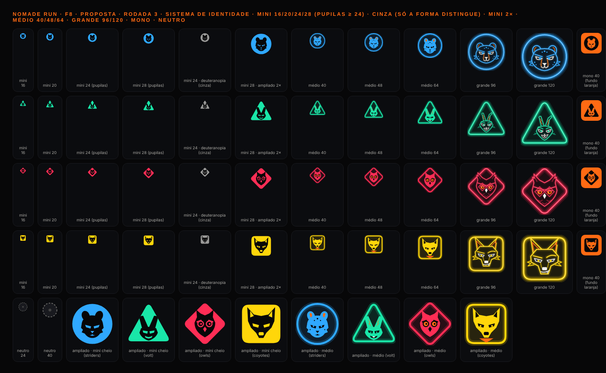
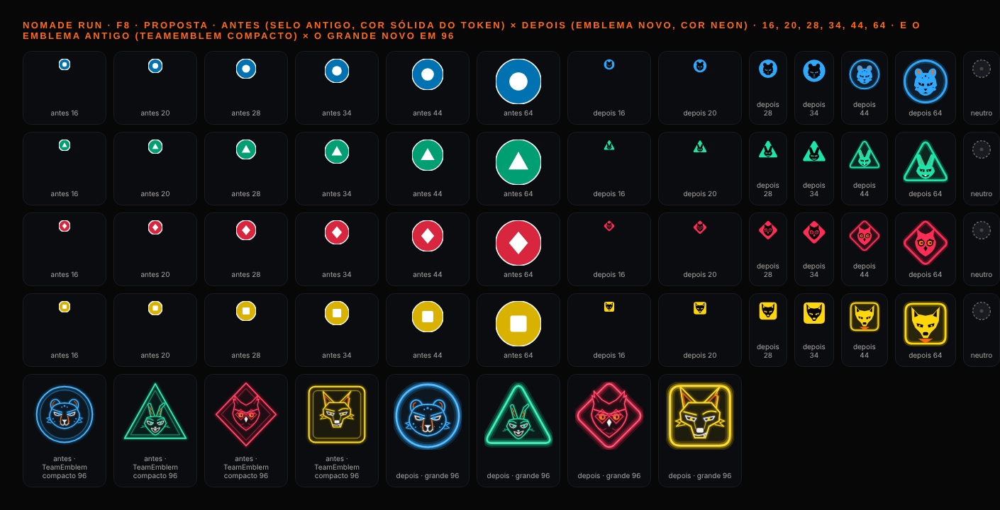
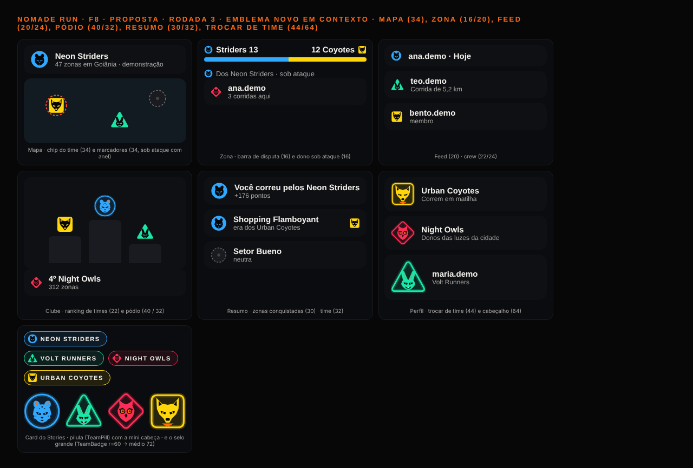
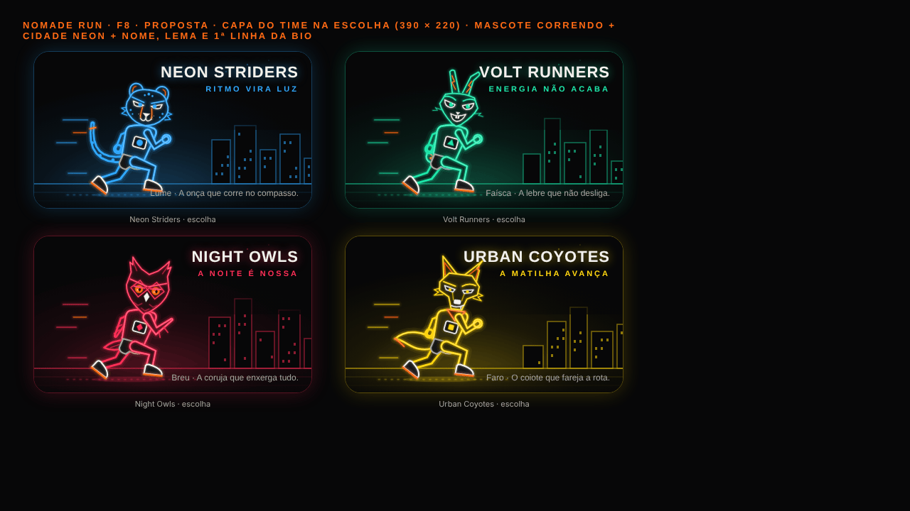
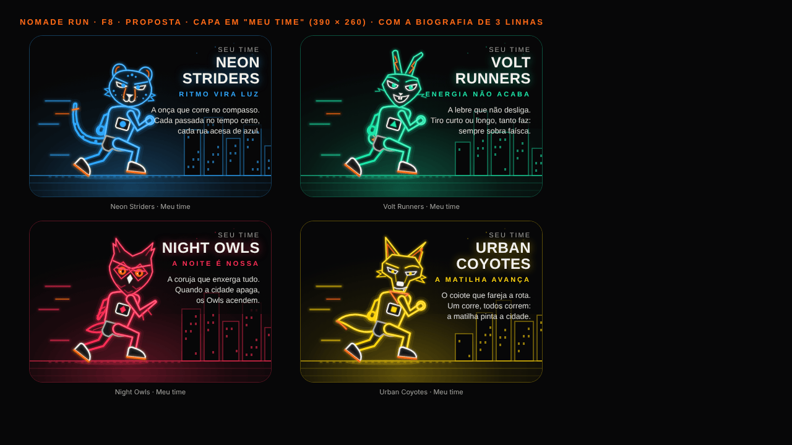

# F8 · Direção de arte — auditoria e sistema de identidade dos times

> **Equipe:** E4 (direção de arte). **Data:** 30/10/2026. **Base:** `a671008` (main após o PR #3).
> **Pedido do dono:** "os símbolos das equipes ainda estão os antigos em alguns lugares; você criou os animais, deixe eles nos ícones das equipes; se já estiverem bons deixe, senão desenhe outros; artes únicas, que deem prazer de ver e vontade de jogar".
> **Escopo desta entrega:** só documento, scripts e imagens (`docs/melhoria/F8/**`). Nenhum arquivo de produção foi alterado: a implementação fica para a equipe da §6.

Folhas de contato: **atual** em `docs/melhoria/F8/arte/atual/*.png` (gerado por `arte/fonte/atual.cjs`), **proposta** em `docs/melhoria/F8/arte/proposta/*.png` (gerado por `arte/fonte/emblema.cjs` e `arte/fonte/capa.cjs`). Os scripts renderizam com os **mesmos módulos de geometria dos componentes** (`neon/core.ts` + `neon/markup.ts`), então o PNG é o que o app desenha.

---

## 1. Auditoria da arte atual (olhada peça a peça)

Método: cada família renderizada em tamanho real e nos extremos (24, 48, 160 pt), mais o selo antigo reproduzido 1:1 e colocado nos contextos reais (Mapa, zona, feed, pódio, resumo, Perfil, card). Critérios: leitura a 24 / 48 / 160 pt, silhueta, peso de linha, brilho, coerência de traço, e se parece "amador, genérico ou ambíguo".

### 1.1 O diagnóstico em uma frase

O app tem **duas linguagens de time convivendo**: a arte neon (mascotes, corredores, emblemas, chefões) e o **selo antigo** (`team-badge.tsx`: disco de cor sólida `#0072B2`/`#009E73`/`#D7263D`/`#D9B200` com a forma branca), que ainda é o que aparece em **27 pontos de 18 arquivos** — cabeçalho do Mapa, HUD da corrida, barra da zona, feed, crew, pódio e ranking do Clube, resumo, Perfil, moderação, celebração, toasts e a pílula do card. O selo é legível, mas é **genérico** (lê como botão de rádio ou pino de mapa), usa a **cor sólida dos tokens** enquanto todo o resto usa o neon (`neonTeam`), e não carrega nenhum personagem. É a origem da sensação de "ainda estão os antigos".

### 1.2 Veredito por peça

Legenda: **M** manter · **R** retocar · **X** refazer. Tamanhos em pt.

| Família | Peça | Leitura 24 / 48 / 160 | Veredito | Motivo (1 linha) e direção |
|---|---|---|---|---|
| **Times** | Selo antigo `TeamBadge` (team-badge.tsx) | ✅ / ✅ / ✅ | **X** | Legível mas genérico e fora da paleta neon; vira `TeamEmblem` novo (§2). Referência: badges esportivos modernos (NBA/MLS "primary mark" = cabeça do mascote dentro de uma forma). |
| | `TeamShapeGlyph` (forma solta) | ✅ / ✅ / — | **M** | Continua como pista de daltonismo em listas e no onboarding "A cidade está dividida"; passa a usar `neonTeam`. |
| | `TeamBadge` do card (card-parts.tsx, anel r=60) | — / ✅ / ✅ | **X** | Anel com forma: correto, sem alma. Vira o emblema **médio** 72 dentro do SVG do card. |
| | `TeamPill` do card | — / ✅ / — | **R** | Pílula fica; o glifo vira a cabeça **mini** 18 (ver `contexto-r3.png`, última célula). |
| | `TeamEmblem` atual (moldura dupla + cabeça + faixa) | ❌ / ⚠️ / ✅ | **X** | A 20–40 a cabeça line-art vira borrão (traço 3,6 em 200 → 0,4 px); moldura dupla come 30 % da área; faixa do nome corta o triângulo e o losango. Substituído pelo sistema da §2 (o `grande` reaproveita o rosto). |
| | Mascote busto `Mascot` (4 × 4 poses) | ❌ / ⚠️ / ✅ | **M** (≥ 120) + regra | Expressivo e coerente a 150+; abaixo de 96 nunca usar (aura some, placa de peito ilegível). Em `zone-sheet` (56) e `club-screen` (72) troca pelo emblema. |
| | Corredor `MascotRunner` (4) | — / ✅ / ✅ | **M** | A peça mais forte do app: silhueta lê até a 72. Vira a **capa** do time (§3). |
| | Líderes `LeaderBust` (4 × 2) | ❌ / ⚠️ / ✅ | **R** (P3) | Família mais rígida: rostos "clip-art", Íris e Nara com a mesma construção. Olhos maiores, menos linhas internas, boca com intenção. Fora do caminho crítico (só no `leader-sheet`). |
| **Chefões** | Soneca, Rei Buzina, Fuligem, Mormaço, Paredão (4 estados) | ❌ / ⚠️ / ✅ | **M** | Elenco com personalidade e silhuetas distintas; o violeta isola bem. A 48 só com `quality="plano"` (lista da Raid). Retoque opcional: as "pernas" do Fuligem (canos) leem como muletas. |
| **Baús** | comum / raro / lendário × 3 estados | ⚠️ / ✅ / ✅ | **M** | Raridade lê por material (branco, laranja, prisma) e forma. A 40 o cadeado some, aceitável. |
| **Medalhas** | 12 tipos × 3 níveis + bloqueada | ❌ / ⚠️ / ✅ | **R** | Sistema certo (roseta + fita) mas as 12 são iguais à distância: ícone interno ocupa ~35 % da roseta → subir para 55–60 %. Nível 2 em branco parece "acima" do nível 3 laranja: trocar para 1 = laranja escuro simples, 2 = laranja, 3 = laranja + raios. |
| **Ícones de modos** | 8 | ✅ / ✅ / — | **M** + 1 retoque | Limpos e legíveis a 24. **Raid** lê como gato (orelhas + raio), confunde com o Breu: trocar pelos chifres de touro do vazio "sem chefão" (mesma silhueta do vilão). |
| **Vazios** | 13 | — / — / ✅ | **M** | Coerentes, com a dose certa de humor; o mascote em "sem notificações" e "volte amanhã" funciona. |
| **Logo** | símbolo / logotipo / horizontal | ✅ / ✅ / ✅ | **M** | Fecha a 24; o prisma das 4 cores no anel é a única peça que usa as 4 cores — certo para a marca. |
| **Sequência** | acesa / fraca / gelo | ✅ / ✅ / ✅ | **M** | — |
| **Aba Correr** | padrão / selecionado | ✅ / — / — | **M** | — |
| **Tutorial** | corra / pinte / defenda | — / — / ✅ | **M** | — |
| **Fundos das abas** | arena / clube / você / atividades | — | **M** | A 4–6 % são textura; "clube" (grade de formas) é o mais "papel de parede", mas invisível na opacidade real. |

### 1.3 Os 10 vereditos mais importantes

1. **Trocar o selo antigo em todos os 27 pontos** pelo `TeamEmblem` novo (mini/médio/grande). É a única mudança que o dono vai notar em todas as telas.
2. **Unificar a cor:** selo, pílula e barras passam a usar `neonTeam`; a cor sólida de `factions[].color` fica só para preenchimentos de mapa (regiões) e textos sobre fundo claro.
3. **Nunca desenhar a cabeça line-art abaixo de 96 pt.** Abaixo disso, silhueta fechada (2 cores).
4. **A forma do time continua sendo a moldura** em todos os tamanhos (teste em cinza em `emblemas-r3.png`: círculo, triângulo, losango e quadrado distinguem sem cor).
5. **Mascote busto só a partir de 120 pt** (Meu time, celebração, vazios). Em `zone-sheet` e `club-screen` sai.
6. **Corredor vira capa** da escolha de time e de "Meu time" (§3), com cidade neon mínima.
7. **Medalhas:** aumentar o ícone interno e reordenar os níveis (branco não pode parecer prata-acima-do-ouro).
8. **Ícone Raid:** sair do "gato" para a silhueta do vilão (chifres), para não concorrer com o Breu.
9. **Líderes:** retoque de expressão, prioridade baixa; não bloqueia a F8.
10. **Ferramentas:** continua tudo em SVG + Reanimated (D-71 confirmada); Lottie/Skia/Rive/HyperFrames não entram no app nesta fase (§4).

---

## 2. Sistema de identidade dos times (a parte principal)

**Ideia:** um emblema por time = **a cabeça do mascote dentro da forma do time**. A forma (círculo, triângulo, losango, quadrado) continua sendo a moldura em qualquer tamanho — é a pista para daltônicos. A cabeça muda de "silhueta" para "rosto desenhado" conforme o tamanho.

Protótipo: `arte/proposta/emblemas-r3.png` (3 rodadas; r1 e r2 guardadas para comparação), contexto em `contexto-r3.png`, antes × depois em `antes-depois.png`, SVGs por time em `arte/proposta/emblema-<time>-{mini,medio,grande,mono}.svg` e `emblema-neutro.svg`. Geometria-fonte em `arte/fonte/emblema.cjs` (`SHAPES`, `HEADS`).





### 2.1 As cabeças (viewBox 100 × 100, silhueta fechada)

| Time | Mascote | O que faz a silhueta ser única | Feição cortada (cor do fundo) | Acento laranja (só médio) |
|---|---|---|---|---|
| Neon Striders | **Lume**, onça | testa larga, orelhas altas arredondadas, **tufos nas bochechas**, queixo estreito | 2 olhos cerrados em cunha, nariz, boca "w" | interior das orelhas; manchas escuras (médio) |
| Volt Runners | **Faísca**, lebre | rosto afilado + **duas orelhas altas** que entram no vértice do triângulo | olhos em cunha, sorriso largo (dentes brancos no médio) | raio cheio dentro de cada orelha |
| Night Owls | **Breu**, coruja | **tufos como chifres** + **olhos enormes** (discos) | discos dos olhos, bico losango, sobrancelhas em V | os olhos ficam **laranja** no médio (marca do Breu) |
| Urban Coyotes | **Faro**, coiote | orelhas pontudas largas + **focinho longo** | olhos em cunha, nariz retangular, interior das orelhas | **bandana** sob o queixo |

Regra de desenho: **nenhuma linha**. A cabeça é um polígono cheio e as feições são **recortes na cor do fundo**. Por isso a mesma geometria funciona a 16 pt e sobre fundo laranja (mono), sem camadas de brilho.

### 2.2 Os 3 tamanhos

| Variante | Tamanho | Construção | Cores | Onde |
|---|---|---|---|---|
| **`mini`** | 16–36 pt (piso 16, ideal 20+) | forma **cheia** na cor do time; cabeça recortada no escuro; a partir de 24 pt, pupilas na cor do time | 2 (cor do time + `#070708`) | barra da zona (16), feed/crew (20–24), ranking (22), chip do Mapa (34), lista de zonas (30), pílula do card (18), toasts (32) |
| **`medio`** | 40–72 pt | halo (stroke 12 a 22 %), contorno 4,5 com tinta 12 %, cabeça **cheia na cor** com feições escuras + **1 acento laranja** | 3 (time + escuro + laranja) | pódio (40), trocar de time (44), HUD da corrida (40), celebração (36–56), cabeçalho do Perfil (64), selo do card (72), Clube crew (72) |
| **`grande`** | 96+ pt | moldura com 3 camadas de brilho + rosto line-art dos mascotes (`faceNodes(team,'parado')`, escala por forma: círculo 0,74, triângulo 0,52, losango 0,70, quadrado 0,84) | neon completo | Meu time (quando não houver capa), escolha de time (fallback), celebração "zona conquistada", card do Stories |
| **`mono`** | qualquer | forma cheia em `color`, cabeça recortada em `on` (cor do fundo) | 1 + fundo | botões laranja, chips coloridos, `onColor` |
| **`neutro`** | qualquer | anel tracejado cinza + miolo apagado (mesma linguagem do mapa para zona sem dono) | cinza `ink3` | zonas neutras, crew sem time |

Decisões tomadas nas rodadas (antes/depois em `emblemas-r1.png` → `r2` → `r3`):
- **r1 → r2:** "mini contorno" descartado (anel some a 20–28); Lume lia como urso → silhueta felina (orelhas altas, tufos, queixo); orelhas da lebre atravessavam a moldura no grande → escala 0,52 e cabeça mais baixa; faixa do nome removida (cortava triângulo e losango; o nome vai em `Text` ao lado); mono precisava da cor do fundo explícita.
- **r2 → r3:** orelhas da lebre mais grossas e mais juntas (lê a 16–20); pupilas só a partir de 24; teste em cinza (deuteranopia) confirma que a forma basta.

### 2.3 API proposta

```tsx
<TeamEmblem
  team={FactionId | null}        // null → variante neutra
  size={number}                  // pt; default 24
  variant={'auto' | 'mini' | 'medio' | 'grande'}  // auto: <40 mini · <96 medio · ≥96 grande
  color?: string                 // default neonTeam[team]
  on?: string                    // cor do fundo (recorte das feições); default neon.bg
  mono?: boolean                 // 1 cor: forma em `color`, cabeça em `on`
  attack?: boolean               // anel tracejado vermelho por fora (zona sob ataque), como hoje
  quality?: QualityProp          // só afeta o grande
  accessibilityLabel?: string    // decorativo por padrão (aria-hidden); com label vira informativo
  testID?: string
/>
```

- Arquivo novo `src/components/art/team/emblem-art.ts` (puro: `SHAPES`, `HEADS`, `emblemMiniNodes`, `emblemMedioNodes`, `emblemGrandeNodes`, `emblemNeutroNodes`) + `emblem.tsx` reescrito. O `TeamEmblem` atual (compacto/completo) some; `emblemNodes` de `mascot-art.ts` fica só para o `grande`.
- Para o **card do Stories** (SVG único de 1080 × 1920): `TeamEmblemInSvg` (mesmo contrato `{ cx, cy, size }` dos `MascotSvgArt`/`BossSvgArt`), e a `TeamPill` passa a receber a cabeça mini como `<G>`.
- **Prop `on`** é o que faz o mono e o mini funcionarem sobre qualquer fundo (surface, card, laranja): a feição é um polígono na cor do fundo, não um recorte real.

### 2.4 O que troca, arquivo por arquivo

| Arquivo (dono) | Hoje | Passa a |
|---|---|---|
| `components/team-badge.tsx` | `TeamBadge` disco sólido | **`TeamBadge` vira um alias fino de `TeamEmblem variant="auto"`** (mantém a assinatura `faction/size/attack` para não tocar 18 arquivos de uma vez); `TeamShapeGlyph` fica, com `neonTeam` |
| `features/social/card/card-parts.tsx` (E8) | `TeamBadge` anel + `TeamPill` glifo | `TeamEmblemInSvg` médio 72 · pílula com cabeça mini 18 |
| `features/screens/map-screen.tsx` (chip 34) e `run-screen.tsx` (HUD 40) | selo | mini 34 / médio 40 com `attack` |
| `features/screens/zone-sheet.tsx` (16, 20) | selo | mini (piso 16; se a E6 aceitar, 18) |
| `features/screens/club-screen.tsx` (pódio 40/32, ranking 22, crew 56) e `crew-screen.tsx` | selo + `Mascot` 72 | médio 40 / mini 32–22 · crew: médio 56 (sai o busto) |
| `features/screens/summary-screen.tsx` (32, 30) | selo | mini 32 / 30 |
| `features/screens/faction-screen.tsx` (44) · `components/team-picker.tsx` (112) | selo / busto | médio 44 · **capa** (§3) com o emblema médio no canto |
| `components/player-card.tsx` (56/64), `leader-sheet.tsx` (72) | selo | médio |
| `components/feed-run-card.tsx` (20), `features/social/feed/crew-feed-card.tsx` (24) | selo | mini |
| `components/celebration/zone-captured.tsx` (36) e `motion/RewardToast` (32/56) | selo | médio 36–56 / mini 32 |
| `features/auth/neon-badges.tsx` (entrada) | selo | médio (4 em fila) |
| `features/moderation/admin-users-screen.tsx` (28) | selo | mini |
| `features/screens/onboarding/city-divided-step.tsx` e `team-picker.tsx` (`TeamShapeGlyph` 20) | glifo | glifo (fica: ali a forma solta é a legenda do gráfico) |

---

## 3. "Capa" do time (escolha de time e Meu time)

Protótipo: `arte/proposta/capas.png` (card da escolha, 390 × 220) e `capa-meu-time.png` (390 × 260, com a biografia). Primeira versão em `*-r1.png` (texto brigava com o skyline; corrigido com degradê escuro atrás do texto e prédios mais baixos).




### 3.1 Composição (igual nos 4; só muda cor, mascote e skyline)

- **Fundo:** `neon.bg` + brilho radial na cor do time saindo do canto inferior esquerdo (34 % → 0).
- **Cidade:** 5 prédios em traço fino (45 %) na cor do time, janelas acesas (quadradinhos 3 × 4 a 55 %, padrão determinístico), 4 "estrelas" (pontos). Skyline diferente por time (alturas em `SKYLINE` no script) para cada capa ter sua silhueta.
- **Pista:** 3 linhas horizontais em perspectiva (70 / 25 / 12 %) + 6 traços laranja em gradiente (as faixas da pista, animáveis).
- **Mascote:** `MascotRunner` corpo inteiro, ~215 pt no card e 250 na capa, à esquerda, correndo para a direita (para o texto).
- **Texto (por `Text`, fora do SVG):** nome do time em display 22–24 (brilho da cor do time), **lema de 3 palavras** em 11 pt tracking 3 na cor do time, bio de 3 linhas 12,5/17 em `ink` a 90 %. Um degradê `bg` a 92 % atrás da coluna de texto garante contraste.
- **Emblema médio** (§2) no canto superior esquerdo do card (não está no mock: a E6 decide se entra, 40 pt).

### 3.2 Texto por time (tom: curto, de torcida, sem promessa de vantagem)

| Time | Lema (3 palavras) | Bio (3 linhas) |
|---|---|---|
| Neon Striders | **Ritmo vira luz** | A onça que corre no compasso. / Cada passada no tempo certo, / cada rua acesa de azul. |
| Volt Runners | **Energia não acaba** | A lebre que não desliga. / Tiro curto ou longo, tanto faz: / sempre sobra faísca. |
| Night Owls | **A noite é nossa** | A coruja que enxerga tudo. / Quando a cidade apaga, / os Owls acendem. |
| Urban Coyotes | **A matilha avança** | O coiote que fareja a rota. / Um corre, todos correm: / a matilha pinta a cidade. |

Os lemas antigos (`factions[].motto`: "Ritmo e precisão", "Resistência sem fim", "Donos das luzes da cidade", "Correm em matilha") continuam valendo nas listas; os novos são a **frase da capa**. Decisão do dono se substituem o `motto`.

### 3.3 Como anima (para a E5, sobre `MascotRunner` e a cena)

- **Idle (loop, 1,6 s):** corredor com o "trote" já existente (`animated` do `MascotRunner`: `rastro` e `corpo`); faixas laranja da pista deslizam para a esquerda (translateX −76 em 1,6 s linear = sensação de velocidade); 2–3 janelas piscam a cada 2–3 s (opacidade 0,55 ↔ 0,2); brilho radial respira (escala 1 → 1,04 em 2,2 s). Com "Reduzir movimento": tudo parado, só o brilho a 100 %.
- **Tap no card (escolha):** mola `bouncy` de escala 0,98 → 1,02 → 1 no card, flash do lema na cor do time (opacidade 0,6 → 1), vibração curta (padrão do time: Striders 1 toque, Volt 2 curtos, Owls 1 longo, Coyotes 3 curtos — já sugerido na bíblia da F1), e o corredor dá um "pulo" (translateY −6, 180 ms).
- **Confirmar time:** a capa cresce para a tela cheia e o corredor troca pelo busto `pose="vitoria"` (já existe no `TeamConfirm`).
- **Custo:** 1 `MascotRunner` animado (2 `Svg`) + 3 valores compartilhados por card. Na escolha com os 4 cards visíveis, **só o card em foco anima**; os outros ficam no quadro 0.

---

## 4. Ferramentas (o que entra e o que não entra)

Fatos conferidos aqui: `expo ~57.0.27`, `react-native 0.86.3`, `react-native-svg 15.15.4`, `react-native-reanimated 4.5.1`. Lista do Expo Go (`node_modules/expo/bundledNativeModules.json`): `lottie-react-native ~7.3.8` ✅ · `@shopify/react-native-skia 2.6.2` ✅ · `rive-react-native` **ausente** (exige development build). O web (Vercel, `COMO_APRESENTAR`) é alvo de apresentação, então cada lib precisa funcionar também no `expo export` web. Teste real de instalação **não foi feito** nesta sessão (ambiente sem rede para `npx expo install` e sem aparelho); a avaliação usa a lista do Expo Go + o que a E2 mediu na F1 (`02-skills-e-mcps.md` §tabela de libs) + o que a D-71 decidiu.

| Ferramenta | O que é | Cabe nesta fase? | Motivo |
|---|---|---|---|
| **react-native-svg + Reanimated** (atual) | vetor + animação na UI thread | **Entra (continua)** | 100 % da arte já está nele, roda no Expo Go e na web, 1.423 testes passam, bundle dentro do orçamento. O emblema novo é só polígonos cheios: mais barato que a arte atual. |
| **Lottie** (`lottie-react-native` 7.3.8) | reproduz JSON do After Effects/Bodymovin | **Não entra no app** | Pede pipeline de AE (ou `text-to-lottie`), duplica a arte que já existe em SVG, e na web o `lottie-web` pesa ~280 kB gzip (o orçamento tem 63 kB de folga). Vale só para **1 peça de apresentação** (splash do vídeo da banca), fora do app. |
| **Skia** (`@shopify/react-native-skia` 2.6.2) | canvas GPU, shaders, blur real | **Não entra agora; plano B mantido (D-71)** | O brilho em camadas de stroke já dá o neon sem filtro. O ganho seria blur real e partículas (confete) — só se o Android cair de 55 fps na celebração. Na web precisa do CanvasKit (~1,5 MB wasm): fora do orçamento. |
| **Rive** (`rive-react-native`) | state machines de animação vetorial, editor próprio | **Não entra** | Não está no Expo Go SDK 57 (precisa de dev client); editor fechado; a equipe não tem o pipeline. Ideal para mascotes com state machine, mas é uma reescrita, não uma finalização. |
| **HyperFrames** (`heygen-com/hyperframes`, Apache 2.0) | framework Node/TS: escreve HTML+CSS (GSAP, CSS, Lottie, Three…) com atributos `data-*` de tempo e **renderiza MP4 determinístico** com Chrome headless + FFmpeg; tem CLI, player web, Studio, catálogo de transições/legendas e skills para agentes | **Não cabe no app; cabe na apresentação** | É ferramenta de **produção de vídeo** (Node 22 + FFmpeg), sem runtime React Native. Serve para: (a) o **vídeo da banca** (abertura de 20–30 s com o logo, as 4 capas e os chefões, usando os mesmos SVGs dos scripts `.cjs`), (b) **cards animados para Stories** exportados como MP4 (hoje o card é PNG estático), (c) prévias animadas na página web de apresentação. Nada disso roda dentro do app. Risco: dependência nova só em `docs/apresentacao`; sem impacto no bundle. |

Resumo: **o app segue SVG + Reanimated**; **HyperFrames entra como ferramenta opcional da apresentação** (vídeo e Stories em MP4), se o coordenador quiser gastar 1 dia nisso; Lottie/Skia/Rive ficam fora.

---

## 5. Plano de produção (para a equipe de implementação)

Estimativas: **P** ≤ 2 h · **M** meio dia · **G** 1 dia+. Ordem = dependência.

| # | Peça | Arquivos | Est. | Observação |
|---|---|---|---|---|
| 1 | `emblem-art.ts` (geometria mini/médio/grande/mono/neutro, portada de `arte/fonte/emblema.cjs`) + `emblem.tsx` novo (`TeamEmblem` com `variant`, `on`, `mono`, `attack`) | `components/art/team/` | **M** | Polígonos cheios em `ArtNode` `glowFill`/`plain`; o grande reaproveita `faceNodes`. Teste: renderiza 4 times × 5 variantes, cor, tamanho, `on`, `attack`, neutro. |
| 2 | `team-badge.tsx` vira alias de `TeamEmblem variant="auto"` (mesma assinatura) | `components/team-badge.tsx` | **P** | Troca os 27 usos de uma vez sem editar as telas. Capturas antes/depois (E10). |
| 3 | `TeamEmblemInSvg` + `TeamPill` com cabeça mini no card do Stories | `components/art/neon/in-svg.tsx`, `features/social/card/card-parts.tsx` (E8) | **M** | Mesmo contrato `{ cx, cy, size }`. Conferir o PNG exportado (view-shot). |
| 4 | Ajustes de tamanho nas telas (zona 16→18 se couber, crew: busto 72 → médio 56, Clube crew idem) | `zone-sheet.tsx`, `crew-screen.tsx`, `club-screen.tsx` (E6) | **P** | — |
| 5 | **Capa do time** `TeamCover` (cena SVG: brilho, skyline, pista + `MascotRunner`) com `animated` e `reduceMotion` | `components/art/team/cover.tsx`, `cover-art.ts` | **G** | Texto por `Text`. Só o card em foco anima. |
| 6 | Capa na escolha de time e em "Meu time" | `components/team-picker.tsx`, `features/screens/faction-screen.tsx` (E6) | **M** | Lema e bio da §3.2 em `factions` ou num `team-bio.ts` (domínio: texto, sem regra). |
| 7 | Medalhas: ícone interno maior e níveis reordenados | `components/art/medal/medal-art.ts` | **M** | Regerar `medalhas.png`. |
| 8 | Ícone Raid com a silhueta do vilão | `components/art/mode-icons/mode-icon-art.ts` | **P** | — |
| 9 | Galeria `/dev/arte`: seção "Emblemas v2" (3 tamanhos × 4 + mono + neutro + capa) | `app/dev/arte.tsx` | **P** | Serve para as capturas do QA. |
| 10 | Líderes: expressão (olhos, boca) | `components/art/leader/leader-art.ts` | **M** | Prioridade 3; pode ficar para depois. |
| 11 | (Apresentação, opcional) vídeo da banca com HyperFrames a partir dos SVGs | `docs/apresentacao/` | **G** | Fora do app. |

**Riscos de desempenho (artes animadas por tela):**
- Mini e médio são 1 `Svg` com 4–12 polígonos, sem camada de brilho: **uma lista com 50 emblemas** custa menos que 1 busto atual. Sem risco.
- Grande: 3 camadas de moldura + rosto completo (~60–90 elementos). Limite: **2 por tela**.
- Capa: 1 `MascotRunner` animado (2 `Svg`, transform/opacity só) + faixas da pista + janelas. Limite: **1 capa animada por tela**; na escolha, os outros 3 cards no quadro 0. Medir no Android médio (meta 55 fps, D-71).
- Card do Stories: tudo estático dentro do SVG único (já é assim).

### 5.1 Critérios de aceite visuais (checklist de 10 itens)

1. Em nenhuma tela aparece o disco sólido do selo antigo (busca por `#0072B2`/`#009E73`/`#D7263D`/`#D9B200` em componentes de time = 0 fora do mapa).
2. O emblema mini lê o **animal** a 24 pt e a **forma** a 16 pt, nas 3 densidades (capturas 1×, 2×, 3×).
3. Em cinza (simulação de deuteranopia na galeria), os 4 emblemas se distinguem pela forma.
4. Mono sobre o botão laranja: cabeça visível (feições na cor do fundo), sem halo.
5. Nenhuma cabeça line-art (`faceNodes`) desenhada abaixo de 96 pt; nenhum busto abaixo de 120.
6. O grande no triângulo: orelhas da lebre **dentro** da moldura; no losango: tufos do Breu sem tocar a borda.
7. Barra da zona (16–18 pt): emblemas alinhados ao texto pela linha de base, sem cortar o halo.
8. Capa: texto da coluna direita com contraste ≥ 4,5:1 sobre o degradê (medir nos 4 times; Coyotes é o pior caso).
9. Capa com "Reduzir movimento": nada se move; sem isso, só 1 capa anima por tela e a corrida fica ≥ 55 fps no Android médio.
10. Card do Stories exportado (PNG 1080 × 1920): pílula com a cabeça mini legível e o selo médio 72 sem serrilhado.

---

## 6. Decisões pendentes (para o coordenador/dono)

1. **Aprovar o sistema** (cabeça na forma, 3 tamanhos) e o nome da prop: `variant` (`mini`/`medio`/`grande`) — ou `size` só, com `auto`.
2. **Lemas novos** substituem `factions[].motto` ou convivem (lista × capa)?
3. **Piso de 16 pt** na barra da zona: manter 16 (lê a forma, animal fraco) ou subir para 18–20 (E6).
4. **HyperFrames** para o vídeo da banca e Stories em MP4: sim/não (1 dia, só em `docs/apresentacao`).
5. **Líderes**: retocar agora ou deixar para depois da F8.
6. **`TeamBadge` como alias** (troca em bloco, 0 edição de tela) vs. substituição explícita em cada arquivo (mais limpa, 18 arquivos, cruza 5 donos).
