# E4 · Onda 2 (F3) — Arte que falta: líderes, corredores, logo, partes para a E5 e o card da E8

> **Equipe:** E4 (direção de arte). **Tarefa:** T7.2.8. **Data:** 23/10/2026. **Base:** `89144d8`.
> **Pastas alteradas:**
> - `apps/mobile/src/components/art/**`;
> - `apps/mobile/src/app/dev/arte.tsx`;
> - `apps/mobile/assets/art/**` (novo);
> - este relatório e `E4-onda2/`.
>
> Nenhuma biblioteca instalada. O `app.json` e os documentos de coordenação não foram alterados.

## 1. Resumo

| # | Pedido | Entrega |
|---|---|---|
| 1 | Bustos dos 4 líderes | `LeaderBust`: Íris Valente, Téo Faria, Nara Lis e Bento Rocha, com as poses `parado` e `falando` (boca aberta + gesto). O modo vivo respira, pisca, fala e acena |
| 2 | Golpe, furioso e derrotado de Soneca, Rei Buzina e Fuligem, com os 3 níveis de dano; corrigir Soneca e Mormaço | Os 3 estados já existiam desde a onda 1. Nesta onda: **Soneca e Mormaço redesenhados** e o **dano 2 legível** no Rei Buzina e na Fuligem |
| 3 | Mascotes de corpo inteiro em corrida | `MascotRunner` (os 4), com 3 níveis de qualidade e 2 camadas animáveis (`rastro` e `corpo`) por `Animated.View` |
| 4 | Logo oficial | `Logo` (símbolo, logotipo e horizontal) em paths. Em `assets/art/`: PNG do ícone 1024, adaptativo do Android (frente, fundo e monocromático), favicon e 4 SVGs |
| 5 | Arte em partes para a E5 | `Chest layer="corpo"\|"tampa"\|"item"` (com o prêmio novo), `Boss silhouette` (o clarão) e, para o `TeamConfirm`, `Mascot pose="vitoria"` ou `MascotRunner` |
| 6 | Contrato `{ cx, cy, size }` da E8 | `MascotSvgArt`, `BossSvgArt`, `LeaderSvgArt`, `RunnerSvgArt` e `LogoSvgArt` (um `<G>` dentro do SVG do card) + `mascotSlot`/`bossSlot` no formato `CardArtSlot` |
| 7 | Token do vilão | `VILLAIN` agora lê `neon.villain` (`theme/neon.ts`) |
| 8 | Galeria `/dev/arte` | Seções novas (logo, líderes, corredores, partes, card), conferidas no export web sem erro no console. PNG por família, com pngquant |

**API da onda 1 mantida.** Todas as props antigas continuam iguais. As novas são opcionais (`layer`, `silhouette`). O tipo `ChestPart` continua `'tampa' | 'corpo'`.

## 2. Arte nova, crítica e rodadas

### 2.1 Líderes (`leader/`)

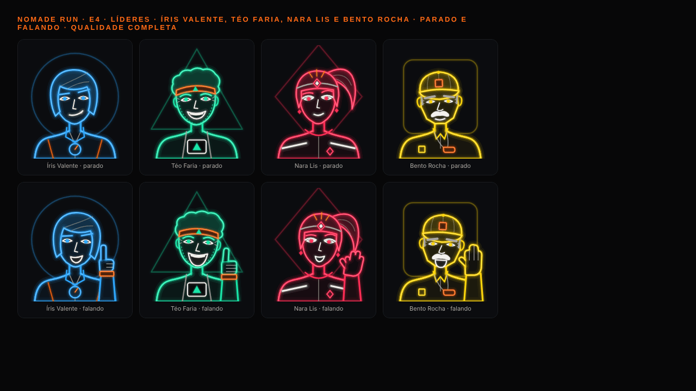

- **Grade e traço:** mesma do busto dos mascotes (200 × 220), com a aura na forma do time atrás da cabeça.
- **Forma do time em um objeto de cada líder:**
  - Íris: cronômetro redondo;
  - Téo: triângulo na faixa da testa e no número de peito;
  - Nara: lanterna de cabeça e brincos em losango;
  - Bento: quadrado no boné e no peito.
- **Personalidade (bíblia da F1, §3):**

  | Líder | Parado | Falando (gesto) |
  |---|---|---|
  | **Íris Valente** | sorriso de canto, sobrancelha direita erguida, cabelo chanel | indicador erguido, com o relógio no pulso |
  | **Téo Faria** | sorrisão com dentes, barba por fazer, cachos e faixa | gargalhada e joinha, com a munhequeira |
  | **Nara Lis** | olhar de pálpebra baixa, rabo de cavalo, faixas refletivas (Corrida Segura) | aceno de mão aberta |
  | **Bento Rocha** | boné, bigode branco, sobrancelhas grisalhas, apito | boca aberta chamando, mão espalmada ("toca aqui") |

- **Fala animada:**
  - a boca vem em 2 camadas (fechada e aberta) e a fala troca só a opacidade, num ritmo irregular de sílabas (`TALK`);
  - a mão acena ±4° em torno do punho;
  - nenhum path é animado.
- **Rodadas:**
  - **Bento:** o boné parecia **capacete de obra**. A aba virou um crescente que desce sobre a testa. A mão em concha na boca parecia **um celular**, então virou a mão espalmada;
  - **Téo:** os cachos empilhados pareciam **brócolis**. Ficaram mais baixos e mais largos;
  - **Nara:** a franja reta fazia uma "caixa" no rosto. Ganhou uma curva.
- **Tamanho real e custo** (`lideres-tamanhos.png`):
  - legíveis em 72 pt; em 40 pt valem pela silhueta;
  - parado: 202 a 240 elementos no completo;
  - falando: 254 a 281 no completo, 179 a 204 no leve.

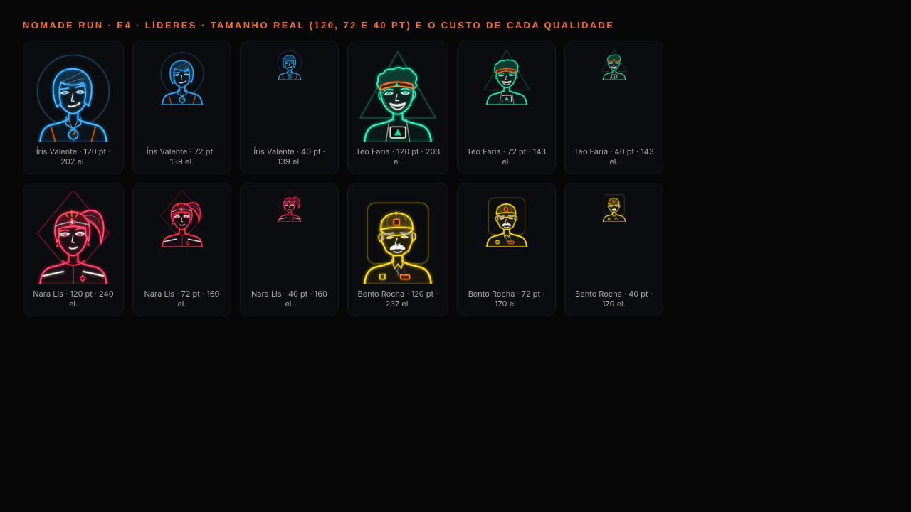

### 2.2 Chefões: revisão do elenco (`boss/boss-art.ts`)

**Antes:** `E4-onda1/chefoes.png`. **Depois:**

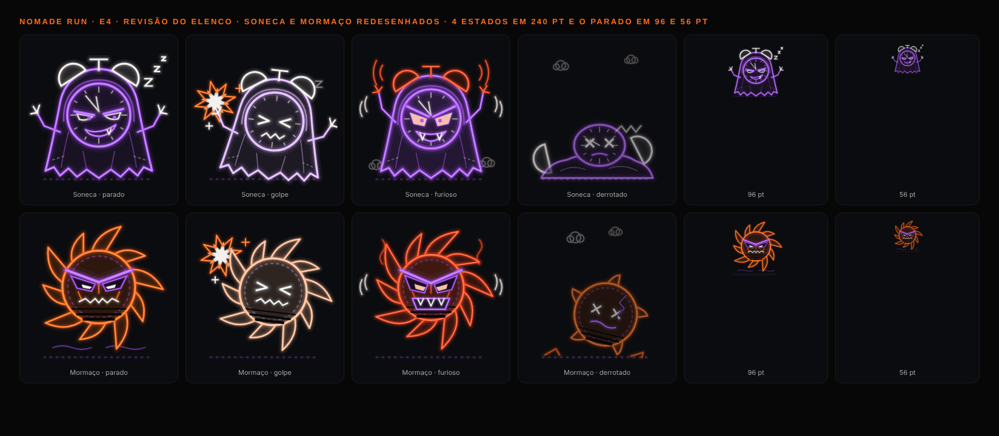

- **Soneca ("a mais infantil do grupo"):** virou um despertador **encapuzado num cobertor** que arrasta no chão.
  - a barra rasgada esconde as perninhas, que eram o ponto mais infantil;
  - os sinos furam o capuz como chifres;
  - os ponteiros parados em **11:55** ("só mais cinco minutinhos") viram a ruga da testa;
  - as pálpebras são pesadas, de tédio, e o sorriso é torto, com um canino;
  - o derrotado é o cobertor desmontado no chão, com o mostrador deitado.
- **Mormaço ("emoji de sol"):**
  - as lâminas viraram um **cata-vento de serra**: curvas e varridas para o mesmo lado, lendo como giro mesmo paradas (a E5 gira a camada `raios`);
  - o rosto virou **máscara**: crista em V de ponta a ponta, órbitas escuras e angulosas com a fenda incandescente, marcas nas bochechas e boca de serra entre os cortes "synthwave".

**Dano 0/1/2 dos 3 chefões da onda 1:**

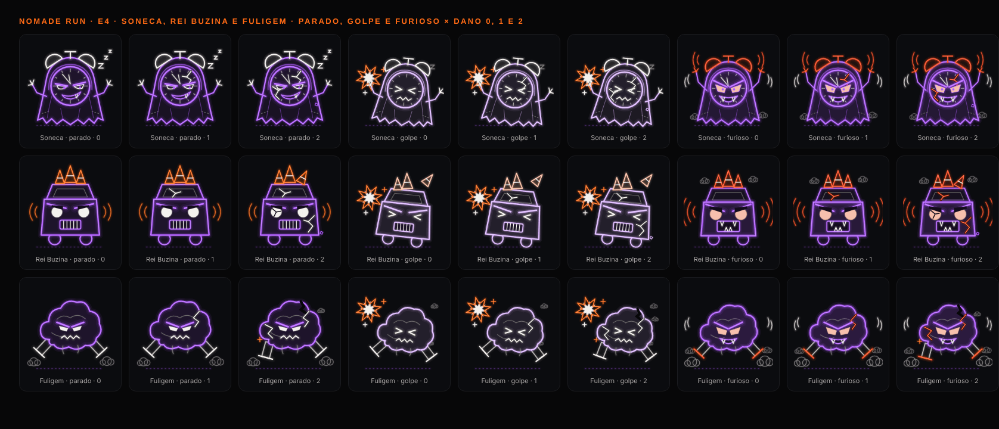

- **Rodada:** na primeira captura, o dano 2 do Rei Buzina e da Fuligem quase não se distinguia do 1 em 150 pt. Agora:
  - **Rei Buzina:** o cone da direita entorta e o farol esquerdo trinca;
  - **Fuligem:** o escapamento esquerdo quebra (cai torto, com faísca) e a nuvem ganha um rasgo.
- **Elenco completo** (5 × 4, dano 0): `E4-onda2/chefoes.png`.

### 2.3 Mascotes em corrida (`team/runner-art.ts`, `team/mascot-runner.tsx`)

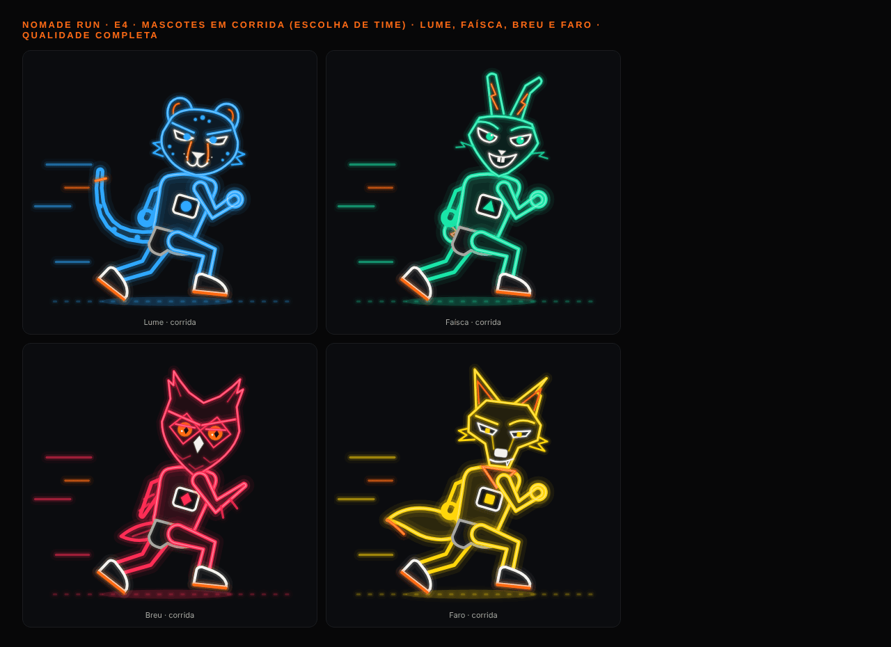

- **Desenho:**
  - perfil para a direita, com a cabeça de frente (a mesma do busto, em escala 0,6) e corpo de atleta;
  - regata com o número de peito na forma do time, shorts e tênis com sola laranja;
  - membros por contorno (`limb()`, largura por articulação): o traço continua geométrico e cada membro tapa o que está atrás.
- **Detalhe de cada bicho:**
  - Lume: cauda longa com anéis e ponta laranja;
  - Faísca: pompom com raio;
  - Breu: asas no lugar dos braços;
  - Faro: cauda peluda e bandana.
- **Rodadas:**
  - a cabeça "flutuava" acima do tronco: desceu e cresceu;
  - o tronco era uma caixa: ganhou cintura;
  - o pé de trás apontava para trás: girou para o impulso;
  - a cauda do Lume era serrilhada: virou curva;
  - as asas do Breu cruzavam o peito como uma faixa e escondiam o número: viraram asas no balanço dos braços.
- **Desempenho:**

  | Qualidade | Elementos | Uso |
  |---|---|---|
  | completo | 306 a 365 | herói (1 por tela) |
  | leve | 220 a 255 | os 4 juntos na escolha |
  | plano | 155 a 175 | — |

  - Animado = 2 `Svg`: o corpo quica (−4 e +1,5°, a cada 170 ms) e o rastro desliza para trás. Só transform e opacidade.
  - Com "Reduzir movimento", fica parado.

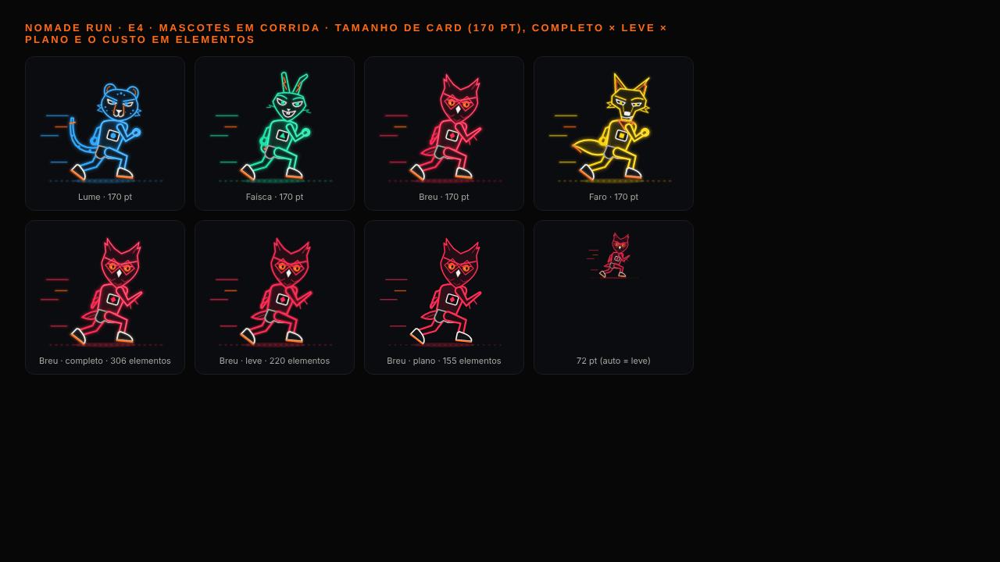

### 2.4 Logo oficial (`logo/`) e ícones (`assets/art/`)

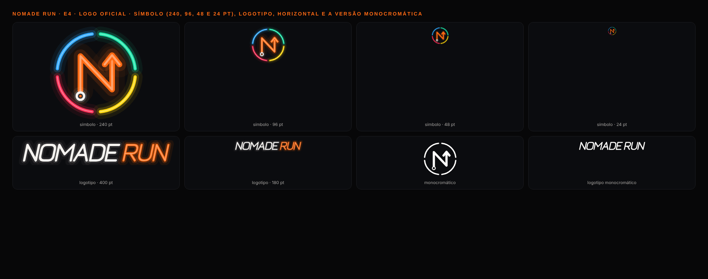
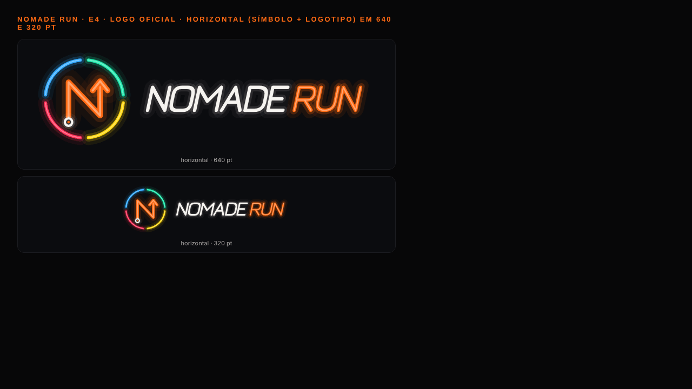

- **Símbolo:**
  - a cidade dividida em 4: um anel de 4 arcos, um por time, com folga entre eles;
  - dentro, uma rota laranja que escreve um "N": largada no anel branco e chegada com a seta para cima;
  - lê em 48 e 24 pt.
- **Logotipo:**
  - letras geométricas de traço único, inclinadas 12° (velocidade);
  - "NOMADE" no branco quente e "RUN" no laranja, como o herói das telas de entrada;
  - **paths, sem `<text>`**.
- **Rodada:** o halo largo do "N" e do "NOMADE" parecia uma sombra borrada. O brilho caiu para 0,75 e 0,55.
- **Ícones** (`gerar-icones.cjs`, a partir da mesma geometria):

  | Arquivo | Uso |
  |---|---|
  | `icone-1024.png` | iOS e loja (opaco; o sistema arredonda) |
  | `android-icone-frente.png` | adaptativo, frente transparente; símbolo de 540 px dentro da zona segura de 66% |
  | `android-icone-fundo.png` | adaptativo, fundo `#070708` com brilho radial |
  | `android-icone-monocromatico.png` | tema do sistema (Android 13+) |
  | `favicon-48.png` | web |
  | `logo-simbolo.svg`, `logo-logotipo.svg`, `logo-horizontal.svg`, `logo-simbolo-mono.svg` | vetores para card, apresentação e TCC |

- **Brilho do PNG grande:** só na rasterização offline do PNG, o brilho ganha uma cópia desfocada por baixo. **O componente e os SVGs continuam sem filtro.**

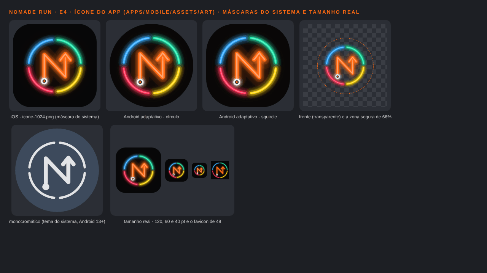

### 2.5 Partes para a E5 e o card da E8

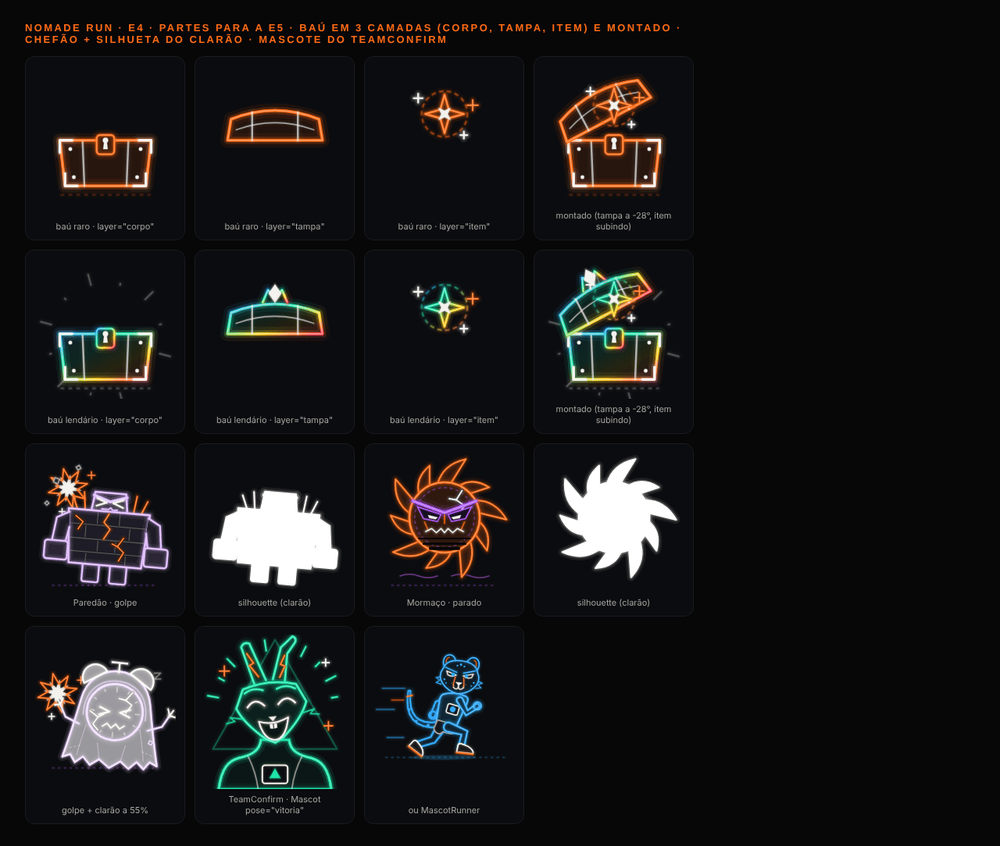
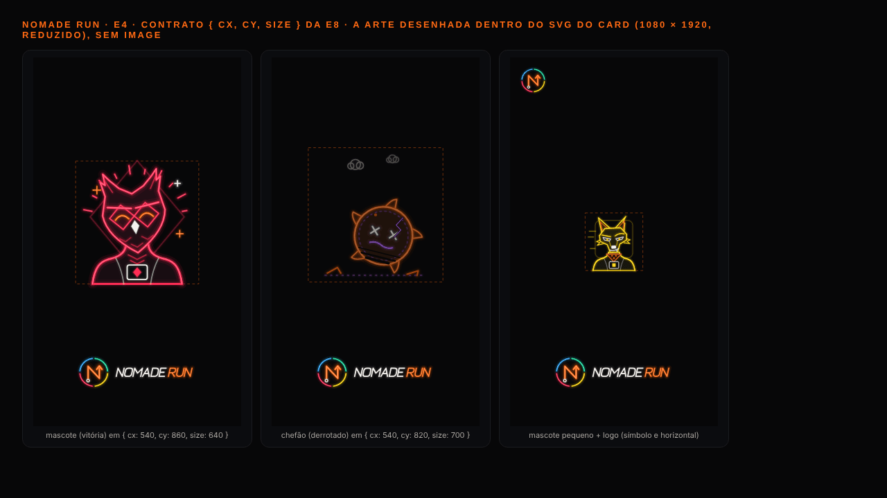

### 2.6 Galeria no navegador (componentes reais, `expo export -p web`, 0 erro no console)

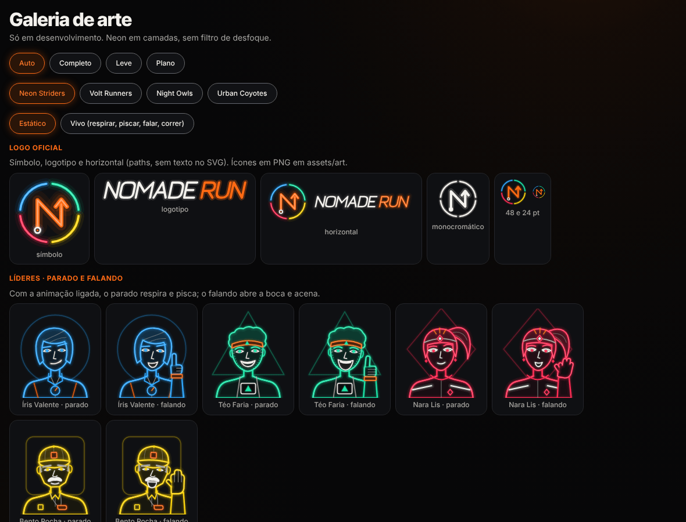
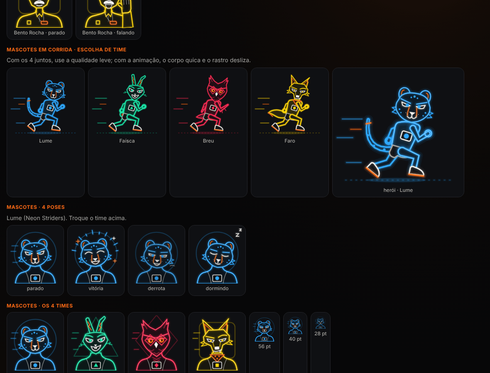
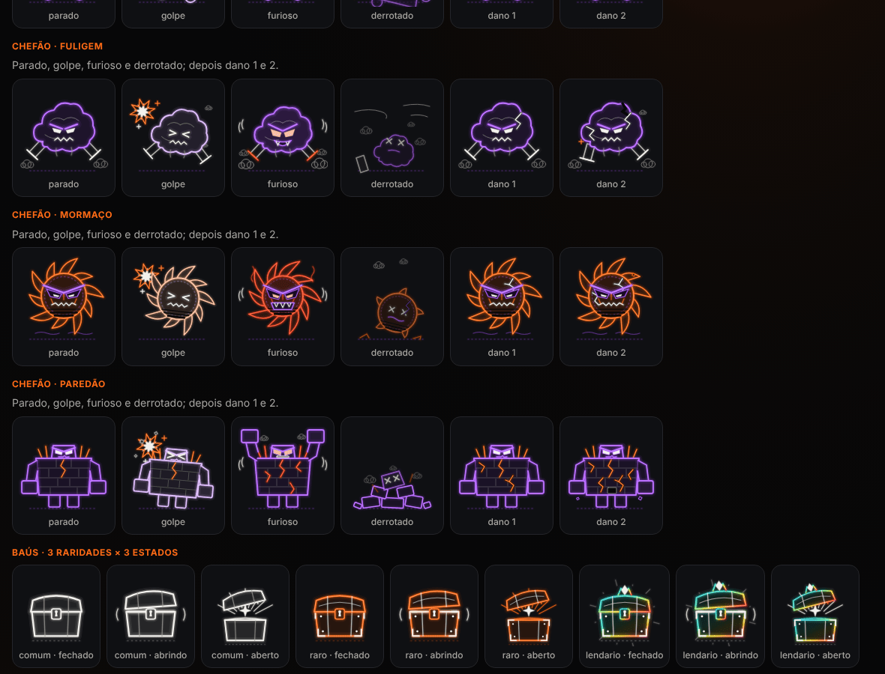
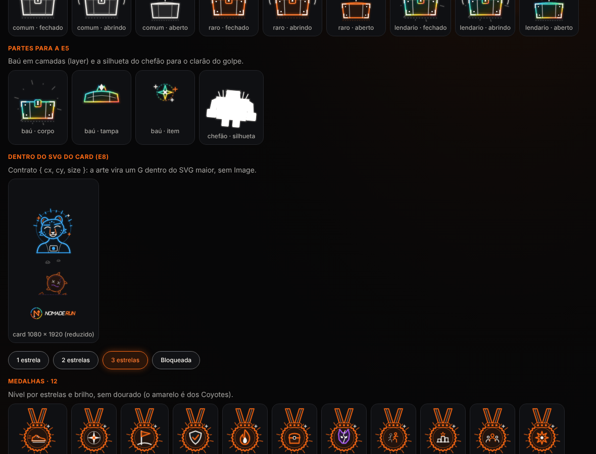

- A captura 2 está com o modo **vivo** ligado: as camadas dos líderes e dos corredores renderizam no meio da animação.

## 3. API nova (props)

| Componente | Props | viewBox · pivôs |
|---|---|---|
| `LeaderBust` | `team`, `pose` (`parado`·`falando`), `size` (140), `color`, `quality`, `animated`, `parts` (`corpo`·`cabeca`·`olhos`·`boca`·`mao`), `accessibilityLabel`, `testID`, `style` | 200 × 220 · `LEADER_PIVOTS` (boca 100,138; mão 162,176) |
| `MascotRunner` | `team`, `size` (200), `color`, `quality` (use `leve` com os 4 juntos), `animated`, `parts` (`corpo`·`rastro`), a11y | 240 × 220 · `RUNNER_PIVOTS` (corpo 128,210; rastro 60,140) |
| `Logo` | `variant` (`simbolo`·`logotipo`·`horizontal`), `size` (largura), `mono` (uma cor), `quality`, `decorative`, a11y | 200 × 200 · 400 × 64 · 640 × 200 |
| `Chest` (novo) | `layer` (`corpo`·`tampa`·`item`) | `CHEST_PIVOTS.item` (80, 56) |
| `Boss` (novo) | `silhouette` (`true` = branco, ou uma cor) | — |
| Dentro de um SVG (E8) | `MascotSvgArt`, `RunnerSvgArt`, `LeaderSvgArt`, `BossSvgArt` (+ `silhouette`), `LogoSvgArt`, sempre com `box: { cx, cy, size }`; `mascotSlot(team, pose?)` e `bossSlot(id, state?, dano?)` devolvem `(box) => ReactNode` | `fitTransform(vb, box)` encaixa no quadrado, centrado |

- **Acessibilidade** (mesma regra da onda 1):
  - `LeaderBust` e `MascotRunner` são decorativos por padrão; viram imagem com `accessibilityLabel`;
  - `Logo` é imagem "NOMADE RUN" por padrão; `decorative` o esconde;
  - as camadas `layer` e a `silhouette` são decorativas, salvo com rótulo;
  - nada recebe toque.
- **Exportados também:**
  - `LEADER_NAMES`, `LEADER_POSES`, `LEADER_BOX`;
  - `RUNNER_BOX`;
  - `LOGO_VARIANTS`, `LOGO_COLORS`, `LOGO_LABEL`, `LOGO_BOX`;
  - `CHEST_LAYERS`, `ChestLayer`;
  - `InSvgArt`, `SvgArtBox`, `fitTransform`.

**Exemplos:**

```tsx
// E5 · ChestOpening (as 3 camadas se alinham na mesma caixa)
<ChestOpening chest={<Chest rarity="raro" layer="corpo" size={160} />} lid={<Chest rarity="raro" layer="tampa" size={160} />} item={<Chest rarity="raro" layer="item" size={160} />} … />
// E5 · BossHit (clarão branco por cima, opacidade 1 → 0)
<BossHit boss={<Boss id="mormaco" decorative />} bossFlash={<Boss id="mormaco" silhouette />} … />
// E5/E6a · TeamConfirm
<TeamConfirm mascot={<Mascot team="volt" pose="vitoria" size={220} animated />} … />
// E8 · card
<ShareCard art={{ mascot: mascotSlot('owls', 'vitoria'), boss: bossSlot('mormaco', 'derrotado') }} … />
// E6a · carrossel de times
<MascotRunner team="striders" size={170} quality="leve" animated /> <LeaderBust team="striders" pose="falando" animated />
```

## 4. Testes

`src/components/art/__tests__/art-onda2.test.tsx`: **8 testes, 8 passando**, ao menos 1 por família nova.

| Família | O que confere |
|---|---|
| leader | 4 × 2 renderizam com cor e tamanho; 8 árvores diferentes; só `g/path/circle/rect/ellipse`, sem `filter`/`blur`; animado = 7 camadas (6 sem a mão) e aceita rótulo |
| runner | 4 renderizam com cor e tamanho; completo ≤ 380 elementos; leve < 75% do completo; animado = 2 camadas, com estilos só de transform, opacidade e posição |
| logo | 3 variantes como imagem "NOMADE RUN", com `testID`, laranja e as 4 cores dos times; sem `Text`; `mono` sem laranja e decorativo |
| partes | `corpo` + `tampa` = baú fechado inteiro; camadas decorativas; `item` aceita rótulo; silhueta só branca, sem o chão; `VILLAIN === neon.villain` |
| E8 | 6 artes viram `<G translate… scale…>` no SVG do card, sem `View`/`Image`; o encaixe do mascote 200 × 220 em `size` 440 dá `translate(340 680) scale(2)` |

O teste da onda 1 (`art.test.tsx`, 12) continua verde, incluindo o "dano 2 > dano 1 > dano 0" com a arte nova.

**Verificações em `apps/mobile`**, antes de cada commit:

| Verificação | Resultado |
|---|---|
| `npm run typecheck` | ok |
| `./node_modules/.bin/eslint src` | 0 problemas |
| `npx jest --maxWorkers=2` | 82 suítes passando e 4 puladas; **994 testes passando** e 26 pulados (eram 986) |

**Observação:** numa das rodadas da suíte completa, `src/domain/__tests__/live-events.test.ts` falhou 1 vez. Ele passa isolado e passou na rodada seguinte. Parece instável sob carga e fica fora da pasta da E4 (fica para a E10/E3).

## 5. Evidência

- **Comprimida com** `pngquant --quality=85-98`.
- **Para regenerar:**
  ```
  NODE_PATH=/opt/node22/lib/node_modules node docs/melhoria/relatorios/E4-onda2/gerar-evidencia.cjs [família…]
  NODE_PATH=/opt/node22/lib/node_modules node docs/melhoria/relatorios/E4-onda2/gerar-icones.cjs
  ```
- **Famílias:** `chefoes`, `chefoes-dano`, `chefoes-revisao`, `lideres`, `lideres-tamanhos`, `corrida`, `corrida-qualidade`, `logo`, `logo-horizontal`, `partes`, `cartao`, mais `icones.png` e as capturas `galeria-web-1..4.png`.

## 6. Pendências, pedidos e riscos

**Pedidos:**
- **Coordenador:** ligar o ícone no `app.json`:
  - `icon` → `./assets/art/icone-1024.png`;
  - `android.adaptiveIcon`: `foregroundImage` → `android-icone-frente.png`, `backgroundImage` → `android-icone-fundo.png`, `monochromeImage` → `android-icone-monocromatico.png`, `backgroundColor` → `#070708`;
  - `web.favicon` → `favicon-48.png`;
  - o `ios.icon` usa `./assets/expo.icon` (Icon Composer): trocar ou gerar de novo a partir do `logo-simbolo.svg`;
  - a splash não foi feita.
- **E5:**
  - usar `layer`, `silhouette` e `CHEST_PIVOTS.item` (exemplos na §3);
  - a **chama** e o **gelo** do `StreakFlame` (`flame`/`ice`) não estavam na lista desta tarefa e continuam com os marcadores da E5. Peço para a onda 3;
  - as cores de raridade (`RARITY_COLORS`) batem com a arte: comum = branco quente, raro = laranja, lendário = prisma.
- **E6a:**
  - no carrossel, `MascotRunner quality="leve"` com os 4 e `LeaderBust` (o vivo fala e acena) no detalhe;
  - o nome e a fala do líder vão em `Text` (a arte é decorativa).
- **E8:**
  - trocar `MascotPlaceholder`/`BossPlaceholder` por `mascotSlot`/`bossSlot`;
  - trocar o logotipo de texto por `LogoSvgArt variant="horizontal"`;
  - nenhuma dessas artes usa gradiente, então não há conflito de id no `toDataURL`.
- **E10:**
  - medir o FPS da escolha de time com 4 `MascotRunner animated` (8 `Svg`, leve) e 1 `LeaderBust animated` (7 `Svg`) num Android médio;
  - conferir a legibilidade dos líderes em 72 pt.

**Riscos:**
- **Custo do corredor:** no `completo`, passa de 300 elementos. Por isso `leve` com os 4 juntos e `completo` só no herói.
- **Líder animado:** são 7 `Svg`. Use 1 por tela.
- **Nomes dos líderes** (D-70, proposta trocável): a arte não depende do nome. `LEADER_NAMES` é a única fonte.
- **Brilho do PNG do ícone:** usa desfoque só na rasterização offline. Se a regra "sem desfoque" valer também para os PNGs, basta tirar a camada `under` em `gerar-icones.cjs`. O ícone continua bom só com as camadas.
