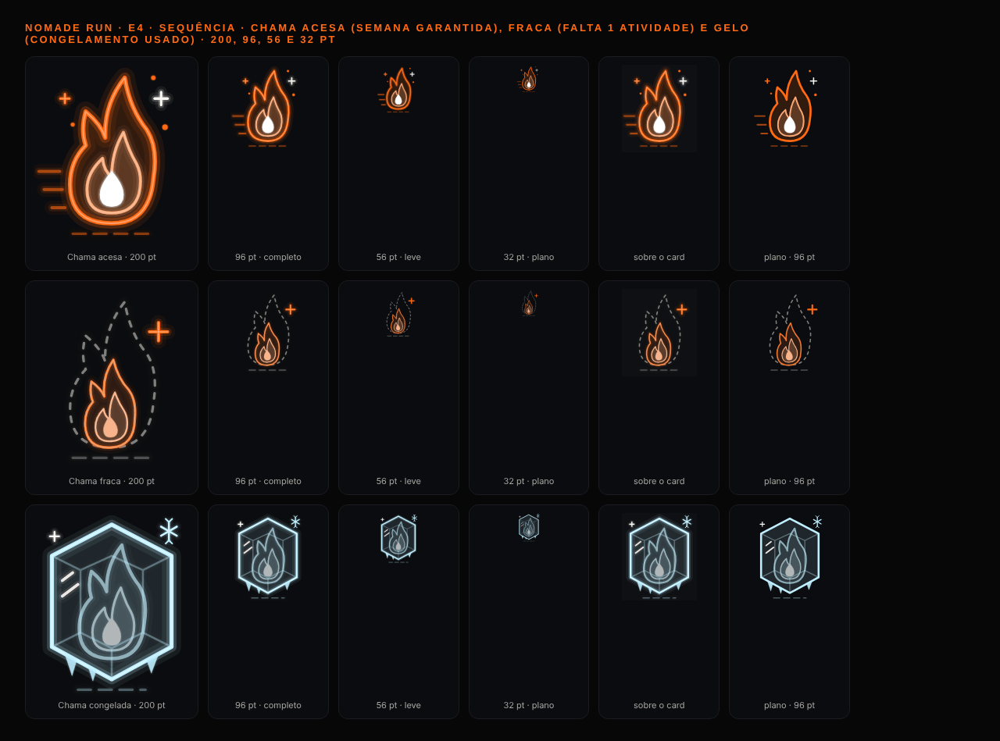
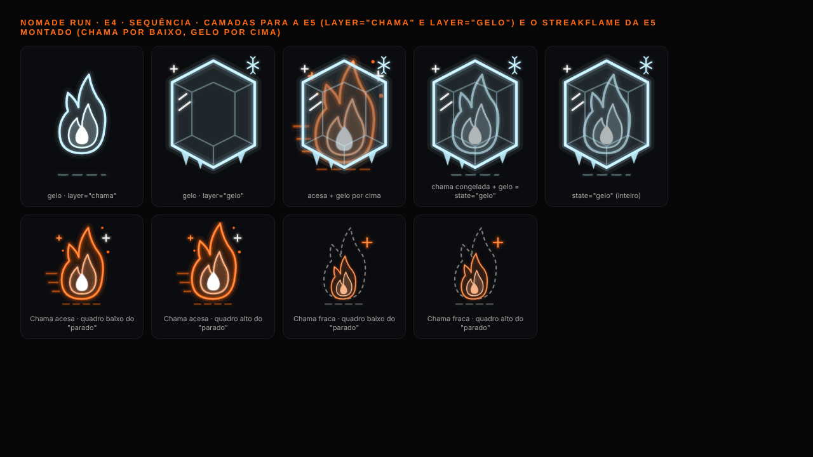
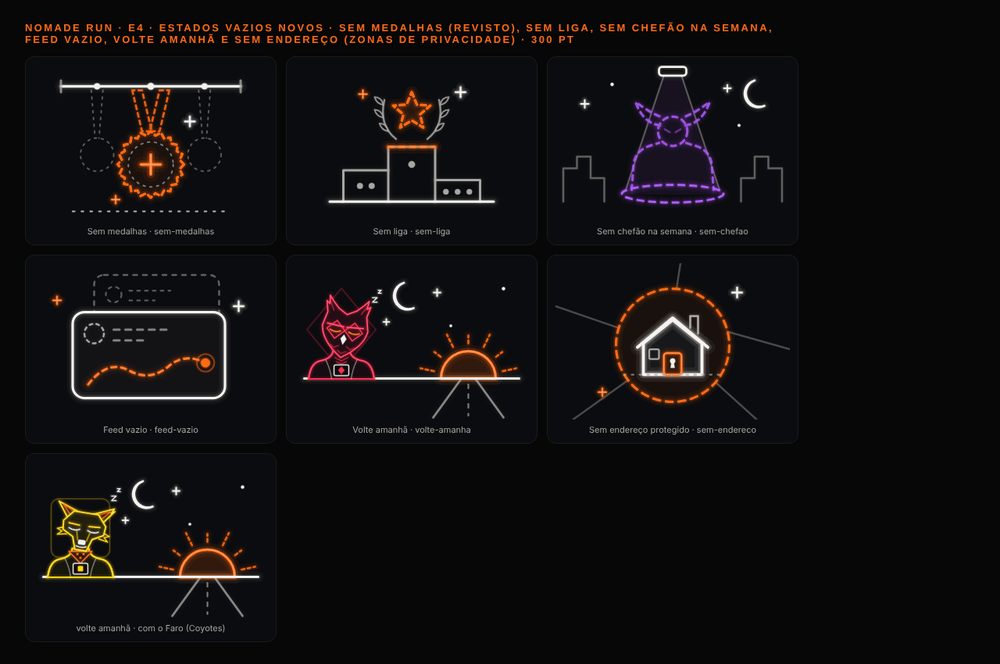
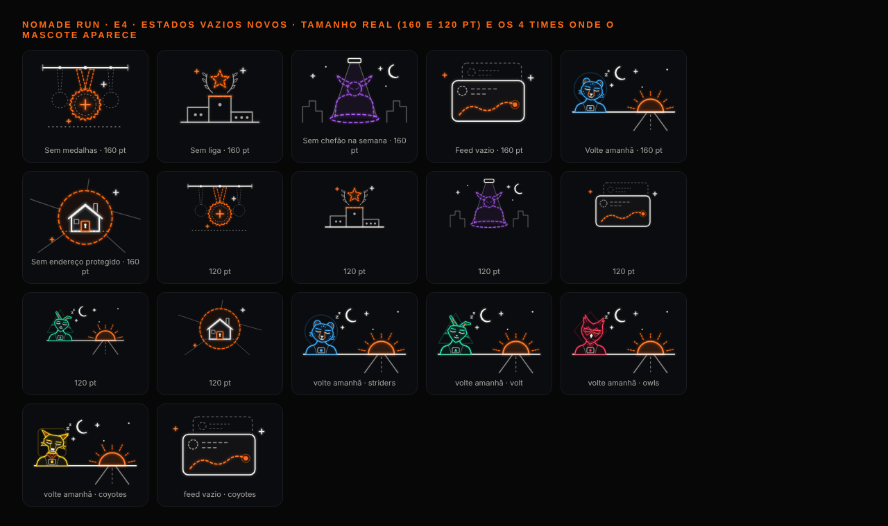
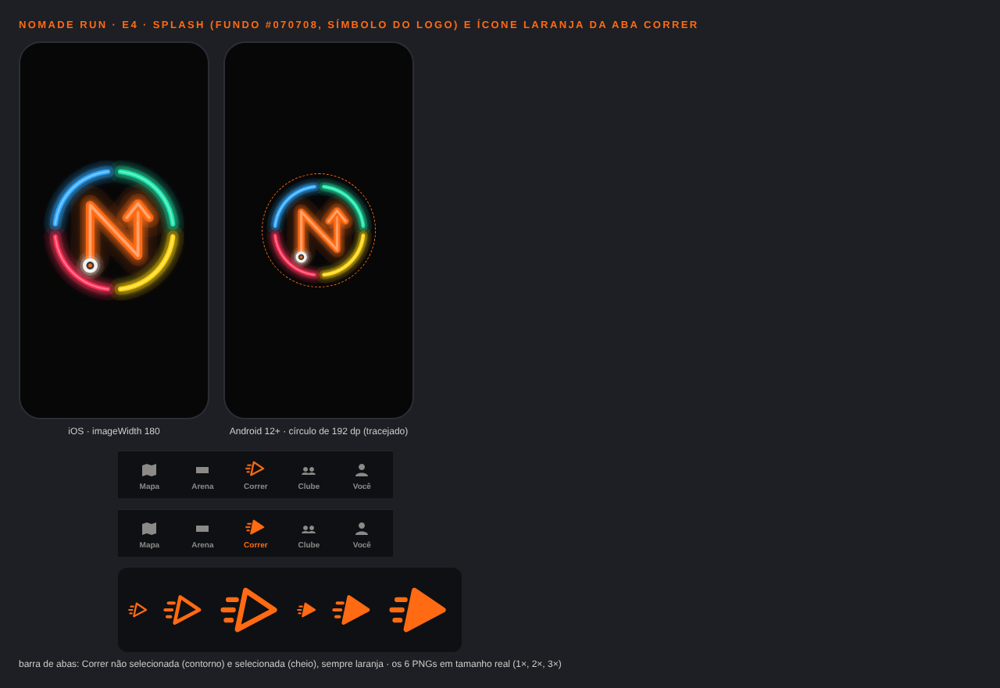
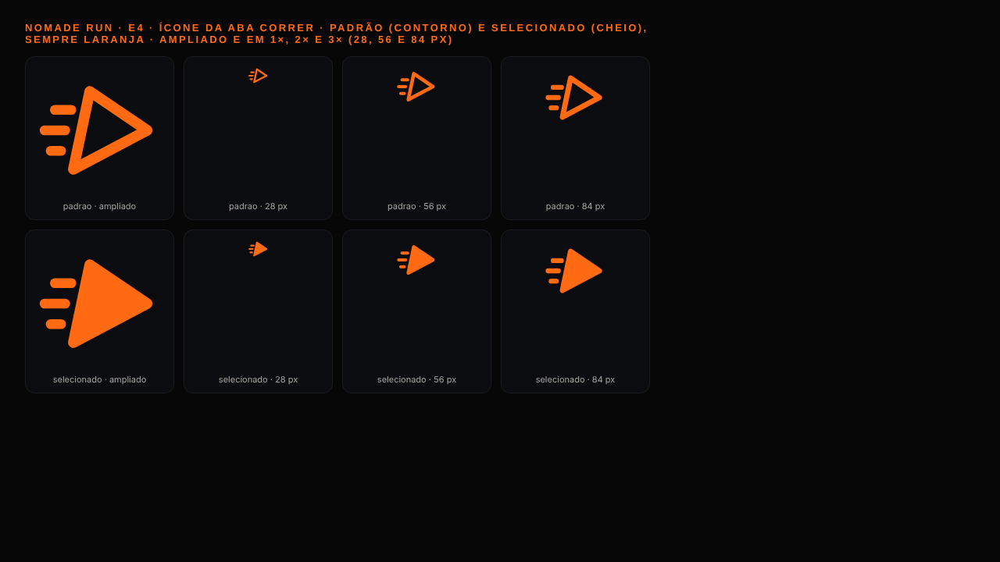

# E4 · Onda 3 (T7.3.4): chama e gelo, aba Correr, splash e vazios novos

> **Equipe:** E4 (direção de arte). **Data:** 28/10/2026. **Base:** `092497c` + merge de `claude/affectionate-gauss-e8gm77`.
> **Pastas:** `src/components/art/**`, `src/app/dev/arte.tsx`, `apps/mobile/assets/art/**` e este relatório (com `E4-onda3/`).
> Nenhuma biblioteca instalada. O `app.json` não foi alterado: o trecho para ligar o splash e o ícone está na §3.

## 1. Entregas

| # | Pedido | Entrega |
|---|---|---|
| 1 | Chama e gelo da sequência | `StreakArt state="acesa" \| "fraca" \| "gelo"`, com as camadas `layer="chama" \| "gelo"` e o "parado" vivo |
| 2 | Ícone laranja da aba Correr | `aba-correr{,-selecionado}{,@2x,@3x}.png` (28 pt) e os 2 SVGs; o componente `RunTabIcon` usa a mesma geometria |
| 3 | Splash com o logo | `splash-simbolo.png` (1024, transparente) e `splash-simbolo-{mdpi…xxxhdpi}.png` (para `imageWidth` 180) |
| 4 | Estados vazios novos | `sem-liga`, `sem-chefao`, `feed-vazio`, `volte-amanha`, `sem-endereco` (a casa pedida pela E6a) e `sem-medalhas` redesenhado |
| 5 | Cor do baú raro | Mantida (`#FF6A13`): não colide com nenhum time nem com o violeta (§4) |
| 6 | Galeria `/dev/arte` | Seções "Sequência" e "Ícone da aba Correr"; os vazios passam a 13 |

## 2. Arte, crítica e rodadas




- **Acesa:** chama inclinada para a frente (linhas de velocidade atrás), com contorno laranja, miolo quente e núcleo branco.
- **Fraca:** chama baixa dentro do **contorno tracejado** da chama cheia, com um "+" laranja. O tracejado já significa "ainda não" nos vazios.
- **Gelo:** a chama em azul-gelo (`ICE #BFEFFF`), presa num cristal hexagonal com facetas, pingentes e floco. Não é uma forma de time.
- **Rodadas:**
  - o cristal cortava o halo no topo e foi reduzido;
  - os reflexos "||" pareciam o ícone de pausa e viraram riscos diagonais;
  - os pingentes em "V" pareciam letras e viraram triângulos cheios;
  - a chama congelada estava cinza (fosco forte demais): o fosco caiu de 45% para 32%;
  - a fraca sumia em 32 pt: ficou maior e mais clara.




- **Vazios:**
  - **sem medalhas:** o suporte na parede, com o contorno da 1ª medalha e um "+". O anterior tinha 3 medalhas pequenas demais;
  - **sem liga:** pódio vazio (a posição em pontos, sem número), com estrela e louros tracejados;
  - **sem chefão na semana:** holofote violeta sobre o vulto tracejado do chefão. A 1ª versão, uma "crista com chifres", lia como gato (e lembrava o Breu), e virou um brutamontes com chifres de touro;
  - **feed vazio:** 2 posts fantasma e uma rota laranja tracejada;
  - **volte amanhã:** o mascote do time dorme na beira da pista, com o sol de amanhã no fim da estrada;
  - **sem endereço:** a casa (porta com cadeado) dentro de um raio laranja tracejado, com as ruas cortadas na borda.




## 3. Trecho para o `app.json` (coordenador)

**Splash:** troque a entrada `expo-splash-screen` em `plugins`. No Android 12+, o símbolo de 180 dp cabe no círculo de 192 dp.

```json
[
  "expo-splash-screen",
  {
    "backgroundColor": "#070708",
    "image": "./assets/art/splash-simbolo.png",
    "imageWidth": 180,
    "resizeMode": "contain",
    "android": {
      "image": "./assets/art/splash-simbolo.png",
      "mdpi": "./assets/art/splash-simbolo-mdpi.png",
      "hdpi": "./assets/art/splash-simbolo-hdpi.png",
      "xhdpi": "./assets/art/splash-simbolo-xhdpi.png",
      "xxhdpi": "./assets/art/splash-simbolo-xxhdpi.png",
      "xxxhdpi": "./assets/art/splash-simbolo-xxxhdpi.png"
    }
  }
]
```

**Ícone da aba Correr** (arquivo da E6, `src/components/app-tabs.tsx`; não vai no `app.json`). Troque o `Icon` da Correr por:

```tsx
<NativeTabs.Trigger.Icon
  src={{ default: require('../../assets/art/aba-correr.png'), selected: require('../../assets/art/aba-correr-selecionado.png') }}
  renderingMode="original"
/>
```

- O Metro escolhe sozinho o `@2x`/`@3x`.
- Com `renderingMode="original"`, o iOS mantém o laranja nos 2 estados.
- No Android, a barra Material pode tingir o ícone com a cor da aba: conferir no aparelho (E10). Se tingir, o `tintColor` da Correr segue laranja só quando ela está selecionada.

## 4. Cor do baú raro (`conferir-cores.cjs`, ΔE2000)

| Baú raro `#FF6A13` contra | Visão normal | Deuteranopia | Tritanopia |
|---|---|---|---|
| Striders | 52,6 | 59,9 | 77,7 |
| Volt | 64,3 | 21,8 | 72,9 |
| Owls | **23,4** | 10,3 | 5,8 |
| Coyotes | 37,1 | 14,9 | 26,2 |
| Vilões (violeta) | 50,5 | 63,1 | 26,2 |

- **Decisão:** manter o laranja.
  - Em visão normal, tudo fica acima de 20 (nitidamente outra cor), e o violeta fica longe.
  - Com daltonismo, o laranja se aproxima do vermelho dos Owls, como acontece com o laranja do app inteiro.
  - A raridade não depende da cor: o raro tem cantoneiras, rebites e nervura, e o texto diz "Baú raro". O baú nunca marca um time.
- **Gelo `#BFEFFF` contra os Striders:** 23,4 em visão normal e 16,6 na tritanopia. O cristal desfaz a dúvida pela forma.

## 5. API nova (compatível com as ondas 1 e 2)

| Componente | Props |
|---|---|
| `StreakArt` | `state` (`acesa`, `fraca`, `gelo`), `size` (96), `color` (chama), `quality`, `layer` (`chama`, `gelo`), `animated`, `parts` (`chama`, `gelo`, `brilho`), `accessibilityLabel`, `testID`, `style`. Decorativo por padrão; `streakLabel(state)` dá o rótulo |
| `RunTabIcon` | `variant` (`padrao`, `selecionado`), `size` (28), `color`; decorativo |
| `EmptyArt` | `kind` ganhou `sem-liga`, `sem-chefao`, `feed-vazio`, `volte-amanha` e `sem-endereco` (o `volte-amanha` usa `team`) |

- **Exportados:**
  - `ICE`;
  - `STREAK_STATES`, `STREAK_LABELS`, `STREAK_LAYERS`, `STREAK_PIVOTS` (chama 60,122; gelo 60,70) e `STREAK_BOX` (120 × 140);
  - `RUN_TAB_VARIANTS` e `RUN_TAB_BOX`.
- **Uso na E5 (`StreakFlame`):**
  - `flame={<StreakArt state={status === 'frozen' ? 'gelo' : 'acesa'} layer="chama" size={56} />}`;
  - `ice={<StreakArt state="gelo" layer="gelo" size={56} />}`.
- **"Parado" vivo:** a acesa tremula (escala Y 1→1,06 e giro de ±1,6° na base); a fraca oscila devagar e o "+" pulsa; o gelo só cintila. É só transform e opacidade, em até 4 `Svg`. Com "Reduzir movimento", fica parado.
- **Pedido da E6a:** trocar `sem-localizacao` por `sem-endereco` em `privacy-zones-screen.tsx` (arquivo da E6a).

## 6. Testes e verificações

- **`art-onda3.test.tsx`:** 5 testes (streak 3, aba Correr 1, vazios 1). Conferem renderização, cor, tamanho, estados diferentes, sem filtro e sem texto, a acessibilidade, as camadas e o movimento reduzido.
- **`art.test.tsx` (onda 1):** a contagem de vazios foi atualizada de 8 para 13, com o violeta conferido no `sem-chefao`. Nenhum teste foi pulado.
- **Em `apps/mobile`:**
  - `npm run typecheck`: ok;
  - `eslint src`: 0 problemas;
  - `npx jest --silent --maxWorkers=2`: 120 suítes passando e 4 puladas; **1360 testes passando** e 26 pulados.
- **Evidência:** gerada com `pngquant`. Para regenerar:
  ```
  NODE_PATH=/opt/node22/lib/node_modules node docs/melhoria/relatorios/E4-onda3/gerar-evidencia.cjs
  NODE_PATH=/opt/node22/lib/node_modules node docs/melhoria/relatorios/E4-onda3/gerar-assets.cjs
  ```

## 7. Pendências

- **Coordenador:** ligar o splash (§3).
- **E6:**
  - ícone da Correr no `app-tabs.tsx` (§3);
  - `sem-endereco` nas zonas de privacidade;
  - os vazios novos onde couberem (liga, Raid sem chefão, feed, "volte amanhã" no baú e nas missões do dia).
- **E5:** `StreakArt` no `StreakFlame` (no lugar do `PlaceholderIce` e da medalha).
- **E10:**
  - conferir no Android se a barra tinge o PNG da Correr;
  - conferir a leitura do splash no Android 12+ (círculo).
