# E5 · Onda 2 — Motion, feedback e recompensa (T7.2.9)

> Equipe E5, Fase 7, F3 onda 2 (integração). Data: 2026-10-23.
> Branch `worktree-agent-a7678a444ac0d5b7a`. Worktree em `.claude/worktrees/agent-a7678a444ac0d5b7a`.
> Base: a worktree nasceu em `a663bee` e foi avançada com `merge --ff-only 89144d8` antes de qualquer mudança. Não houve merge de outra branch nem rebase.

## 1. Resumo

| Tarefa | Entrega | Situação |
|---|---|---|
| Arte da E4 nos momentos | `ChestOpening` (Chest com tampa e corpo), `BossHit`/`BossDefeated` (Boss com `state`/`dano`), `TeamConfirm` (Mascot em "vitória" acenando), `LevelUp` (mascote do time), `StreakFlame` (medalha "Sequência"), toast de medalha (Medal) | ✅ (gelo, item do baú e silhueta branca própria ainda não existem na E4: ver §8) |
| Cor do baú raro | A da arte da E4: laranja `#FF6A13`. Comum em tinta, lendário com as 4 cores dos times. Nenhum violeta | ✅ |
| Adaptador `LiveEvent` → `CelebrationEvent` | `celebration/adapters/` (puro e testado), com o ritmo ao vivo da E3 | ✅ |
| "Bora!" | `BoraReaction` (mola curta, 6 faíscas, vibração leve, versão reduzida) | ✅ |
| Preferências | `store/motion-prefs-store.ts` (Zustand), salvas no aparelho; `haptic()`, `CelebrationSequence` e momentos avulsos respeitam | ✅ |
| Laços fora de foco | `usePausedWhenHidden` (AppState + foco da tela); `SpinRays` e `ShimmerSkeleton` já usam | ✅ |
| Galeria `/dev/motion` | Arte real, seletor de chefão, "Bora!" e as 2 preferências | ✅ |

- **API da onda 1 mantida:** nenhum nome removido nem prop obrigatória nova. `chest`/`lid`/`item`/`boss`/`bossFlash`/`mascot`/`flame`/`ice` continuam valendo como **troca** da arte; sem eles, entra a arte da E4 (antes: marcadores geométricos).
- **Só acréscimos nos tipos:** `points?` em `zone-captured`, `gapMeters?` em `zone-milestone`, `bossId?` nos 2 do chefão, `medal?`/`tier?` em `medal`, modo `skipped` no plano, `skip?` em `PlanOptions`.
- **Pastas fora da E5:** nenhuma alterada (`components/art`, telas, `tokens.ts`, `package.json` intocados). Nenhuma biblioteca instalada.

## 2. Arquivos

**Novos:**
- `apps/mobile/src/store/motion-prefs-store.ts`
- `apps/mobile/src/components/motion/prefs-storage.ts` e `prefs-storage.web.ts`
- `apps/mobile/src/components/motion/use-paused-when-hidden.ts`
- `apps/mobile/src/components/celebration/adapters/live-events.ts` e `adapters/index.ts`
- `apps/mobile/src/components/celebration/bora.tsx`
- Testes: `components/motion/__tests__/motion-prefs.test.tsx`, `components/celebration/__tests__/live-adapter.test.ts`, `components/celebration/__tests__/art-moments.test.tsx`
- Quadros e gerador: `docs/melhoria/relatorios/E5-onda2/` (`gerar-quadros.cjs` e 13 folhas + `galeria.png`)

**Alterados:**
- `components/celebration/`: `chest-opening.tsx`, `boss.tsx`, `team-confirm.tsx`, `progress-moments.tsx`, `zone-captured.tsx`, `default-moment.tsx`, `choreography.ts`, `queue.ts`, `moment.tsx`, `celebration-sequence.tsx`, `index.ts`
- `components/motion/`: `haptics.ts`, `spin-rays.tsx`, `shimmer-skeleton.tsx`, `confetti.tsx`, `burst.tsx`, `index.ts`, `__tests__/render-mocks.ts` (tags SVG da arte)
- `app/dev/motion.tsx`

## 3. Antes → depois

| Momento | Antes (onda 1) | Depois |
|---|---|---|
| `ChestOpening` | Retângulos provisórios; tampa voava; raro em azul provisório | `Chest` da E4. O fechado chacoalha a **tampa na dobradiça** (`parts.tampa`, quadros de `chestLidKeyframes`), achata, e no clarão abre e some; o **aberto** (raios e estrela da E4) entra com mola curta. Cores da E4 (`RARITY_COLORS`, `RARITY_TEXT`, `RARITY_PALETTES`). Estado final e reduzido: só o aberto, com fade |
| `BossHit` | Quadrado violeta | `Boss` da E4 achado pelo nome (`resolveBossId`) ou `bossId`. O "golpe" fica por cima do "parado" e some em 300 ms; achatamento com pivô nos pés; **rachaduras pela vida que sobrou** (`bossDamageFor`, fases 100/67/33% da D-67); clarão com a mesma arte em traço branco e qualidade plana |
| `BossDefeated` | Quadrado violeta | "Furioso" e quebrado treme e fica branco, explode; o "derrotado" fica apagado (40%) atrás do carimbo |
| `TeamConfirm` | `TeamBadge` girando | `Mascot` do time em "vitória": salta com mola e **acena com a cabeça** (`parts.cabeca`, pivô no pescoço). Reduzido: sem aceno |
| `LevelUp` | Só texto | Com `team`, o mascote em "vitória" sobe atrás do número (35%) |
| `StreakFlame` | Gota laranja provisória | Medalha "Sequência" da E4 (a chama dela). O gelo continua provisório |
| Toast de medalha | Sem ícone | `Medal` da E4 quando o evento traz `medal`/`tier` |
| Partículas | Confete e faíscas ficavam **parados à vista** durante o atraso (fill `both`) | Escondidos até a hora (`opacity: 0` + fill `forwards`). O mesmo nas ondas de choque do `TeamConfirm` |
| Halo do baú | No estado final e no reduzido, o fade ia a opacidade 1 e o halo virava um disco cheio | Opacidade fixa no invólucro; teste de regressão para todos os momentos |
| "Pular" | Ficava sob o escurecido do nível novo | `zIndex` acima dos momentos |

## 4. API nova

### 4.1 Adaptador (`@/components/celebration` ou `@/components/celebration/adapters`)

```ts
liveEventToCelebration(e: LiveEvent, ctx: { faction: FactionId; zoneName?: (zoneId) => string | null }): CelebrationEvent | null
liveEventsToCelebrations(events, ctx): CelebrationEvent[]          // só as celebrações, sem repetir id (resumo)
celebrationLevelOf('micro'|'pequena'|'media'|'epica') → 'micro'|'small'|'medium'|'epic'   // LIVE_LEVEL_MAP
liveEventId(e) → 'corrida:tipo:zona-ou-trecho[:marco]:instante'    // estável
liveZoneName(e, ctx?) → nome do evento, do cache ou "Zona sem nome"
createLiveFeedback(ctx, minGapMs = 10_000) → { push(e): { celebration, haptic, voice }, reset() }
LIVE_HAPTICS, LIVE_HAPTIC_MIN_GAP_MS, liveVoiceLine(e, ctx?)
```

| `LiveEvent` | Vira | Vibração ao vivo | Voz |
|---|---|---|---|
| `zona_conquistada` | `zone-captured` (nível da regra: `media`, ou `epica` na 1ª da vida; sem `points`, que só existem no oficial) | `success`, **fura o ritmo** | "Zona conquistada!" |
| `zona_defendida` | `zone-defended` | `impact` | — |
| `zona_progresso` | `zone-milestone` (`fraction`, `gapMeters`) | `tap` | só no 75%: "Faltam 80 metros!" |
| `zona_rival_entrou` | `null` (faixa do HUD) | `tap` | "Zona dos Night Owls: Setor Bueno" |
| `trecho_virado` | `null` | `selection` | — |
| `trecho_pintado`, `trecho_enfraquecido`, `zona_entrou`, `faltam_metros` | `null` | nenhuma | — |

- **Ritmo (E3):** no máximo 1 vibração a cada 10 s, exceto a conquista. O tempo vem de `e.t` (puro, sem relógio).
- **Uso no HUD (E6b):**

  ```ts
  const feedback = createLiveFeedback({ faction, zoneName });
  for (const e of tracker.push(point)) {
    const f = feedback.push(e);
    if (f.haptic) haptic(f.haptic);          // já respeita "Vibração"
    if (f.celebration) mostrarToast(f.celebration);   // ZoneCaptured context="run" / RewardToast
    if (f.voice && vozLigada) falar(f.voice);
  }
  ```
- **No resumo:** `liveEventsToCelebrations(eventos, ctx)` entra direto no `CelebrationSequence`. Lembrete de honestidade: a conquista ao vivo é **previsão**; no resumo, prefira os eventos oficiais do servidor.

### 4.2 "Bora!" (`BoraReaction`, para a E8)

```tsx
<BoraReaction testID="feed-<id>-bora" active={jaMandei} count={total} onPress={alternar}
              label="Bora!" icon={…} accessibilityLabel? color? hapticsEnabled? disabled? style? />
```

- **Mandar:** pulo com mola curta (320 ms, amortecimento 0,45), 6 faíscas e vibração `selection`, **na hora do toque** (otimista).
- **Tirar:** silencioso. Ativo vindo do servidor (ao carregar) não comemora.
- **Cor de ativo:** camada com transição só de opacidade (nada de animar cor).
- **Reduzido:** sem pulo nem faíscas; só o fade.
- **Acessibilidade:** alvo ≥ 44 pt, `accessibilityState.selected`, descrição "Mandar Bora!, 4 no total" / "Tirar Bora!…".
- As outras reações prontas da D-79 (fogo, raio) usam o mesmo componente com `label`/`icon`.
- Puro: `boraFeedback(antes, depois, reduzido)` e `BORA_TIMELINE`.

### 4.3 Preferências (`@/store/motion-prefs-store`, para a E6)

```ts
useMotionPrefs((s) => s.haptics)            // "Vibração" (padrão true)
useMotionPrefs((s) => s.skipCelebrations)   // "Pular celebrações" (padrão false)
useMotionPrefs.getState().setHaptics(bool) / setSkipCelebrations(bool) / reset()
getMotionPrefs()                            // fora do React
MOTION_PREFS_KEY = 'nomade.motion-prefs.v1'; parseMotionPrefs(raw); serializeMotionPrefs(p)
```

- **Persistência:** `expo-sqlite/kv-store` no celular e `localStorage` na web, os mesmos meios do cache do perfil (`prefs-storage.ts`/`.web.ts`). Lê sozinho ao carregar; uma escolha feita antes da leitura terminar vence. Falha de armazenamento = vale em memória.
- **`haptic()`:** só vibra com a preferência **e** o `enabled` de quem chama ligados; `force` (alertas de segurança) continua furando.
- **"Pular celebrações":**
  - `CelebrationSequence`: plano no modo `skipped` (tudo no estado final, sem "Pular", `onDone` na hora, no máximo 1 `success` se havia algo médio ou épico, como um "Pular" no começo). A prop nova `skipCelebrations` força um valor (a galeria usa a preferência);
  - momentos avulsos (`TeamConfirm`, `ChestOpening` etc. sem orquestrador): aparecem já no estado final, sem vibrar, e ainda anunciam ao leitor de tela.

### 4.4 `usePausedWhenHidden` (`@/components/motion`, para a E6 no `NeonBackdrop`)

```ts
const paused = usePausedWhenHidden({ paused?: boolean });   // true = pare o laço
isHidden(appState, focused, paused?)                         // puro
```

- **Escondido:** app em `background`/`inactive`, **ou** tela fora de foco (eventos `focus`/`blur` da navegação), **ou** `paused` pedido pela tela (ex.: enquanto o roteiro do resumo toca).
- Fora de um navegador (galeria, testes), conta como focada e **não lança** (lê o `NavigationContext` direto, sem `useNavigation`). Usa `useSyncExternalStore`: nenhum `setState` em efeito.
- **Como aplicar no `NeonBackdrop`:**

  ```tsx
  const paused = usePausedWhenHidden();
  useEffect(() => {
    if (reduced || paused) return;
    comet.set(withDelay(…, withRepeat(…, -1, false)));
    breathe.set(withRepeat(…, -1, false));
    return () => { cancelAnimation(comet); cancelAnimation(breathe); };
  }, [reduced, paused, comet, breathe]);
  ```
  Em animação CSS: `animationPlayState: paused ? 'paused' : 'running'`, como já fazem `SpinRays` e `ShimmerSkeleton`.

### 4.5 Props novas nos momentos (todas opcionais)

- `BossHit`: `bossId`, `dano`. `BossDefeated`: `bossId`.
- `LevelUp`: `team`.
- `ZoneCaptured`: `points` passou a ser opcional (a previsão ao vivo não tem pontos).
- `CelebrationArt` (de `renderCelebrationMoment`): `team`.
- `CelebrationSequence`: `skipCelebrations`.
- Contas puras exportadas: `bossDamageFor`, `resolveBossId`, `chestLidKeyframes`, `MASCOT_NOD`, `RARITY_TEXT`, `RARITY_PALETTES`.

## 5. Testes (em `apps/mobile`)

| Verificação | Resultado |
|---|---|
| `npm run typecheck` | ✅ sem erros |
| `./node_modules/.bin/eslint src` | ✅ 0 erros, 0 avisos |
| `npx jest --maxWorkers=2` (suíte inteira) | ✅ 84 suítes passaram e 4 foram puladas (já eram: dependem do backend). **1022 testes passaram** e 26 foram pulados |
| Testes da E5 | **190 testes em 8 suítes** (onda 1: 154 em 5). Novos: `motion-prefs` 8, `live-adapter` 9, `art-moments` 19 |
| Cobertura da parte pura nova | `choreography.ts`, `motion-prefs-store.ts` e `use-paused-when-hidden.ts`: 100% das linhas e dos ramos; `adapters/live-events.ts`: 100% das linhas e 93,5% dos ramos; `queue.ts`: 100% / 99,2% |
| `reduced-motion.test.ts` e `testids.test.ts` | ✅ (`bora.tsx` consulta "Reduzir movimento"; o `BoraReaction` tem `testID` e descrição) |

**O que os testes novos garantem:**
- **Preferências:** padrão; leitura tolerante (só booleanos conhecidos, nunca lança); gravação no aparelho; leitura automática ao carregar; uma escolha recente vence a leitura atrasada; `haptic()` não vibra com a preferência desligada, exceto `force`, e a preferência ligada não liga uma chamada com `enabled: false`.
- **`usePausedWhenHidden`:** app no fundo pausa e volta; `paused` da tela; com navegação, `blur` pausa e `focus` volta; sem navegação conta como focada; os ouvintes saem ao desmontar.
- **Adaptador:** os 9 tipos (só 3 viram celebração); mapa de nível, incluindo a 1ª conquista épica; nome pelo evento, pelo cache ou "Zona sem nome"; ids estáveis e únicos, lista sem repetição; a lista entra direto no `planCelebrations`; ritmo de 10 s com a conquista furando; quem nunca vibra; voz só nos 3 casos.
- **Arte:** baú (fechado com `parts.tampa` + aberto; final e reduzido só o aberto; arte de fora continua funcionando); chefão (id pelo nome, "golpe" sobre "parado", dano pela vida, clarão branco, `bossId`/`dano` fixos); derrota ("derrotado" no fim); mascote acenando e sem aceno no reduzido; medalha na sequência e no toast; mascote no nível; nenhuma cor violeta no baú.
- **Regressão:** nenhuma opacidade fixa abaixo de 1 apagada pelo fade do estado final (o bug do halo).
- **"Pular celebrações":** plano `skipped` (tudo no início, 1 `success` só com médio ou épico, leitor de tela vence); momento avulso no estado final sem vibrar e com anúncio; orquestrador sem "Pular", com `onDone` na hora; `skipCelebrations={false}` força o roteiro; "Vibração" desligada silencia o orquestrador.
- **"Bora!":** mandar pula, solta faíscas (só transform e opacidade) e vibra `selection`; tirar é silencioso; descrição e `selected` mudam; reduzido sem animação, só a transição de opacidade.

## 6. Quadros (`E5-onda2/`, comprimidos com pngquant)

Gerados pelo `E5-onda2/gerar-quadros.cjs` sobre o export web (galeria `/dev/motion`, componentes reais, **nenhum erro no console**). Os instantes são aproximados: cada captura leva de 60 a 300 ms.

| Cena | Folha |
|---|---|
| Baú lendário (tampa chacoalha, estouro, aberto da E4, prisma) | 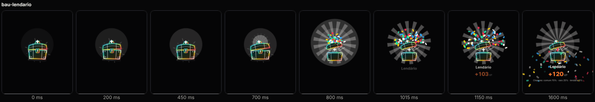 |
| Baú raro (laranja da E4) | 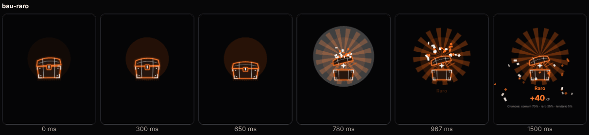 |
| Golpe no Mormaço (golpe → parado com rachaduras, barra violeta) | 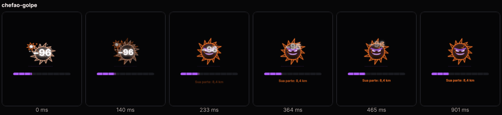 |
| Rei Buzina derrotado (furioso → branco → explode → derrotado apagado) | 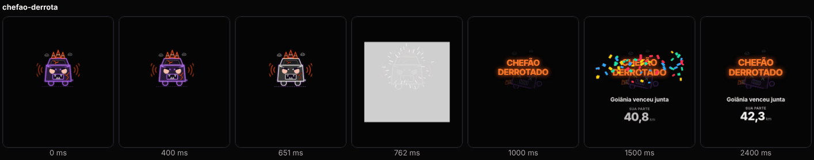 |
| Escolha de time (mascote Volt acenando) | 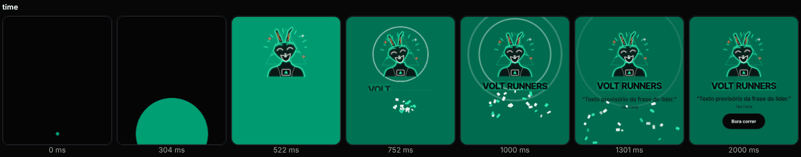 |
| Nível novo com o mascote | 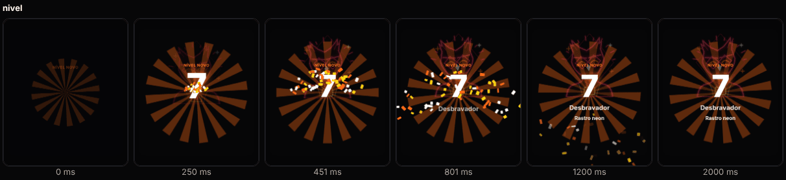 |
| Sequência (medalha da E4) e congelamento (gelo provisório) | 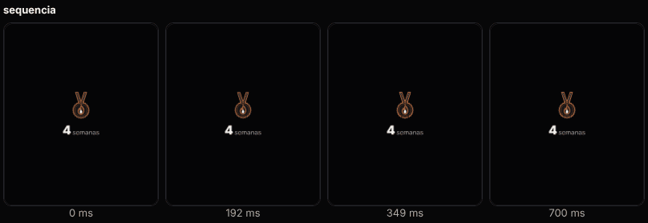 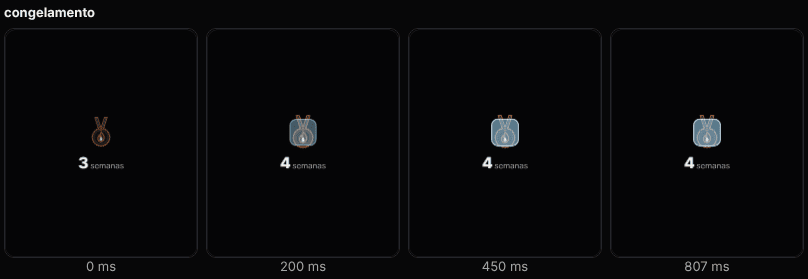 |
| "Bora!" no feed (de perto) | 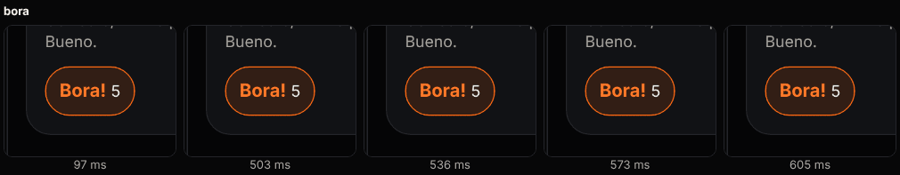 |
| Resumo (fila com "Pular") | 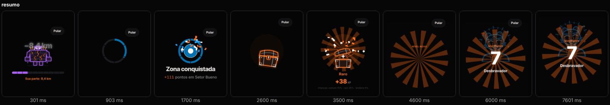 |
| Movimento reduzido: baú, time e "Bora!" | 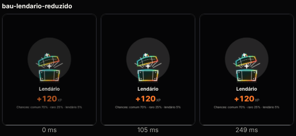 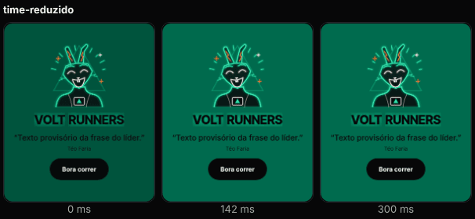 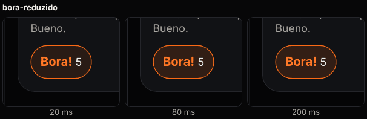 |
| Galeria | 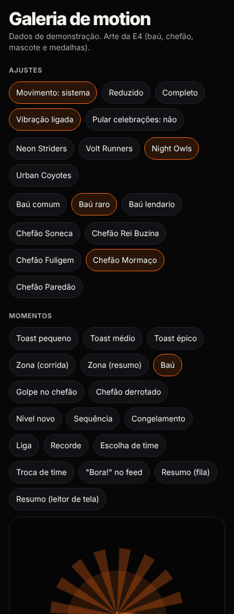 |

**Como regravar** (em `apps/mobile`):

```bash
TMPDIR=<pasta própria e nova> npx expo export -p web --clear --output-dir <pasta própria e nova>
NODE_PATH="$(npm root -g)" PORT=<porta livre> node ../../docs/melhoria/relatorios/E5-onda2/gerar-quadros.cjs <dist> ../../docs/melhoria/relatorios/E5-onda2
pngquant --quality=70-90 --ext .png --force ../../docs/melhoria/relatorios/E5-onda2/*.png
```

## 7. Decisões locais (para o coordenador registrar, se concordar)

1. **Cores de raridade = as da arte da E4.** Comum `ink2`/`ink`, raro `#FF6A13` (o laranja do Pit Lane Neon), lendário com o prisma das 4 cores dos times no confete e `ink` no título. O azul provisório da onda 1 saiu.
2. **Rachaduras pela vida, nas fases da D-67:** dano 0 acima de 2/3, 1 acima de 1/3, 2 abaixo. A tela pode passar `dano` se a regra mudar.
3. **Clarão do chefão com a própria arte em traço branco** (`color="#FFFFFF"`, qualidade plana), até a E4 entregar a silhueta. Custa 1 `Svg` a mais, só durante 160 ms.
4. **Chefão estático nos momentos** (sem `animated`): o tremor e o achatamento ficam num invólucro com pivô nos pés. Usar `parts.corpo` junto com o `floatStyle` interno da E4 brigaria pela mesma propriedade `transform`.
5. **"Pular celebrações" = "Pular" no começo:** tudo no estado final, sem roteiro, no máximo 1 `success` e anúncio mantido.
6. **Preferências no aparelho, não na conta:** são do jeito de usar o celular. Se quiserem sincronizar entre aparelhos, o store já separa leitura e gravação.
7. **Partículas e ondas com `opacity: 0` + fill `forwards`:** com `both`, elas ficavam paradas à vista durante o atraso (achado nos quadros desta onda; corrigido para todos).
8. **Ritmo ao vivo separado do portão de 150 ms:** o de 10 s é regra de jogo (E3) e mora no adaptador; o de 150 ms continua global no `haptic()`.

## 8. Pendências e pedidos

- **E4 (arte):** as partes pedidas ainda não chegaram nesta branch. Quando chegarem, o encaixe é de 1 linha em cada momento:
  - **silhueta branca do chefão:** troca o `BossArt white` do clarão (`boss.tsx`);
  - **item do baú:** entra por `item` (hoje brilha a estrela do próprio baú aberto);
  - **gelo do congelamento:** troca o `PlaceholderIce` (`progress-moments.tsx`), o único marcador que sobrou;
  - **chama própria** (opcional): hoje é a medalha "Sequência".
- **E6 (ajustes):** os 2 interruptores com `useMotionPrefs` (§4.3); `NeonBackdrop` com `usePausedWhenHidden` (§4.4), pausando também enquanto o roteiro do resumo toca (`paused`).
- **E6a (primeira abertura):** `TeamConfirm` já desenha o mascote; basta não passar `mascot`.
- **E6b (corrida e resumo):** `createLiveFeedback` no HUD e `liveEventsToCelebrations` ou eventos oficiais no resumo (§4.1); `renderCelebrationMoment({ team })` para o mascote no nível novo; `bossId` nos eventos do chefão quando o servidor mandar.
- **E8 (feed):** `BoraReaction` (§4.2).
- **E9 (servidor):** mandar `bossId` (os ids da E4 são estáveis) e, no resumo, `points` da conquista.
- **E10 (QA):** medir fps do `ChestOpening` lendário (4 `Svg` do fechado com `parts` + 1 do aberto + 60 confetes) e do `BossHit` (3 `Svg`) num Android médio. O teste estático "só transform e opacidade" deve aceitar `opacity` fixa nos invólucros.
- **Coordenador:**
  - **pasta temporária compartilhada:** o `scratchpad` desta sessão é o mesmo de outras equipes. Um export web meu foi sobrescrito por outro agente (o `motion.html` passou a apontar para o bundle de outra branch) e um script de depuração também. Use nomes únicos por equipe (`<scratchpad>/e5-onda2-<id>/`), além do `TMPDIR` próprio do risco R1;
  - **`/dev/motion` na prévia web:** continua visível (`__DEV__` ou web), como na onda 1.

## 9. Riscos

| # | Risco | Mitigação |
|---|---|---|
| R1 | Baú lendário com até 5 `Svg` + 60 confetes no Android de entrada | Estático (1 `Svg`) no estado final e no reduzido; E10 mede; se pesar, o fechado pode usar `quality="leve"` |
| R2 | A `parts.tampa` recebe animação CSS; o `ArtLayer` da E4 junta `transformOrigin` + estilo | Funcionou na web sem erro; conferir no Expo Go (iOS/Android) |
| R3 | `kv-store` assíncrono: na 1ª renderização vale o padrão (vibração ligada) por alguns ms | A leitura é imediata no início do app; uma escolha feita antes vence |
| R4 | `usePausedWhenHidden` depende do `NavigationContext` do expo-router | Sem contexto, conta como focada; testado com e sem navegação |
| R5 | Export web em worktree pega código de outra branch (R1 da onda 1 + pasta compartilhada) | `TMPDIR` e saída únicos, `--clear`, e conferir no bundle um `testID` novo antes de fotografar |
