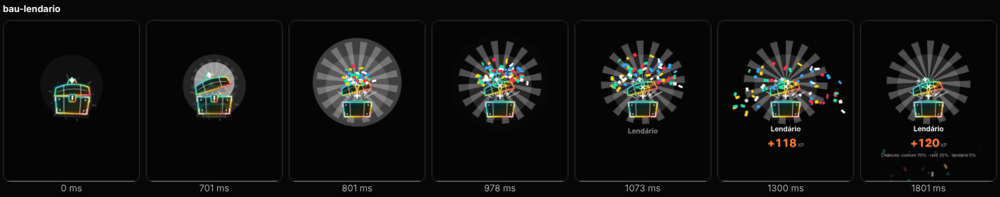
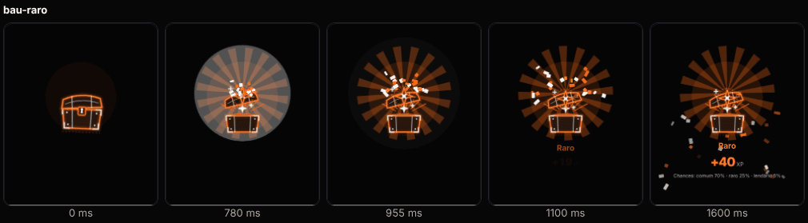
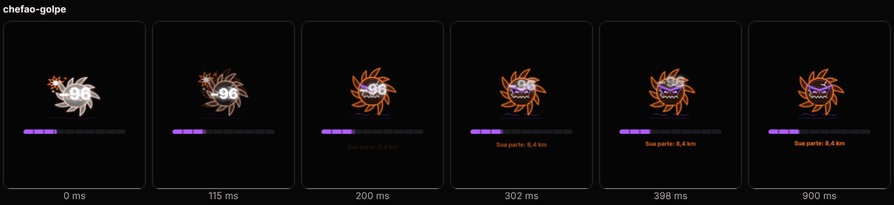
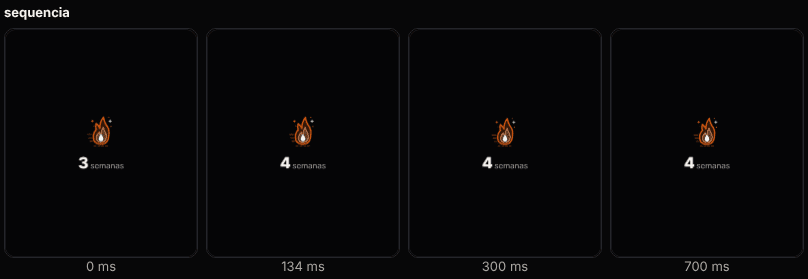
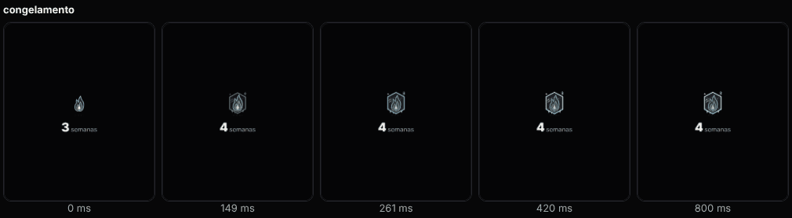
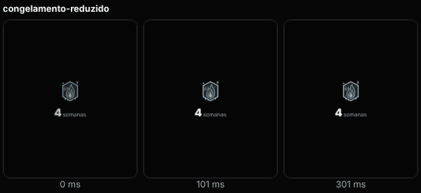
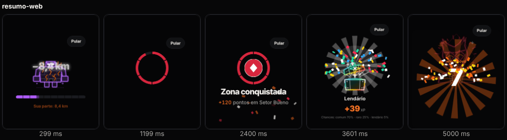

# E5 · Onda 3 — Correções de motion (T7.3.5)

> Equipe E5, Fase 7, F4 onda 3. Data: 2026-10-28.
> Branch `worktree-agent-ad331414b664e63ea` (worktree `.claude/worktrees/agent-ad331414b664e63ea`).
> Base: `092497c` → WIP do coordenador `27bd49d` → merges de `claude/affectionate-gauss-e8gm77` (E9, E6a, E6b, E6c, E7 e, por último, a E4 da onda 3). Sem rebase nem push.

## 1. Resumo

| Tarefa | Entrega | Situação |
|---|---|---|
| Leitor de tela "sempre ligado" na web | `useScreenReaderEnabled()` + `canDetectScreenReader()` (`components/motion/screen-reader.ts`). Na web não pergunta (fica `false`); o anúncio sai numa região viva escondida | ✅ |
| `StreakFlame` com a arte da E4 | `StreakArt` camada `chama` (acesa ou gelo) + camada `gelo` por cima, na mesma caixa, parada (sem laço). Saíram a medalha e o `PlaceholderIce` | ✅ |
| Clarão do golpe | `Boss silhouette` (golpe e derrota) | ✅ |
| Item do baú | `Chest layer="item"` sobe de dentro do baú com mola (`bouncy`, pivô `CHEST_PIVOTS.item`) | ✅ |
| Custo | 8 cenas × CPU 1×/4×/6× × 3 repetições (§4) | ✅ |
| Galeria `/dev/motion` | "Resumo (fila)" segue o sistema; cenas de medição "Confete (60)" e "Arte do onboarding" | ✅ |

**API:** compatível com as ondas 1 e 2. Só acréscimos: `screenReader` agora documenta a web; `item={null}` tira o item; `chest`/`lid` de fora ficam **empilhados** na mesma caixa (como as camadas `layer` da E4; a tela de recompensas da E7 passa `lid={<View />}` e não muda).

## 2. Leitor de tela na web

- **Causa:** o `AccessibilityInfo.isScreenReaderEnabled` do react-native-web 0.21 responde sempre `true`, e o `announceForAccessibility` dele não faz nada.
- **Correção (dentro do componente):** na web o `CelebrationSequence` ignora essa resposta. O roteiro toca, com "Pular" focável e "Reduzir movimento" vindo do `prefers-reduced-motion`.
- **Com um leitor de verdade na web** (NVDA, VoiceOver do Mac): uma `Text` escondida fora da tela (`aria-live="polite"`, sem `opacity: 0` nem `display: none`) entra vazia e, 250 ms depois, ao começar o 1º momento (ou no "Pular"/fim), recebe a mesma frase única do modo leitor ("Corrida concluída. Você conquistou…"). Os momentos continuam com o próprio `aria-live` e rótulo; alguns leitores podem ler os dois.
- **No celular:** nada muda (TalkBack/VoiceOver ligados = sem roteiro, 1 anúncio do sistema, sem região extra).
- **E6b:** pode remover o `screenReader={WEB ? false : undefined}` do `summary-screen.tsx` (e o `WEB`, se ficar sem uso). Hoje é equivalente ao padrão.

## 3. Arquivos

- **Novos:** `src/components/motion/screen-reader.ts`; `src/components/celebration/__tests__/onda3.test.tsx` (13 testes); `docs/melhoria/relatorios/E5-onda3/` (`medir-fps.cjs`, `medicoes.json`, `gerar-quadros.cjs`, 7 folhas).
- **Alterados:** `celebration/{celebration-sequence,chest-opening,boss,progress-moments}.tsx`, `motion/index.ts`, `motion/__tests__/render-mocks.ts` (`withRepeat`, `Easing.sin/inOut` para a arte viva da E4), `celebration/__tests__/art-moments.test.tsx` (asserções da silhueta, do item e da chama), `app/dev/motion.tsx`.

## 4. Medições (web, Chromium sem tela, medianas de 3)

`performance.now()` em cada `requestAnimationFrame`, a partir do toque. CPU 4×/6× = `Emulation.setCPUThrottlingRate` (aproxima Android médio e de entrada; **não substitui aparelho**). `max` inclui o pico da montagem.

| Cena | 1× fps | 4× fps (p95 · %>25 ms) | 6× fps (p95 · %>25 ms) |
|---|---|---|---|
| Galeria parada (referência) | 60 | 60 (16,8 · 0) | 60 (16,7 · 0) |
| Confete 60 sozinho | 59,1 | 56,4 (16,8 · 2,4) | 53,2 (16,8 · 4,3) |
| Baú lendário (5 Svg + 60 confetes + item) | 58,2 | 51,8 (16,8 · 3,4) | **45,5 (33,4 · 14,8)** |
| Golpe no chefão (3 Svg + silhueta) | 58,3 | 52,5 (16,8 · 3,2) | 45,2 (33,3 · 5,9) |
| Nível novo (raios + mascote + 60 confetes) | 58,6 | 50,5 (16,8 · 4,5) | 50,9 (33,3 · 5,1) |
| Baú lendário reduzido | 60 | 55 (16,8 · 1,5) | 50,1 (16,8 · 1,6) |
| Onboarding: 4 `MascotRunner` leve + 1 `LeaderBust`, vivos | 58,8 | 52 (16,8 · 1,5) | 48,4 (16,8 · 2,4) |
| `/dev/arte` viva inteira (8 bustos + 4 corredores + o resto) | 53,2 | 20,7 | 3,7 |

**Leitura e teto recomendado para o Android:**
- **Partículas:** 60 sozinhas aguentam (≥ 53 fps a 6×). O que pesa no baú lendário é a soma: 5 `Svg` do baú + clarão + raios + 60 confetes no mesmo instante. **Teto: 60 no médio; 36 no Android de entrada** (`Confetti count` já aceita 36). Sem troca automática por aparelho nesta onda; se a E10 medir < 45 fps num aparelho de entrada, a regra é `count={Math.min(n, 36)}` só no baú lendário e no nível.
- **Onboarding (risco da E6a):** o carrossel com 4 corredores leves + 1 busto fica em 48–52 fps a 4–6×, com p95 de 1 quadro. Aceitável. O que **não** pode é a galeria de arte inteira viva (3,7 fps a 6×): manter no máximo 1 tela com ≤ 5 artes vivas e pausar fora de foco (`usePausedWhenHidden`).
- **Haptics da E6a:** `Button` usa `haptic('tap')`, que no Android é `Virtual_Key` (o tique de tecla do sistema, que respeita o ajuste do aparelho) e passa pelo portão de 150 ms e pela preferência "Vibração". Ok. `HoldButton` (só no "Segure para encerrar" da corrida) usa `success` sem `force`: com "Vibração" desligada, não vibra. Correto, porque não é alerta de segurança.

## 5. Quadros (`E5-onda3/`, pngquant)

| Cena | Folha |
|---|---|
| Baú lendário com o item subindo |  |
| Baú raro |  |
| Golpe no Mormaço (silhueta branca nos 1ºs 160 ms) |  |
| Sequência e congelamento (`StreakArt`), e o congelamento reduzido |    |
| Resumo na web: o roteiro toca com "Pular" |  |

Regravar (em `apps/mobile`): `TMPDIR=<pasta nova> npx expo export -p web --clear --output-dir <dist>`, depois `NODE_PATH=/opt/node22/lib/node_modules node ../../docs/melhoria/relatorios/E5-onda3/gerar-quadros.cjs <dist> ../../docs/melhoria/relatorios/E5-onda3` e `…/medir-fps.cjs <dist> <saída.json>` (`RATES`, `REPS`, `ONLY`).

## 6. Testes (em `apps/mobile`)

- `npm run typecheck`: sem erros. `./node_modules/.bin/eslint src`: 0 erros, 0 avisos.
- `npx jest --silent --maxWorkers=2`: **122 suítes passaram, 4 puladas** (dependem do backend, como antes); **1.381 testes passaram, 26 pulados**.
- Novos (13): web não pergunta e toca o roteiro; região viva vazia → frase no "Pular"; celular com leitor = 1 anúncio, sem região extra; hook segue `screenReaderChanged`; item padrão da raridade, só transform/opacidade, final/reduzido no lugar, `item` de fora e `null`; camadas de fora empilhadas; silhueta no golpe e na derrota; chama acesa parada, chama congelada + gelo alinhados, reduzido só com fade, `flame`/`ice` de fora.

## 7. Pendências

- **E6b:** remover o contorno `screenReader` do resumo (§2).
- **E10:** repetir a medição num Android de entrada real (baú lendário, nível, onboarding); se < 45 fps, aplicar o teto de 36 confetes.
- **Risco:** a frase da região viva na web pode ser lida junto com o `aria-live` de cada momento (leitura dupla em alguns leitores). Conferir com NVDA na onda 4.
