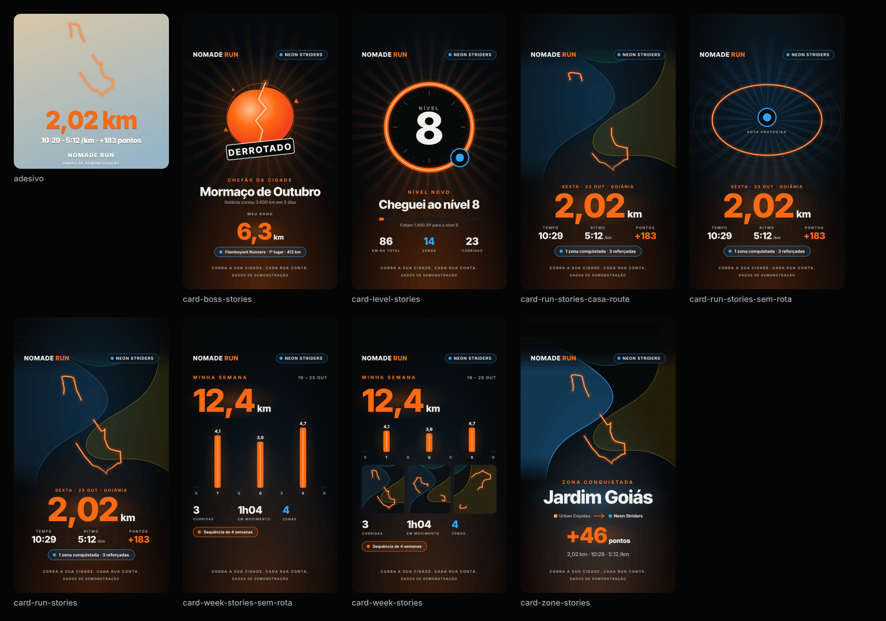

# E8 — Social e compartilhamento · Onda 1 (fundação)

> Equipe E8 · Fase 7, F3, onda 1 · 2026-10-23 · tarefas **T7.1.8** e **T7.1.9** do `PLANO-MESTRE.md`
> Branch `worktree-agent-aa0b1dd80cec5ee6d` (worktree isolada). Sem push, sem merge em outra branch.

## 0. Resumo

- **Corte de privacidade no domain** (`src/domain/share-privacy.ts`, D-78): folga sorteada por zona, pontas de 150 a 250 m, aparo de 0 a 60 m, pedaços curtos descartados e "sem rota" acima de 60% escondido. A saída é o tipo de marca **`SharedRoute`**, que só o corte produz. O teste de propriedade roda **1.200 casos**: nenhum ponto (nem o meio de um segmento) dentro de zona, nada a menos de 150 m das pontas, pedaços ≥ 150 m.
- **GPX 1.1** (`src/domain/gpx.ts`): um `<trkseg>` por pedaço visível e **nenhum horário** quando a rota é cortada. A rota completa, com horários, só sai com `confirmedFullRoute: true`. Propriedade com **1.000 casos**.
- **Modelo do card** (puro): dados → modelo com textos prontos, escolha e ordem dos modelos (o mais raro primeiro) e medida de texto sem DOM com **erro < 3%** (média < 1%) contra o Chromium.
- **Componentes SVG**: 5 modelos × 2 formatos, versão sem rota e adesivo transparente. Usam só react-native-svg 15.15.4 e os tokens Pit Lane Neon. A arte entra por props. O selo "DADOS DE DEMONSTRAÇÃO" aparece quando o dado é de demonstração.
- **Evidência:** os PNGs abaixo saem **dos próprios componentes**: renderização web do react-native-svg → SVG → Chromium (Playwright) → `pngquant`.



| Arquivo | O que mostra |
|---|---|
| [`E8/visao-geral.png`](E8/visao-geral.png) | Stories de todos os modelos, versões sem rota, a casa no caminho e o adesivo sobre fundo claro |
| [`E8/card-run-stories.png`](E8/card-run-stories.png) | Card "Corrida" em tamanho real (1080×1920) |
| [`E8/card-zone-feed.png`](E8/card-zone-feed.png) | Card "Conquista de zona" no feed (1080×1350), com as regiões dos times do mockup |
| [`E8/adesivo.png`](E8/adesivo.png) | Adesivo transparente (1080×1080) |

## 1. Antes × depois

| | Antes | Depois |
|---|---|---|
| Compartilhar (RF-017) | só texto (`Share.share`) | modelo + 5 cards SVG + adesivo, prontos para o `useShareCard` da onda 2 |
| Privacidade da rota fora do aparelho | nada cortava | `clipRouteForSharing` no domain, usado pelo app e exportado na ponte das functions (feed da E9) |
| Tipo da rota no card | — | só `SharedRoute` (marca nominal + registro em tempo de execução) |
| GPX | não existia | `buildGpx`, GPX 1.1, cortado e sem horário por padrão |

## 2. Arquivos

**Domain** (arquivos novos da E8, registrados na ponte):
- `apps/mobile/src/domain/share-privacy.ts`
- `apps/mobile/src/domain/gpx.ts`
- `apps/mobile/src/domain/__tests__/share-privacy.test.ts`
- `apps/mobile/src/domain/__tests__/gpx.test.ts`
- Ponte: `supabase/functions/_shared/domain.ts` (2 linhas `export *`), `supabase/functions/deno.json` e `supabase/scripts/deno.json` (os mapeamentos com e sem `@/`, em ordem alfabética).

**Card** (`apps/mobile/src/features/social/card/`):
- Puro:
  - `card-model.ts`: dados → modelo;
  - `pick-models.ts`: escolha e ordem;
  - `font-metrics.ts`: medida de texto;
  - `route-geometry.ts`: enquadramento da rota.
- SVG:
  - `card-parts.tsx`: peças (texto, poça de luz, selo e pílula do time, rota neon, mapa, raios, herói, ficha);
  - `card-art.tsx`: espaço da arte por props e os marcadores;
  - `card-frame.tsx`: moldura;
  - `run-cards.tsx`: Corrida e Zona;
  - `moment-cards.tsx`: Nível e Chefão;
  - `week-card.tsx`: Minha semana;
  - `sticker-card.tsx`: adesivo;
  - `share-card.tsx`: o despachante `<ShareCard>`;
  - `index.ts`.
- Testes (`__tests__/`):
  - `card-model.test.ts`, `pick-models.test.ts`, `font-metrics.test.ts`, `route-geometry.test.ts`, `share-card.test.tsx`;
  - `fixtures.ts`: dados de demonstração, com a volta real de 2,02 km do mockup;
  - `browser-widths.json`: a referência medida no Chromium;
  - `gerar-svgs.web.tsx` + `react-dom-server.d.ts`: o gerador da evidência, **fora da suíte**, porque o nome não termina em `.test.tsx`.

**Relatório e ferramentas** (`docs/melhoria/relatorios/`):
- `E8-onda1.md`: este relatório;
- `E8/*.png`: a evidência;
- `E8/medir-texto-navegador.cjs`: gera a referência de largura de texto;
- `E8/jest.cards-web.config.js` + `E8/rasterizar-cards.cjs`: geram os PNGs.

**Como regenerar a evidência:**
1. Em `apps/mobile`: `NOMADE_CARDS_OUT=<pasta> npx jest --config ../../docs/melhoria/relatorios/E8/jest.cards-web.config.js`
2. Na raiz: `NODE_PATH=/opt/node22/lib/node_modules node docs/melhoria/relatorios/E8/rasterizar-cards.cjs <pasta>`
3. Comprimir com `pngquant --quality=85-98`.

## 3. Testes (resultado)

| Verificação | Resultado |
|---|---|
| `npm run typecheck` | ok, sem erros |
| `./node_modules/.bin/eslint src` | ok, 0 erros e 0 avisos |
| `npx jest --maxWorkers=2` (app inteiro) | **57 suítes passaram**, 4 puladas (já eram puladas antes); **568 testes passaram**, 26 pulados (já eram), 594 no total |
| `share-privacy.test.ts` | 11 testes, entre eles a **propriedade com 1.200 casos** (~11 a 23 s, conforme a carga da máquina) |
| `gpx.test.ts` | 10 testes, entre eles a **propriedade com 1.000 casos** |
| `features/social` (5 suítes) | 130 testes: medida de texto (75, um por string de referência), modelo (19), escolha (8), geometria (5) e renderização (23) |
| Cobertura de `src/domain` (`--coverage src/domain`) | **99,66% linhas · 99,42% ramos · 98,26% funções · 100% instruções** (limite: 90%). `gpx.ts`: 100%. `share-privacy.ts`: 100% / 97,87% ramos |
| Cobertura de `features/social/card` | 98,5% linhas · 93,9% ramos |
| `deno test … supabase/functions/tests` | **58 passaram**, 0 falharam, 1 ignorado (o plano B da D-02); `domain_bridge.test.ts` verde com os 2 arquivos novos |
| `deno check … supabase/functions/*/index.ts` (+ `_shared/domain.ts`) | ok |
| GPX de amostra (`xmllint --noout`) | XML bem formado; 128 `trkpt`; 0 `<time>` |

**Propriedades conferidas no corte (1.200 rotas aleatórias):**
- rotas de 4 a 50 trechos, de 5 a 250 m cada;
- 0 a 3 zonas aleatórias (raio de 50 a 1.000 m), mais a "casa perto da saída" em metade dos casos e a "volta para casa" em 20%.

Em todos os casos:
- nenhum ponto visível a ≤ raio de qualquer zona, nem o ponto médio de um segmento visível;
- menor folga observada até a borda > 24,5 m;
- nada visível a menos de 150 m do começo e do fim;
- todo pedaço com ≥ 150 m;
- "rota" implica ≤ 60% escondido, e "sem rota" implica nenhum pedaço;
- a saída fica sobre a rota original (< 0,5 m);
- os dois caminhos são exercitados: > 30% dos casos com rota e > 0 sem rota.

**Medida de texto:**
- 70 strings do card, nas 4 fontes, medidas no Chromium com `getComputedTextLength` e as fontes TTF do app;
- erro máximo < 3% em todas e erro médio < 1%;
- o kerning dos números ("4,1", "7,2") passava de 7% sem correção. A correção é uma tabela de 56 pares por fonte, medida no Chromium.

**Privacidade no desenho:**
- 30 cortes com a "casa" em cima da rota;
- o teste lê as coordenadas do caminho SVG desenhado e confere que nenhuma cai dentro do círculo projetado de cada zona.

## 4. API pública nova

### `@/domain/share-privacy` (também em `supabase/functions/_shared/domain.ts`)
```ts
clipRouteForSharing(route: readonly LatLng[], zones: readonly PrivacyCircle[], options: { seed: number; hideEnds?: boolean }): SharedRoute
isSharedRoute(value: unknown): value is SharedRoute
type PrivacyCircle = { lat: number; lng: number; radiusM: number }   // compatível com PrivacyZone do app
type SharedRoute = { mode: 'route' | 'noRoute'; pieces; totalMeters; shownMeters; hiddenMeters; hiddenRatio; endsHidden; noRouteReason: 'empty' | 'mostlyHidden' | null } & marca
SHARE_DENSIFY_STEP_M (8), SHARE_ZONE_MARGIN_MIN_M/MAX_M (25/85), SHARE_END_CUT_MIN_M/MAX_M (150/250),
SHARE_EDGE_TRIM_MAX_M (60), SHARE_MIN_PIECE_M (150), SHARE_MAX_HIDDEN_RATIO (0,6)
```

### `@/domain/gpx`
```ts
buildGpx(source: { kind: 'shared'; route: SharedRoute } | { kind: 'full'; points: GpxPoint[]; confirmedFullRoute: true }, options: { name; description?; activityType? }): string
escapeGpxText(text): string · gpxFileName(activityId): string
GPX_MIME_TYPE ('application/gpx+xml') · GPX_UTI ('com.topografix.gpx') · GPX_CREATOR ('NOMADE RUN')
```

### `@/features/social/card`
- **Modelo:**
  - `buildRunCard`, `buildZoneCard`, `buildLevelCard`, `buildBossCard`, `buildWeekCard`, `buildCardModel(kind, input, choices)`;
  - entradas `ShareRunInput` e `ShareWeekInput`;
  - escolhas `CardChoices { withRoute, showCity, showUsername }` (padrão: rota e cidade ligadas, @ desligado);
  - auxiliares `cardDateLabel`, `weekdayOf`, `formatThousands`, `featuredZone`.
- **Escolha:**
  - `pickCardModels(input) → { kinds, startWithoutRoute, privacyNotice }`, `pickWeekModels`;
  - `buildCarousel(input, choices)`, `buildWeekCarousel`;
  - `privacyNoticeFor(route)`, `CARD_RARITY_ORDER`, `CARD_KIND_LABEL`, `PRIVACY_NOTICE_*`.
- **Texto:** `measureText(text, font, size, letterSpacing?)`, `fitFontSize`, `truncateToWidth`, `cardFonts`.
- **Geometria:** `frameRoutes(routes, box, pad)`, `visibleRoutes`, `CardRegion { owner, rings }`.
- **Componentes:**
  - `<ShareCard model format width? art? regions? svgRef? testID? />`;
  - `<ShareSticker model width? svgRef? testID? />`;
  - os cards soltos (`RunCard`, `ZoneCard`, `LevelCard`, `BossCard`, `WeekCard`);
  - constantes `CARD_FORMATS`, `STICKER_SIZE`, `DEMO_STAMP`.
- **Arte (para a E4):**
  - `ShareCardArt { mascot?, boss? }`;
  - cada uma é `CardArtSlot = ReactNode | ((box: ArtBox) => ReactNode)`, com `ArtBox = { cx, cy, size }` em unidades do card (1080 de largura).

## 5. Decisões de implementação (a registrar como D-xx pelo coordenador, se aprovadas)

1. **Pontas como círculo, não só como distância percorrida.** O começo e o fim escondem todo ponto a até 150–250 m (sorteados) do ponto inicial e do final.
   - Isso cobre a distância percorrida, já que a distância em linha reta é sempre menor ou igual.
   - Também esconde a passagem da rota perto da saída no meio da corrida: é a lacuna no meio da volta em `card-run-stories.png`. Mais forte que o protótipo da F1.
2. **"Sem rota" devolve `pieces: []` e `hiddenRatio: 1`**, com o motivo (`empty` ou `mostlyHidden`). Assim a tela mostra o aviso certo ("Escondemos a maior parte da rota para proteger sua casa.").
3. **A semente vem de quem chama.** O domain é puro (mulberry32 interno, não exportado). Na onda 2, o `useShareCard` sorteia uma semente nova com o `expo-crypto` a cada geração.
4. **Marca dupla.** `SharedRoute` é um tipo nominal (`unique symbol`) e também fica registrado num `WeakSet`: um objeto montado à mão ou copiado com `{...}` não passa no `isSharedRoute`.
   - O card e o `buildGpx` **recusam** esse objeto: o card não desenha a rota e o GPX lança erro.
   - Consequência: a `SharedRoute` **não atravessa serialização** (parâmetro de rota, servidor). Ver o pedido para a E9.
5. **Corrida "em revisão"** tem só o card "Corrida", sem pontos e com o selo "EM REVISÃO", como a provisória. A F1 não tratava esse status.
6. **Dia da semana calculado** (Sakamoto, sem relógio nem fuso): 23/10/2026 é **sexta-feira**. O protótipo da F1 dizia "QUINTA".
7. **Texto:** o `measureText` junta espaços repetidos, como o SVG faz por padrão. Os textos do card usam espaço simples (o nativo pode não juntar).
8. **Web:** a prop `accessible` vazava para o DOM no react-native-svg web (aviso do React). Agora ela vai só no nativo (`A11Y_GROUP`); na web bastam `role="img"` e `aria-label`.
9. **Ids do SVG** com `useId` (gradientes, máscaras, recortes). Vários cards na mesma tela (carrossel) não colidem.
10. **`CardChip`, e não `Chip`:** o teste estático `testids.test.ts` trata qualquer `<Chip>` como interativo. A ficha do card é só desenho.
11. **Mapa some sob o cabeçalho** (máscara por formato) e a pílula do time ganhou fundo opaco. Na 1ª rodada, a borda de uma região cruzava a pílula no feed. A falha foi vista no PNG e corrigida.

## 6. Pendências, pedidos e riscos

### Pedidos
- **E3:** revisar `share-privacy.ts` e `gpx.ts`. O plano prevê a revisão da E3, e a ponte foi tocada só com as 2 linhas da E8.
- **E4:**
  - mascote e chefão como **componentes SVG**, sem `<Image>`, porque um raster sai em branco no `toDataURL`;
  - a arte segue o contrato `ArtBox { cx, cy, size }` e entra por `art={{ mascot, boss }}`;
  - falta também o **logo oficial**: hoje o card usa o logotipo de texto "NOMADE RUN".
- **Dono de `neon.ts` (E6):** acrescentar o token `orangeCore: '#FFD9BF'`, o núcleo claro do traço neon. Hoje ele está em `cardColors`, em `card-parts.tsx`, com comentário.
- **E9 (feed, onda 2):**
  - o corte já está na ponte (`clipRouteForSharing` em `_shared/domain.ts`). A Edge Function deve usá-lo com **semente sorteada** a cada geração do item;
  - pedido de **contrato**: o app recebe a rota do feed já cortada (polyline). Ela não pode virar `SharedRoute` no app, por causa da decisão 4;
  - proposta: um tipo próprio, `ServerClippedRoute`, só para o mini-mapa do feed. Ele sai do decodificador da polyline e nunca é aceito pelo card de compartilhar.
- **E10:** dados de demonstração para o card (`share_card`/`weekly_recap`) no servidor em memória. Os testes daqui já usam `fixtures.ts` com `isDemo: true`. Também falta o teste em aparelho do `toDataURL` (onda 2).
- **Coordenador:**
  - **conflito esperado na ponte** (3 arquivos) com E3 e E7: as linhas da E8 estão em ordem alfabética nos `deno.json` e no fim do `_shared/domain.ts`;
  - decisão sobre o `expo-clipboard` ("Copiar legenda") para a onda 2.

### Pendências (onda 2, T7.2.5)
- `useShareCard`:
  - cópia escondida no tamanho exato;
  - `toDataURL` → `File` → `shareAsync`;
  - na web: fonte embutida e Web Share ou download, porque o `toDataURL` da web perde as fontes (prova da F1);
  - tela `/compartilhar/[id]`, `<ShareButton>`, `useExportGpx`;
  - limpeza do cache.
- Adaptar `RunSummary` e o resultado oficial para `ShareRunInput`: data local, zonas, nível (E7) e chefão (E9).

### Riscos
- **XSD do GPX não validado:** o proxy recusou `topografix.com`. Ficaram conferidos:
  - a ordem dos elementos do XSD (`metadata/name`, `trk/name, desc, type, trkseg`, `trkpt@lat/lon` com `ele` antes de `time`);
  - a faixa de `lon` em [-180, 180);
  - o XML bem formado (`xmllint`).

  Validar contra o XSD quando houver rede.
- **Selo de demonstração no Stories:** fica em y = 1830, abaixo da área segura do Instagram (o desenho da F1), e pode ficar sob a barra de resposta. Para apresentação e captura não faz diferença. Se for preciso, sobe para dentro da área segura.
- **Fontes e máscara no nativo:** não testadas em aparelho (não há Expo Go aqui). As reservas da F1 continuam: retângulo com degradê e view-shot 4.0.3.
- **Custo do teste de propriedade:** 11 a 23 s, conforme a carga (8 equipes dividem 4 núcleos). `NOMADE_SHARE_RUNS` aumenta os casos; abaixo de 1.000 não desce.
- **Base da worktree:**
  - a worktree nasceu em `a663bee`, anterior a `d7747d8`. As outras worktrees estavam na mesma base;
  - a branch foi **avançada** até `d7747d8` com `git merge --ff-only`, só avanço rápido, sem commit de merge. O `reset` foi negado pela proteção do ambiente;
  - os commits da E8 ficam por cima de `d7747d8`.
