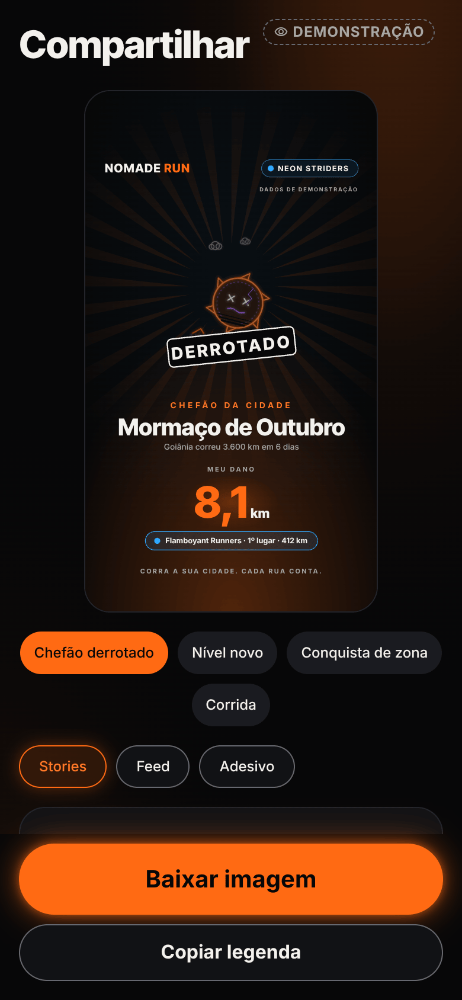
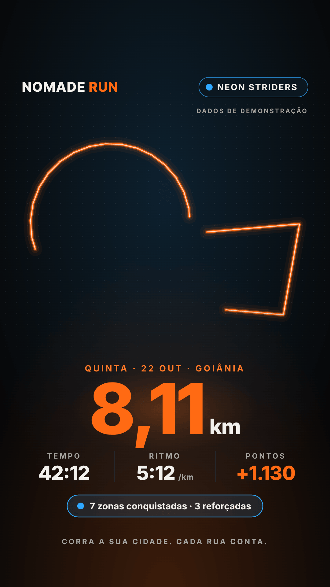

# E8 — Social e compartilhamento · Onda 2 (o fluxo de verdade)

> Equipe E8 · Fase 7, F3, onda 2 · 2026-10-23 · tarefa **T7.2.5** do `PLANO-MESTRE.md`
> Branch `worktree-agent-a572ea959eb257294` (worktree isolada), base `89144d8`. Sem push, sem merge.

## 0. Resumo

- **Compartilhar com imagem funciona de ponta a ponta.** O card SVG da onda 1 vira PNG:
  - no aparelho, por `Svg.toDataURL` → `File(Paths.cache)` → `Sharing.shareAsync`;
  - na web, com as fontes embutidas → canvas → Web Share ou download.
  
  Os PNGs abaixo foram **gerados pelo próprio app** (export web do modo demonstração, botão "Baixar imagem"), não por script de desenho.
- **Tela `/compartilhar/[id]`** e **`<ShareButton>`**:
  - carrossel com o modelo mais raro primeiro;
  - Stories, Feed ou Adesivo;
  - chaves de rota, @ e cidade;
  - aviso de privacidade;
  - "Copiar legenda" (`expo-clipboard`).
  
  São 3 toques do resumo até o menu do sistema. A rota passa pelo corte do domain com as zonas da pessoa e uma semente nova. **Sem as zonas, a rota não sai.**
- **`useExportGpx`**: o corte vem ligado por padrão, sem horário. A rota completa só sai com confirmação.
- **Feed da crew (D-79)**, no contrato da E9 (onda 2):
  - `feed-repo.ts` (`crew_feed`, `react_feed_item`, `feed_item_kudos`, `delete_feed_item`, `my_feed_settings`, `set_feed_settings`) e `share-repo.ts` (`record_share`);
  - pares no servidor de demonstração, com 6 corridas da crew cortadas pelo domain;
  - `<CrewFeed>` pronto, com "Bora!" otimista e faíscas, "quem reagiu" e "Tirar do feed";
  - `<FeedSettings>` com as duas chaves de privacidade do feed;
  - `PGRST202`/`FEATURE_DISABLED` viram "indisponível".
- **Convites:**
  - código, link e texto pronto (`<InviteCard>`);
  - página de reserva `/compartilhar/convite/[codigo]`;
  - domínio configurável por `EXPO_PUBLIC_INVITE_BASE_URL`.
- **Selo de demonstração dos Stories** dentro da área segura (sob a pílula do time, y = 370), não mais em y = 1830.



## 1. Antes × depois

| | Antes (onda 1) | Depois (onda 2) |
|---|---|---|
| Compartilhar (RF-017) | só texto (`Share.share` no resumo) | imagem PNG do card (5 modelos × Stories/Feed + adesivo), menu do sistema; texto como alternativa |
| Selo de demonstração nos Stories | y = 1830 (sob a barra do Instagram) | y = 370 (ou 422 com selo de status), dentro de y ∈ [250, 1670] |
| GPX | só `buildGpx` puro | `useExportGpx`: arquivo → menu do sistema (download na web) |
| Feed (RF-014) | não existia no app | repositório, pares de demonstração, `<CrewFeed>` e `/compartilhar/feed` |
| Convites | só o código no Crew | texto pronto + link + página de reserva |
| Arte no card | marcadores (selo do time, sol partido) | mascote e chefão da E4 como `<G>` dentro do SVG (vetor puro) |

## 2. Evidência (PNG gerado pelo app na web, modo demonstração)

Export `EXPO_PUBLIC_DEMO=1 npx expo export -p web --clear` → `capturar-onda2.cjs` (Playwright, Chromium, 390 px). Em cada modelo o script toca no botão do app e salva o **download que o próprio app gera** (`share-image.web.ts`). Todos os PNGs foram comprimidos com `pngquant --quality=85-98`. Resultado: 0 erros de página e 0 pedidos de rede para fora.

| Arquivo | Modelo |
|---|---|
| [`app-01-chefao-derrotado-stories.png`](E8/onda2/app-01-chefao-derrotado-stories.png) | Chefão derrotado (arte do Mormaço da E4, estado "derrotado") |
| [`app-02-nivel-novo-stories.png`](E8/onda2/app-02-nivel-novo-stories.png) | Nível novo (mascote Lume da E4) |
| [`app-03-conquista-de-zona-stories.png`](E8/onda2/app-03-conquista-de-zona-stories.png) | Conquista de zona |
| [`app-04-corrida-stories.png`](E8/onda2/app-04-corrida-stories.png) | Corrida (rota cortada: começo, fim e a passagem perto da saída somem) |
| [`app-corrida-feed.png`](E8/onda2/app-corrida-feed.png) · [`app-chefao-derrotado-feed.png`](E8/onda2/app-chefao-derrotado-feed.png) | Formato Feed (1080 × 1350) |
| [`app-adesivo.png`](E8/onda2/app-adesivo.png) | Adesivo transparente (1080 × 1080) |
| [`app-corrida-sem-rota-stories.png`](E8/onda2/app-corrida-sem-rota-stories.png) | "Mostrar rota" desligado (arte "rota protegida" com o mascote) |
| [`tela-compartilhar-390.png`](E8/onda2/tela-compartilhar-390.png) · [`tela-compartilhar-sem-rota-390.png`](E8/onda2/tela-compartilhar-sem-rota-390.png) | A tela |
| [`tela-feed-crew-390.png`](E8/onda2/tela-feed-crew-390.png) · [`feed-bora-390.png`](E8/onda2/feed-bora-390.png) | Feed da crew de demonstração (6 corridas) e um "Bora!" (o contador foi de 1 para 2 no clique, ver `relatorio.json`) |
| [`tela-convite-390.png`](E8/onda2/tela-convite-390.png) | Página do link de convite |
| [`relatorio.json`](E8/onda2/relatorio.json) | Downloads (nome sugerido e bytes), erros e pedidos externos |

**Sobre os momentos:**
- **Chefão e nível** aparecem só com `?momentos=1` **no modo demonstração**. Na conta real, esses dados chegam pelo `<ShareButton>` (E7/E9).
- Em demonstração, esses extras usam o `DEMO_RAID` e o XP da conta de demonstração. O card sai com o selo "DADOS DE DEMONSTRAÇÃO".



## 3. Arquivos

**App** (`apps/mobile/src/`):

- `features/social/share/`:
  - `use-share-card.ts`: o hook (estados, prazo, trava);
  - `share-flow.ts`: estados, textos, prazo de 6 s, tamanhos e nomes (puro);
  - `share-image.ts` (nativo) e `share-image.web.ts` (web);
  - `share-input.ts`: resumo → `ShareRunInput`, corte e legenda (puro);
  - `share-screen.tsx`: a tela;
  - `share-button.tsx`: `<ShareButton>`;
  - `share-extras.ts`: nível e chefão que vêm do resumo, mais os momentos de demonstração;
  - `card-art-e4.tsx`: mascote e chefão da E4 dentro do SVG;
  - `use-export-gpx.ts`;
  - `index.ts`.
- `features/social/feed/`:
  - `crew-feed.tsx`: `<CrewFeed>`;
  - `crew-feed-card.tsx`;
  - `reaction-bar.tsx`: "Bora!", "Fogo" e "Raio";
  - `server-route-map.tsx`: mini-mapa 16:9;
  - `use-crew-feed.ts`;
  - `feed-model.ts` (puro);
  - `crew-feed-screen.tsx`;
  - `feed-settings.tsx`: `<FeedSettings>`;
  - `index.ts`.
- `features/social/invite/`:
  - `invite.ts` (puro);
  - `invite-card.tsx`: `<InviteCard>`;
  - `invite-landing.tsx`;
  - `index.ts`.
- `features/social/clipboard.ts`: `expo-clipboard`, nunca lança.
- `features/social/card/card-frame.tsx`: selo na área segura (`STORIES_SAFE`, `storiesDemoStampY`).
- Rotas:
  - `app/compartilhar/[id].tsx`;
  - `app/compartilhar/feed.tsx`;
  - `app/compartilhar/convite/[codigo].tsx`.
- `services/api/feed-repo.ts`: RPCs, polyline de precisão 4 e `ServerClippedRoute`.
- `services/api/share-repo.ts`: `record_share`.
- `services/api/demo/social.ts`: os pares da E8. Em `services/api/demo/rpc.ts` entraram só 2 linhas, o `import` e o `...DEMO_SOCIAL_RPC_HANDLERS`.
- `apps/mobile/package.json` + `package-lock.json`: `expo-clipboard ~57.0.2`, instalado com `npx expo install` (`EXPO_OFFLINE=1`).

**Testes:**
- `features/social/share/__tests__/`:
  - `share-flow`, `share-input`;
  - `use-share-card`, `share-screen`;
  - `export-gpx`.
- `features/social/feed/__tests__/`: `feed-model`, `crew-feed`.
- `features/social/invite/__tests__/invite.test.ts`.
- `features/social/card/__tests__/demo-stamp.test.tsx`.
- `services/api/__tests__/feed-repo.test.ts` e `services/api/demo/__tests__/social.test.ts`.

**Relatório:**
- `docs/melhoria/relatorios/E8-onda2.md`;
- `E8/onda2/*.png` e `relatorio.json`;
- `E8/capturar-onda2.cjs`.

## 4. Testes (resultado)

| Verificação | Resultado |
|---|---|
| `npm run typecheck` | ok, 0 erros |
| `./node_modules/.bin/eslint src` | 0 erros, 0 avisos |
| `npx jest --maxWorkers=2` (app inteiro, rodada final) | **96 suítes**: 92 passaram e 4 foram puladas (já eram). **1.090 testes**: 1.064 passaram e 26 foram pulados (já eram). 0 falhas |
| Suítes da E8 (16) | **208/208**: 130 da onda 1 + **78 novos** |
| `demo-contract.test.ts` | verde (as 3 RPCs novas têm par; nenhum par órfão) |
| `testids.test.ts` | verde (todo interativo novo tem `testID` e rótulo) |
| Export web `EXPO_PUBLIC_DEMO=1 --clear` | ok; captura com 0 erros de página e 0 pedidos externos |

**Nota sobre o `live-events`:**
- Numa rodada intermediária, `src/domain/__tests__/live-events.test.ts › 15 km a 1 Hz em < 200 ms` falhou com **231 ms**.
- É um teste de desempenho da E3. A máquina estava com load average 25 em 4 núcleos, com 9 frentes rodando ao mesmo tempo.
- Sozinho, passou: **11/11**. A E8 não tocou no domain.

**Testes novos que valem destacar:**
- **Privacidade:**
  - propriedade com 300 casos: nenhum ponto da rota do card dentro de zona (`share-input`);
  - sem as zonas, sai "sem rota" com aviso;
  - no feed de demonstração: nenhum ponto a ≤ raio + 10 m da zona de privacidade, nem a < 140 m das pontas, e ≤ 80 pontos por item;
  - o `ServerClippedRoute` não passa como `SharedRoute`;
  - GPX cortado sem `<time>`.
- **Polyline:**
  - exemplo oficial do formato do Google (precisão 5);
  - ida e volta com 400 casos;
  - texto inválido vira `null`, sem lançar.
- **Reações:**
  - propriedade com 500 sequências: no máximo 1 reação minha, total muda só por ±1, nunca negativo;
  - `KUDOS_SELF`, `KUDOS_LIMIT` (200/dia), paginação por cursor.
- **Nativo:**
  - `toDataURL` sem opções no iOS e com `{width:1080,height:1350}` no Android;
  - `write(base64, { encoding: 'base64' })`, `shareAsync` com `image/png` e `public.png`;
  - vazio → "empty", prazo → "timeout", sem menu → "unavailable";
  - toque duplo gera 1 imagem só.

## 5. Feed: o contrato da E9 que o app usa

A E9 publicou o servidor do feed nesta onda (`docs/API_CONTRATO.md`, "Contrato v2 — onda 2"). O `feed-repo.ts` e os pares de demonstração seguem **esses nomes**; o rascunho que a E8 tinha feito pela F1 foi trocado por ele (commit `112fd8b`).

| RPC | O app usa em | Observação |
|---|---|---|
| `crew_feed(p_limit, p_before)` | `listCrewFeed` → `useCrewFeed` | `p_before` = id do último item; resposta `{ crew, items: [F], next }`. `F = { id, day, you, author, meters, movingSeconds, avgPace, highlights, route: string[] \| null, routeHidden, kudos, myReaction, isDemo }` |
| `react_feed_item(p_item, p_reaction)` | `reactToFeedItem` → "Bora!" otimista | devolve o `F` atualizado; `KUDOS_SELF`, `KUDOS_LIMIT`, `NOT_FOUND` voltam como mensagem e a reação é desfeita |
| `feed_item_kudos(p_item)` | "N reações" → lista de quem reagiu | só nomes da crew |
| `delete_feed_item(p_item)` | "Tirar do feed" (só no próprio item) | some na hora; volta se o servidor recusar |
| `my_feed_settings()` / `set_feed_settings(p_share_runs, p_show_map)` | `<FeedSettings>` | "Mostrar minhas corridas para a crew" e "Mostrar o mapa das minhas corridas" |
| `record_share(p_activity)` | `recordShare` depois do menu do sistema | só corrida oficial; servidor antigo = `{ recorded: false }` |

- **Rota:** `route: string[]` (1 polyline por pedaço, precisão 4, ≤ 80 pontos) → `decodeServerRoute` → `ServerClippedRoute`. O app também aceita `string` (1 pedaço). Pedaço inválido é descartado; nada sobrando = "Rota protegida".
- **Indisponível:** `PGRST202`, `PGRST205`, `42883`, `42P01` e `FEATURE_DISABLED` viram `FEED_UNAVAILABLE` ("Feed indisponível"; `<FeedSettings>` some).
- **Realtime em `kudos`:** ainda não assinado. O app atualiza ao abrir, ao "Ver mais" e na reação otimista. A assinatura entra depois sem mudar a interface (o servidor de demonstração ainda não tem o canal).
- **Pares de demonstração (`demo/social.ts`):** os 6 RPCs + `record_share`, com a crew FLR, 6 corridas (3 do corredor de demonstração, cortadas com a zona "Casa (demonstração)", e 3 de colegas), reações com `KUDOS_SELF`/`KUDOS_LIMIT`, preferências e "tirar do feed".
- **Ainda sem servidor (o app não usa):** `invite_preview(code)` para `anon` (a página do convite só mostra o código), `referrals`/`claim_referral`.

## 6. O que a E6 encaixa

### No resumo (E6b): `<ShareButton>`
Troca o `Share.share` de texto do `summary-screen.tsx`:
```tsx
import { ShareButton } from '@/features/social/share';
<ShareButton activityId={id} status={official ? r.status : null} level={levelUp /* E7, opcional */} boss={bossDefeated /* E9, opcional */} />
```
- **Props:**
  - `activityId` (obrigatório; o mesmo do `/resumo?id=`);
  - `status` (`rejected` esconde o botão);
  - `level?: CardLevel`;
  - `boss?: CardBoss`;
  - `label` (padrão "Compartilhar");
  - `kind`, `size`, `wide`;
  - `testID` (padrão `resumo-compartilhar`).
- **Toque:** abre `/compartilhar/<id>`.

### Você → Privacidade: `<FeedSettings />`
Duas chaves (corridas no feed e mapa), sem props obrigatórias (`testID` padrão `feed-config`). Some sozinho quando o servidor não tem o feed.

### No Clube (onda 3): `<CrewFeed>`
```tsx
import { CrewFeed } from '@/features/social/feed';
<CrewFeed faction={faction} onJoinCrew={() => router.push('/clube/crew')} onCreateCrew={…} />
```
- **Props:**
  - `faction` (arte do vazio);
  - `onJoinCrew` / `onCreateCrew` (botões do estado "sem crew");
  - `embedded` (padrão `true`: lista simples com "Ver mais", para viver dentro da `ScrollView`; com `false`, vira `FlatList` virtualizada);
  - `pageSize` (20);
  - `testID` (`feed-crew`).
- **Atalho pronto:** `/compartilhar/feed` ("Ver tudo").

### Convites: `<InviteCard>`
- **Crew → "Convidar":** `<InviteCard kind="crew" crewName code={crew.inviteCode} faction city />`.
- **Você → "Convidar amigos":** `<InviteCard kind="app" place faction />`.

### Detalhe da corrida → "⋯" → "Exportar GPX": `useExportGpx()`
- **Uso:** `exportGpx({ activityId, points, at, fullRoute? })`. O estado sai em `state` (`working`/`done`/`error` com a mensagem pronta).
- **Rota completa:** `fullRoute: true` só depois de um diálogo de confirmação ("A rota completa mostra o começo, o fim e os horários. Exportar mesmo assim?").
- **Ajuda:** `GPX_HELP`.

### `_layout.tsx` (dono: E6)
Registrar as rotas:
- `compartilhar/[id]` e `compartilhar/feed` dentro do guard `app`, com `presentation: 'modal'`;
- `compartilhar/convite/[codigo]` **fora** dos guards. A pessoa convidada pode não ter conta.

Hoje elas funcionam como rotas sem registro (empilhadas, sem cabeçalho).

## 7. Decisões de implementação (para virar D-xx, se o coordenador aprovar)

1. **Feed só por RPC**, com a rota como lista de polylines de precisão 4 (≈ 11 m) e ≤ 80 pontos. O decodificador produz `ServerClippedRoute`, um tipo nominal com registro em tempo de execução, separado do `SharedRoute`. O card de compartilhar nunca aceita a rota de outra pessoa.
2. **Sem as zonas de privacidade, a rota não sai** (card e GPX). Isso vale para sem internet e para erro, e a tela avisa "Sem conferir suas zonas de privacidade, a rota fica escondida". Foi escolhido em vez de usar zonas antigas do cache, que não existe.
3. **Semente nova a cada abertura da tela.** O corte muda de um compartilhamento para outro, e a borda da zona não se revela por sobreposição.
4. **Nome de arquivo fixo por formato** (`nomade-stories.png`, `nomade-feed.png`, `nomade-adesivo.png`). O cache guarda no máximo 3 PNGs e 1 GPX por corrida, sem rotina de limpeza.
5. **Web:**
   - fontes lidas do `@font-face` que o expo-font injeta, baixadas uma vez e embutidas em base64;
   - Web Share com arquivo quando o navegador aceita;
   - se o navegador perder o gesto da pessoa (`NotAllowedError`, Safari), o app **baixa**;
   - fechar o menu (`AbortError`) não é erro.
6. **Selo de demonstração dos Stories** à direita, sob a pílula do time: y = 370, ou y = 422 com selo de status. O teste confere y ∈ (250, 1670) em todo modelo.
7. **Arte da E4 no card:**
   - usa os nós de `mascotNodes`/`bossNodes` como `<G transform>` com gradiente próprio, não os componentes `Mascot`/`Boss`, que desenham num `<Svg>` próprio dentro de uma `View`;
   - o nome do chefão vira o id da arte por prefixo: "Mormaço de Outubro" → `mormaco`.
8. **Momento "Bora!" próprio** (6 faíscas na cor do time + "+1" + vibração `tap`), com as primitivas da E5. Respeita "Reduzir movimento". A E5 troca pelo dela quando existir.
9. **"Bora!" otimista:** desfeito se o servidor recusar, com a mensagem do servidor (ex.: limite do dia). A trava de 300 ms fica no toque.
10. **Convite:**
    - o link é HTTPS para a prévia web: `EXPO_PUBLIC_INVITE_BASE_URL` ou, na web, a origem da página;
    - no aparelho sem a variável, o convite vai só com o código e onde colar;
    - nada de `nomaderun://`, que não abre no Expo Go.

## 8. Pendências, pedidos e riscos

### Pedidos
- **Coordenador:**
  - depois do merge, rodar `npx expo install` (ou `npm install`) em `apps/mobile` do checkout principal. O `node_modules` principal **não tem** o `expo-clipboard`: esta worktree ganhou um `node_modules` próprio quando o npm trocou o link simbólico;
  - configurar `EXPO_PUBLIC_INVITE_BASE_URL` com o domínio da prévia na Vercel;
  - **conflito esperado** em `services/api/demo/rpc.ts`: as 2 linhas da E8 ficam no fim do objeto.
- **E6/E6b:** encaixes da §6, registro das 3 rotas no `_layout` e confirmação da rota completa no GPX.
- **E9:** o app segue o contrato da onda 2 (§5). Pedidos de teste: item de fora da crew invisível; `route` sem ponto a ≤ raio de zona do autor; nada de horário no `F`; o corte da function igual ao do domain com a mesma semente.
- **E7:**
  - `level` (nível novo da corrida) para o `<ShareButton>`;
  - se o par de demonstração do `record_share` da E7 também existir, **fica o da E7** (o meu devolve `completed: []`): remover a linha `record_share` de `demo/social.ts` no merge.
- **E5:** quando houver o momento "Bora!", trocar o bloco `Burst` + `FloatingNumber` em `feed/reaction-bar.tsx` (linha do `moment > 0`).
- **E10:**
  - incluir `/compartilhar/demo-corrida-1?momentos=1`, `/compartilhar/feed` e `/compartilhar/convite/DEMOFLR1` no `capturas.cjs`;
  - os pares já passam no `demo-contract`.

### Riscos
- **Nada testado em aparelho:** `toDataURL`, fontes e máscara não rodaram no nativo (não há Expo Go aqui). O código segue a prova da F1 (`tsc` + leitura do nativo do react-native-svg 15.15.4). **Critério de aceite pendente:** Android e iOS, conferindo quais destinos do Instagram aparecem no menu.
- **Web Share no Safari:** gerar leva cerca de 0,3 a 1 s, e o Safari pode recusar o `share` fora do gesto. Nesse caso o app baixa a imagem. Plano B, se incomodar: guardar a imagem pronta e pedir um 2º toque ("Compartilhar imagem pronta").
- **Momentos de demonstração (`?momentos=1`):** inventam o nível e o chefão **só** no modo demonstração, com selo. Na conta real, o card de nível ou chefão só aparece quando o resumo passar os dados.
- **Recap semanal** não entra no carrossel desta tela (depende do `weekly_recap` da E9). O componente já existe (onda 1).
- **XSD do GPX** continua sem validação online (proxy).
- **Testes de desempenho de outras equipes** podem oscilar com a máquina cheia (`live-events`, acima).
