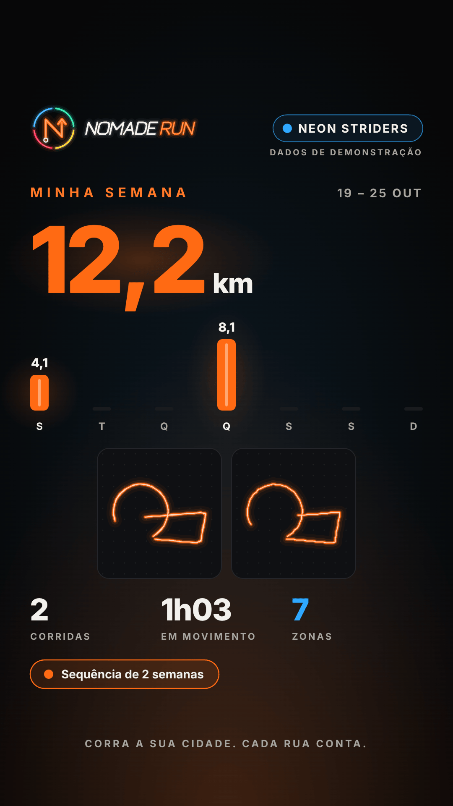

# E8 — Social e compartilhamento · Onda 3 (arte real, "Bora!" da E5, aplausos ao vivo e recap)

> Equipe E8 · Fase 7, F4, onda 3 · 2026-10-28 · tarefa **T7.3.7** do `PLANO-MESTRE.md`
> Branch `worktree-agent-af1493504e3ba74b8`, sobre o WIP salvo pelo coordenador e o merge de `claude/affectionate-gauss-e8gm77` (E9, E6a e E7). Sem push.

## 0. Resumo

- **Arte real no card:** `mascotSlot`/`bossSlot` da E4 viram a arte padrão de todos os modelos (os marcadores provisórios saíram). O logotipo de texto virou `LogoSvgArt variant="horizontal"`, com o @ sob o logotipo e a pílula do time alinhada ao símbolo. O adesivo usa `LogoSvgArt variant="logotipo"`, com sombra. O mascote ficou maior no "Nível novo" (230 px, saindo do anel) e na "Rota protegida" (210 px).
- **"Bora!" da E5:** `BoraReaction` nas 3 reações do feed (Bora!, Fogo, Raio). O momento provisório da E8 (faíscas + "+1") saiu.
- **Realtime dos aplausos:** `subscribeKudos` (`postgres_changes` em `kudos`, RLS na assinatura). O aplauso de outra pessoa soma na hora, e 1,5 s depois da última mudança os contadores são conferidos com o `crew_feed`. Na demonstração, a reação da pessoa sai pelo canal e um colega aplaude ao vivo a corrida mais recente cerca de 4 s depois de abrir o feed (uma vez). O `crew_feed` seguinte conta igual.
- **Recap semanal (modelo 5):** a tela `/compartilhar/semana?inicio=AAAA-MM-DD` usa a Edge Function `weekly-recap` da E9. As rotas já vêm cortadas no servidor e entram no card por um **adaptador** (`ownRouteFromServer` → `CardRoute`), **sem cortar de novo**. Com servidor antigo (404), o recap é montado das próprias corridas e cortado no aparelho. Para a E6a e a E7: `<RecapButton>` e `recapHref()`.
- **Telemetria:** `trackTelemetry('share')` no `onShared` do compartilhar e do recap (opt-in da E7, sem propriedades).

## 1. Evidência (PNG gerado pelo app na web, modo demonstração)

Export `EXPO_PUBLIC_DEMO=1 npx expo export -p web --clear` → `E8/capturar-onda3.cjs` (Playwright, Chromium, 390 px). O script toca no botão do app e salva o **download que o próprio app gera** (`share-image.web.ts`). Os PNGs foram comprimidos com `pngquant --quality=85-98`. Resultado: **0 erros de página e 0 pedidos de rede para fora** (`E8/onda3/relatorio.json`). Abri cada PNG e corrigi o que ficou ruim na 1ª rodada (ver a crítica abaixo).

| Arquivo | O que mostra |
|---|---|
| [`app-01-chefao-derrotado-stories.png`](E8/onda3/app-01-chefao-derrotado-stories.png) · [`app-chefao-derrotado-feed.png`](E8/onda3/app-chefao-derrotado-feed.png) | `bossSlot('mormaco', 'derrotado', 2)` + logo da E4 |
| [`app-02-nivel-novo-stories.png`](E8/onda3/app-02-nivel-novo-stories.png) | `mascotSlot` (Lume, vitória) saindo do anel, 230 px |
| [`app-03-conquista-de-zona-stories.png`](E8/onda3/app-03-conquista-de-zona-stories.png) | Conquista de zona |
| [`app-04-corrida-stories.png`](E8/onda3/app-04-corrida-stories.png) | Corrida (rota cortada no aparelho) |
| [`app-05-minha-semana-stories.png`](E8/onda3/app-05-minha-semana-stories.png) · [`-feed`](E8/onda3/app-05-minha-semana-feed.png) · [`-sem-rotas`](E8/onda3/app-05-minha-semana-sem-rotas-stories.png) | **Recap semanal**: mini-rotas cortadas no servidor de demonstração (`weekly-recap`) |
| [`app-corrida-sem-rota-stories.png`](E8/onda3/app-corrida-sem-rota-stories.png) | "Rota protegida" com o mascote da E4 em destaque |
| [`app-adesivo.png`](E8/onda3/app-adesivo.png) | Adesivo com `LogoSvgArt variant="logotipo"` e sombra |
| [`tela-semana-390.png`](E8/onda3/tela-semana-390.png) | A tela `/compartilhar/semana` |
| [`feed-antes-ao-vivo-390.png`](E8/onda3/feed-antes-ao-vivo-390.png) → [`feed-ao-vivo-390.png`](E8/onda3/feed-ao-vivo-390.png) | **Aplauso ao vivo**: a corrida mais recente foi de "2 aplausos" para "3 aplausos" sem recarregar (Realtime de demonstração, cerca de 4 s) |
| [`feed-bora-e5-390.png`](E8/onda3/feed-bora-e5-390.png) | `BoraReaction` da E5 logo depois do toque ("Mandar Bora! (aplauso), 1" → "Tirar Bora!, 2") |

**Crítica da 1ª rodada, e o que mudou:**
- **Recap (Stories):** o "MINHA SEMANA" encostava no logo novo. Desceu 40 px.
- **Recap (Feed):** sobrava um terço vazio embaixo e a ficha da sequência sumia. Agora as barras e as mini-rotas são maiores, a ficha aparece e, com menos de 3 rotas, elas ficam centralizadas.
- **Chefão:** a arte da E4 tem folga em volta e o Mormaço lia pequeno. A caixa passou de 2R para 2,5R.
- **Selo duplicado:** o selo "Demonstração" das telas da E8 (compartilhar, semana, feed) repetia o selo global (`DemoSeal`, na raiz) e quebrava o título em 2 linhas. Saiu das 3 telas; o card continua com o selo dele.

## 2. Arquivos

**App** (`apps/mobile/src/`):
- `features/social/card/`:
  - `card-art.tsx`: arte padrão da E4 (`defaultMascot`, `defaultBoss`, `bossIdOf`, `cardArtFor`). Os marcadores saíram;
  - `card-frame.tsx`: logo da E4 (`CARD_LOGO`, `cardLogoLayout`);
  - `card-route.ts` (novo): `CardRoute = SharedRoute | OwnServerRoute`, `ownRouteFromServer`, `isCardRoute`;
  - `card-sizes.ts` (novo): medidas puras (`CARD_FORMATS`, `STICKER_SIZE`), para quem não precisa carregar a arte;
  - `moment-cards.tsx`, `run-cards.tsx`, `sticker-card.tsx`, `card-parts.tsx` (o `Wordmark` provisório saiu), `route-geometry.ts`, `card-model.ts`, `index.ts`.
- `features/social/share/card-art-e4.tsx`: **removido** (virou `card/card-art.tsx`).
- `features/social/share/share-screen.tsx`: `trackTelemetry('share')`, sem o selo duplicado. `feed/crew-feed-screen.tsx`: idem. `share-flow.ts`, `share-image.web.ts`: imports puros.
- `features/social/feed/`:
  - `reaction-bar.tsx`: `BoraReaction`;
  - `use-crew-feed.ts`: Realtime e `live`;
  - `feed-model.ts`: `applyKudosChange`, `mergeKudos`, `KUDOS_SYNC_MS`.
- `features/social/recap/` (novo): `recap-model.ts` (puro), `use-weekly-recap.ts`, `recap-screen.tsx`, `recap-button.tsx`, `index.ts`.
- `app/compartilhar/semana.tsx` (nova rota).
- `services/api/`:
  - `feed-repo.ts`: `subscribeKudos`, `toKudosChange`;
  - `recap-repo.ts` (novo): `getWeeklyRecap` → `POST /weekly-recap`;
  - `functions.ts`: **1 linha** (`'weekly-recap'` no `FunctionName`);
  - `demo/social.ts`: Realtime de `kudos`, aplauso ao vivo, `weeklyRecapDemo`;
  - `demo/functions.ts`: **2 linhas** (o import e o par `'weekly-recap'`).

**Testes novos:** `recap/__tests__/recap-model.test.ts` (13), `recap/__tests__/recap-screen.test.tsx` (3), `feed/__tests__/kudos-live.test.ts` (7), `services/api/demo/__tests__/social-onda3.test.ts` (4). Atualizados: `share-card.test.tsx` (+4: arte da E4, chefão desconhecido, `bossIdOf`, logo na área segura), `crew-feed.test.tsx`, `demo-stamp.test.tsx`, `share-flow.test.ts`, `share-input.test.ts` (só imports e as asserções da arte nova).

**Relatório:** este arquivo, `E8/onda3/*.png`, `E8/onda3/relatorio.json` e `E8/capturar-onda3.cjs`.

## 3. Testes (em `apps/mobile`)

| Verificação | Resultado |
|---|---|
| `npm run typecheck` | ok, 0 erros |
| `./node_modules/.bin/eslint src` | 0 erros, 0 avisos |
| `npx jest --silent --maxWorkers=2` (app inteiro, 1 vez no fim) | **119 suítes passaram** e 4 foram puladas (já eram). **1.344 testes passaram** e 26 foram pulados (já eram). 0 falhas |
| `demo-contract.test.ts` | verde: `weekly-recap` tem par; o `rpc('weekly_recap')` não é usado e não tem par órfão |
| `testids.test.ts` | verde: todo interativo novo tem `testID` e rótulo |

**O que os testes novos garantem:**
- **Privacidade:**
  - propriedade com 200 casos: no recap local, nenhum ponto das mini-rotas fica dentro de zona de privacidade;
  - sem as zonas, sai sem rotas e com aviso;
  - na demonstração, as rotas do `weekly-recap` ficam fora das zonas da conta e têm ≤ 80 pontos;
  - um objeto montado à mão não vira rota de card;
  - o **único** chamador de `ownRouteFromServer` é o `recap-model.ts` (varredura do `src`).
- **Arte:**
  - sem `art` por props, o card usa `MascotSvgArt`/`BossSvgArt` (`mormaco`, `derrotado`, dano 2);
  - chefão desconhecido vira o mascote, não um chefão errado;
  - nenhum `<Image>`;
  - o logo é `LogoSvgArt` horizontal, sem texto "NOMADE";
  - o símbolo fica na área segura dos Stories e o @ não cai sobre ele.
- **Aplausos ao vivo:**
  - propriedade com 300 sequências: o total só sobe 1 por `INSERT` de outra pessoa e nunca fica negativo;
  - a minha reação não conta 2 vezes;
  - a conferência não mexe em item com reação a caminho;
  - na demonstração: `INSERT`/`UPDATE`/`DELETE` pelo canal, e o aplauso ao vivo acontece 1 vez e o `crew_feed` conta igual.
- **Recap:** semana de segunda a domingo (inclusive na virada do ano), leitura tolerante, recap local só com corridas pontuadas, legenda sem hora, tela no modo demonstração (card, chaves, exportação, semana vazia) e o `<RecapButton>`.

## 4. Contrato com a E9 (alinhado)

| O app usa | Observação |
|---|---|
| `POST /weekly-recap { weekStart? }` | `toWeeklyRecap` lê `weekStart`, `weekEnd`, `final`, `days[7]`, `meters`, `runs`, `movingSeconds`, `zones`, `streakWeeks`, `isDemo` e `routes[].pieces` (precisão 4). `routeHidden` é ignorado (o card sempre trata a ponta como escondida). Campo estranho vira o neutro. |
| 404 (`NOT_AVAILABLE` ou function inexistente) | `RECAP_UNAVAILABLE`: recap local (`listMyActivities` da semana + `getActivityPath` das 3 mais longas, cortadas no aparelho com as zonas e semente nova; sem as zonas, sem rotas e com aviso). |
| `rpc('weekly_recap')` | **não usado** (sem rotas). Não tem par de demonstração: o teste de contrato não aceita par órfão. |
| Realtime `kudos` | `channel('kudos-N').on('postgres_changes', { event: '*', table: 'kudos' })`. `INSERT` com `feed_item_id`, `user_id` e `reaction`. Em `UPDATE`/`DELETE` o app não depende da linha antiga: ele só confere os contadores. |

**Adaptador da rota (decisão para virar D-xx):** o `SharedRoute` continua só do `clipRouteForSharing` local (domain intocado). O card passa a aceitar `CardRoute = SharedRoute | OwnServerRoute`. O `OwnServerRoute` é um tipo nominal com registro próprio e nasce **só** de `ownRouteFromServer`, a partir das polylines do `weekly-recap` da própria pessoa. Um teste confere que o único chamador é o `recap-model.ts`: a rota do feed, de outra pessoa, nunca vira card. Objeto montado à mão não passa por `isCardRoute`.

## 5. O que a E6 (e a E7) encaixa

- **E6a, tela Atividades:** `import { RecapButton } from '@/features/social/recap'`, depois `<RecapButton />` (semana atual; se ela estiver vazia, a anterior) ou `<RecapButton weekStart="2026-10-19" />`. O `testID` padrão é `atividades-semana`.
- **E6, `_layout.tsx`:** registrar `compartilhar/semana` dentro do guard `app`, com `presentation: 'modal'`, junto de `compartilhar/[id]` e `compartilhar/feed`.
- **E7, notificação do recap:** `reminderRoute('recap')` hoje leva a `/recompensas`. Trocar por `recapHref(semanaQueAcabou)` (`@/features/social/recap`).
- **Clube (E6):** o `<CrewFeed>` não mudou de props. O hook expõe `live` (canal assinado), se quiserem um selo "ao vivo".

## 6. Pendências e riscos

- **Pedidos:**
  - **E6/E6a:** encaixes da §5 e o registro de `compartilhar/semana` no `_layout`;
  - **E7:** `reminderRoute('recap')` → `recapHref(...)`;
  - **E10:** o `DemoDb.emit` só tipa `zones | notifications`. A E8 manda `kudos` com um cast em `demo/social.ts`. Pode alargar o tipo quando quiser. Incluir `/compartilhar/semana` no `capturas.cjs`.
- **Coordenador:** 3 linhas fora da minha pasta, todas nos índices: `services/api/functions.ts` (`'weekly-recap'`) e `services/api/demo/functions.ts` (o import e o par).
- **Riscos:**
  - **Nada testado em aparelho:** `toDataURL` com a arte da E4 (muitos `<G>` com `transform`) só rodou na web. No Android médio, medir o tempo de geração do card com mascote e logo (a E4 estima ~300 elementos no completo).
  - **Realtime real:** a política de `kudos` vale na assinatura, mas o `DELETE` do Postgres não passa pela RLS do mesmo jeito. O app não usa a linha antiga, só confere com o `crew_feed`, então nada vaza na tela. A E9 confere a publicação de `kudos`.
  - **Mini-rotas da demonstração iguais:** as 2 corridas da semana usam a mesma volta do mundo de demonstração. No servidor real, cada uma é a sua.
