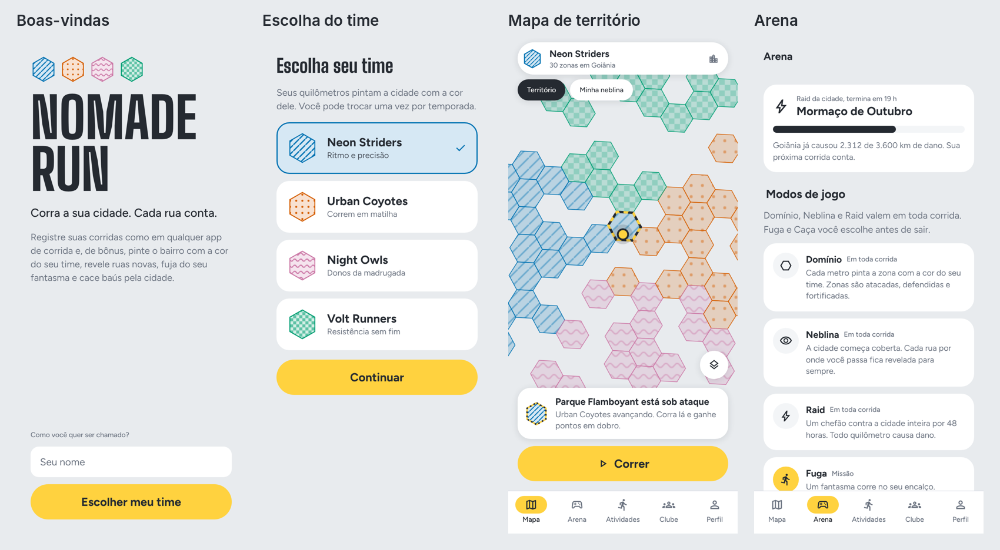
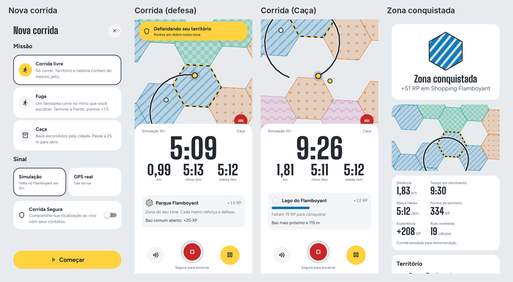
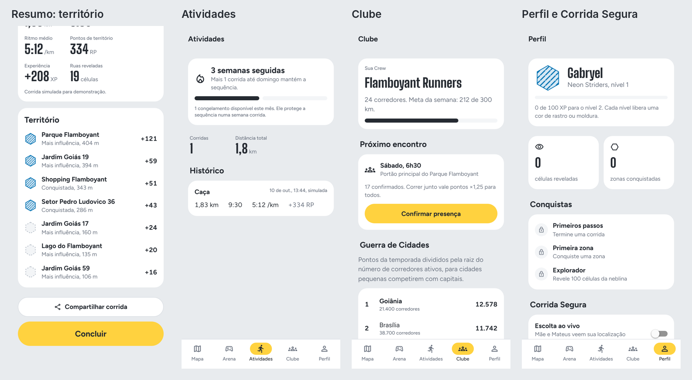

# NOMADE RUN — Product Book v1.0

**Corra a sua cidade. Cada rua conta.**

Documento de produto do NOMADE RUN: estratégia, jogo, experiência, design, arquitetura e plano. Resultado da execução do prompt mestre (`docs/05-PROMPT-MESTRE.md`) sobre a pesquisa em `docs/pesquisa/`.

Autores: Gabryel Gomes Bahmad Camapum e Mateus Augusto De Faria Brito · Versão 1.0 · 10/10/2026

---

## Sumário executivo

O Brasil tem **15 milhões de corredores de rua** e é o segundo maior mercado do Strava, mas o Strava cobra cada vez mais por recursos básicos e quase não tem jogo: só segmentos e medalhas. Os apps de território que surgiram desde 2024 provaram que existe fome por isso. O INTVL, por exemplo, teve 2,5 milhões de downloads. Só que eles premiam volume: quem corre loops gigantes domina o mapa e o iniciante desiste.

O **NOMADE RUN** junta três coisas que ninguém entrega juntas:

1. **Um app de corrida completo e generoso.** A gravação, as estatísticas, a retrospectiva anual e a Corrida Segura são grátis para sempre.
2. **Uma Arena de minigames sobre o mapa real.** O território (Domínio) é um dos sete modos, e **toda corrida conta, mesmo sem escolher modo nenhum**.
3. **Competição justa.** A pontuação usa **esforço relativo**, há ligas por nível e a disputa de território vai do bairro até **cidade contra cidade**.

**North Star:** corredores que correm 2 ou mais vezes por semana. **MVP do TCC:** núcleo de corrida, Domínio, Neblina, Fuga e Caça, ranking e Corrida Segura, com as regras de negócio 100% cobertas por testes unitários.

---

## 1. Ideação (Fase 2)

*Chapéus: Game Designer e CPO · Skills: `brainstorming`, `gamification-loops`.*

Partimos de uma pergunta da skill `brainstorming`: "por que alguém corre?". As respostas na pesquisa foram saúde, cabeça livre, pertencer a um grupo, se superar e conhecer a cidade. Toda ideia abaixo precisa servir a pelo menos uma delas, e não só ao placar.

**Matriz de avaliação** (1 a 5; o total soma diversão, retenção e as notas invertidas de esforço e risco, para que o mais fácil e seguro some mais):

| # | Ideia | Diversão | Retenção | Esforço | Risco | Total | Decisão |
|---|---|---|---|---|---|---|---|
| 1 | Domínio: território H3 por facção | 5 | 5 | 3 | 2 | 15 | **Arena (MVP)** |
| 2 | Neblina: revelar o mapa correndo (fog of war pessoal) | 4 | 5 | 2 | 1 | 16 | **Arena (MVP)** |
| 3 | Fuga: escapar de um fantasma (seu recorde, um amigo ou o dono da zona) | 5 | 4 | 2 | 1 | 16 | **Arena (MVP)** |
| 4 | Caça: baús e tesouros no mapa | 4 | 4 | 2 | 2 | 14 | **Arena (MVP)** |
| 5 | Raid: chefão coletivo da cidade em 48 h | 4 | 4 | 2 | 1 | 15 | **Arena (v1.0)** |
| 6 | Rabisco: arte GPS com forma da semana | 4 | 3 | 3 | 2 | 12 | **Arena (v1.0)** |
| 7 | Bandeira: capture the flag ao vivo entre equipes | 5 | 3 | 4 | 3 | 11 | **Arena (v2, eventos)** |
| 8 | Liga do Bairro semanal com promoção e rebaixamento | 3 | 5 | 2 | 1 | 15 | **Estrutura competitiva** |
| 9 | Guerra de Cidades (placar normalizado) | 4 | 4 | 2 | 2 | 14 | **Estrutura competitiva** |
| 10 | Rei do Trecho: coroa de 7 dias por segmento | 4 | 4 | 3 | 2 | 13 | **v1.0** |
| 11 | Corrida Segura: Escolta ao vivo, SOS, alerta de parada | 2 | 5 | 3 | 2 | 12 | **Diferencial (MVP)** |
| 12 | Guia: coach por voz que narra treino e jogo | 4 | 4 | 3 | 2 | 13 | **Diferencial (v1.0)** |
| 13 | Encontros de clube com check-in e multiplicador | 4 | 5 | 2 | 2 | 15 | **Diferencial (v1.0)** |
| 14 | Prova Conectada: percurso de prova vira evento | 4 | 3 | 3 | 3 | 11 | v2 |
| 15 | Drop Relâmpago (janela de 15 min para todos) | 4 | 3 | 1 | 3 | 13 | Evento da Caça |
| 16 | Revezamento assíncrono em equipe | 3 | 4 | 2 | 2 | 13 | v2 |
| 17 | Missões em áudio com história da cidade | 5 | 4 | 4 | 2 | 13 | v2 (conteúdo) |
| 18 | Ritmo no Beat (cadência na batida) | 3 | 2 | 4 | 3 | 8 | Descartada por ora |
| 19 | Parceiros locais: zona patrocinada com cupom | 3 | 3 | 3 | 3 | 10 | Monetização v1.0 |
| 20 | Mapa social "quem está correndo agora" (com atraso) | 3 | 3 | 3 | 4 | 9 | Só para amigos (v2) |
| 21 | Esforço relativo na pontuação | 3 | 5 | 1 | 1 | 16 | **Regra do Domínio** |
| 22 | Sequência semanal com congelamento | 3 | 5 | 1 | 1 | 16 | **Progressão** |
| 23 | Avatar nômade com mochila de cosméticos | 4 | 3 | 3 | 1 | 13 | v1.0 |
| 24 | Passe de temporada cosmético | 3 | 4 | 2 | 2 | 13 | Monetização v1.0 |
| 25 | Retrospectiva anual grátis | 3 | 3 | 2 | 1 | 13 | **Núcleo** |
| 26 | Recap animado para Stories | 4 | 3 | 2 | 1 | 14 | **MVP (imagem)** |
| 27 | Planos de treino (5 km, 10 km, 21 km) | 2 | 4 | 3 | 2 | 11 | Nômade+ v1.0 |
| 28 | Rotas iluminadas e movimentadas à noite | 2 | 4 | 4 | 3 | 9 | v2 (dados abertos) |
| 29 | Ligas corporativas (B2B) | 2 | 3 | 2 | 2 | 11 | Monetização v2 |
| 30 | Duelo 1×1 de território entre amigos | 4 | 3 | 2 | 2 | 13 | v1.0 (lobby privado) |
| 31 | Modo Caminhada com liga própria | 2 | 4 | 1 | 1 | 14 | v1.0 (inclusão) |
| 32 | Desafios de prova em AR | 3 | 2 | 5 | 3 | 7 | Descartada |

**Escolhas:**
- **Arena:** Domínio, Neblina, Fuga, Caça, Raid, Rabisco e Bandeira.
- **Diferenciais fora do jogo:** Corrida Segura, Guia (coach por voz) e Encontros de clube.
- **Estruturas competitivas:** Liga do Bairro e Guerra de Cidades.

**Decisões e porquês.** O Game Designer queria a Bandeira no MVP, por ser o modo mais divertido. O Tech Lead foi contra: ela exige tempo real com GPS de cerca de 10 m e vários jogadores no mesmo lugar e na mesma hora, algo difícil de testar com dois desenvolvedores. **Decisão:** a Bandeira fica para v2, como evento de clube.

---

## 2. Estratégia de produto (Fase 3)

*Chapéus: CEO, CPO e Growth · Skills: `prd-writing`, `aso`.*

### 2.1 Visão, manifesto e posicionamento
- **Visão:** transformar cada corrida na cidade em uma partida que vale a pena jogar de novo amanhã, ou semana que vem.
- **Manifesto:** a cidade é grande demais para ser só um trajeto. No NOMADE RUN, sua corrida da manhã pinta o bairro com a cor do seu time, revela ruas que você nunca viu, foge de um fantasma e ajuda a cidade inteira a derrubar um chefão. E se você só quiser correr em paz, tudo bem: o app registra sua corrida tão bem quanto qualquer outro e nunca te pune por descansar.
- **Posicionamento:**
  - **Contra o Strava:** "o Strava mede sua corrida; o NOMADE RUN dá um motivo para ela".
  - **Contra o INTVL:** "território justo: quem corre 3 km com esforço compete com quem corre 30 km".

### 2.2 Personas
| Persona | Rotina | Dor | O que a faz ficar |
|---|---|---|---|
| **Júlia, 24, Goiânia**, estudante de design | Corre 3×/semana com um run club no Parque Flamboyant | Tem medo de correr sozinha à noite e se entedia com o mesmo percurso | Corrida Segura grátis, Neblina para descobrir ruas novas e a Crew do clube |
| **Rafael, 34, Brasília**, analista de dados | Corre 40 km/semana, assina o Strava, faz provas de 21 km | Os números não motivam mais; o placar de segmentos é sempre dos mesmos | Domínio, Rei do Trecho, Liga do Bairro e Guerra de Cidades |
| **Marcos, 41, Anápolis**, pai de dois filhos | Corre 2×/semana às 5h30, por 30 minutos | Pouco tempo; sente que nunca vai competir com ninguém | Esforço relativo, Fuga contra o próprio recorde e sequência semanal que respeita o descanso |

### 2.3 Proposta de valor, métricas e não-objetivos
- **Proposta de valor:** "Registre sua corrida como no melhor app de corrida e, de bônus, jogue a sua cidade."
- **North Star Metric:** corredores ativos semanais com **2 ou mais corridas válidas** na semana.
- **Métricas de apoio:**
  - retenção D30;
  - % de corridas com ao menos um evento de jogo (zona afetada, área revelada ou missão cumprida);
  - convites aceitos e entradas em Crews.
- **Contra-métricas** (se subirem, algo está errado):
  - % de usuários que desativam notificações;
  - taxa de atividades reprovadas pelo antifraude;
  - relatos de "me sinto obrigado a correr".
- **Pilares:** Esporte (núcleo de corrida), Arena (jogo), Clube (social), Escolta (segurança) e Guia (coach).
- **Não-objetivos:**
  - não somos app de ciclismo nem de academia;
  - não fazemos diagnóstico de saúde;
  - não incentivamos correr todos os dias;
  - não vendemos vantagem no jogo;
  - não mostramos a posição ao vivo de desconhecidos.

### 2.4 Monetização (não é pay-to-win)
| Produto | Preço | O que inclui |
|---|---|---|
| **Grátis para sempre** | R$ 0 | Gravação, estatísticas, segmentos, todos os modos da Arena, Corrida Segura com 5 contatos e retrospectiva anual |
| **Nômade+** | R$ 12,90/mês ou R$ 99/ano, via Pix (50% de desconto para estudante) | Análises avançadas, planos de treino, Guia ilimitado, lobbies privados de Domínio, mapa de calor pessoal e Rabisco livre |
| **Passe de Temporada** | R$ 14,90 por temporada | Só cosméticos: cores de rastro, efeitos de conquista, molduras e skins do avatar |
| **Zonas patrocinadas (B2B)** | Contrato | Cafés e lojas patrocinam uma zona e o dono semanal ganha cupom; as marcas também podem patrocinar Raids |

### 2.5 Loja de aplicativos (skill `aso`)
- **Nome (29 de 30 caracteres):** NOMADE RUN: Corra e Conquiste
- **Subtítulo (30 de 30 caracteres):** Corrida GPS com jogo na cidade
- **Screenshots, na ordem:**
  1. O mapa vivo da cidade com territórios ("Sua corrida pinta o bairro").
  2. A Arena com os 7 modos ("Escolha seu jogo antes de sair").
  3. O resumo com a zona conquistada ("Cada rua conta").

---

## 3. Arena: game design detalhado (Fase 4)

*Chapéus: Game Designer, Backend/Geo e QA · Skills: `gamification-loops`, `md-skill-tree-architect`, `sharp-edges`.*

### 3.1 Princípio: toda corrida conta
A Arena tem **camadas passivas** e **missões**:
- As **camadas passivas** (Domínio, Neblina e Raid) funcionam em qualquer corrida, até numa "corrida livre".
- As **missões** (Fuga, Caça e Rabisco) são escolhidas antes de sair, uma por corrida.
- Os **eventos** (Bandeira e Drop Relâmpago) acontecem em datas marcadas.

Quem só quer correr nunca é obrigado a jogar. Quem quer jogar sempre tem algo em jogo.

### 3.2 Domínio: território
- **Fantasia:** "pinte o bairro com a cor do seu time."
- **Como funciona:**
  - Grade H3 com zonas em **resolução 9** (~0,1 km², ~174 m de lado), as mesmas da ERS v1.0.
  - Agregação em **resolução 7** (distrito) para o título de Prefeito e para o mapa em zoom afastado.
- **Pontuação (proposta RN-001 v2, com esforço relativo):**
  `RP = metros válidos × 0,1 × M_esforço × M_sequência × M_fantasma × M_grupo × M_defesa`
  - `M_esforço = clamp(ritmo_base ÷ ritmo_atual, 0,8; 1,3)`.
    - `ritmo_base` é a mediana do ritmo do próprio usuário nas últimas 10 corridas válidas.
    - Sem histórico, vale 6:00 min/km.
    - Assim, correr no seu limite vale tanto para um iniciante quanto para um atleta.
  - Os demais multiplicadores e o teto de 300 RP por usuário, zona e dia permanecem como na ERS v1.0.
- **Regras mantidas da ERS v1.0:**
  - conquista com histerese: **≥ 30 RP para conquistar uma zona neutra** (RN-002 v2, seção 9.3) e ≥ 110% do dono para tomar;
  - sob ataque a partir de 50% da influência do dono, com 24 h de defesa e pontos em dobro para quem defende;
  - escudo de 3 níveis;
  - decaimento diário de 10%;
  - temporada mensal (influência × 0,30 no reset);
  - Prefeito do distrito.
- **No mapa:**
  - Cada zona é um hexágono com preenchimento de 25–30% de opacidade na cor da facção e **um padrão de hachura exclusivo de cada facção**, para que daltônicos também distingam os times.
  - Zonas sob ataque ganham contorno em **faixa de sinalização** (amarelo e asfalto alternados, como fita de obra).
- **Notificação:** no máximo 1 alerta por zona a cada 6 h e no máximo 5 por dia.
- **Antifraude:** o completo (seção 3.10).
- **Para não desmotivar iniciantes:**
  - esforço relativo;
  - teto diário por zona;
  - ligas por nível na Liga do Bairro;
  - o decaimento impede que alguém domine para sempre.

### 3.3 Neblina: exploração
- **Fantasia:** "a cidade está coberta de névoa; correr revela."
- **Como funciona:**
  - É uma camada **pessoal**.
  - Usa células H3 de **resolução 10** (~15.000 m²). Cada célula por onde o usuário passa a menos de 30 m é revelada para sempre.
  - O perfil mostra "% do seu bairro revelado" e "% da cidade revelada".
- **Recompensas:**
  - 10 XP por célula nova;
  - medalhas de bairro completo (80% revelado);
  - medalha "Nômade" por correr em 1, 5 e 10 cidades.
- **Por que retém:** é completismo puro e incentiva a variar o percurso, o que também é bom para a saúde, porque evita a monotonia.
- **No mapa:** névoa cinza translúcida sobre as áreas não reveladas. Ela só aparece no filtro "Minha Neblina", nunca por padrão, para não poluir o mapa.

### 3.4 Fuga: o fantasma
- **Fantasia:** "algo está te seguindo, e é você mesmo da semana passada."
- **Como jogar:** antes de sair, o usuário escolhe o perseguidor:
  - o **próprio recorde** em uma distância;
  - um **amigo**;
  - o **dono da zona** em que está;
  - um **ritmo-alvo**.
- **Regras:**
  - O fantasma corre no ritmo escolhido.
  - O app mostra a distância até ele a cada segundo.
  - Se o fantasma chegar a **0 m** de diferença, o usuário é "pego", mas a corrida continua e ele pode recuperar.
  - Terminar à frente dá **multiplicador ×1,5 de RP** nas zonas do trecho (o M_fantasma da RN-001) e 50 XP.
- **Áudio:** o Guia avisa a cada 100 m de diferença ("O fantasma está a 40 metros"), sem alarme estridente.
- **Esforço técnico:** baixo. Roda localmente, sem servidor.

### 3.5 Caça: tesouros
- **Fantasia:** "a cidade está cheia de baús escondidos."
- **Como funciona:**
  - Todos os dias, o servidor sorteia de 5 a 8 baús por usuário num raio de 3 km da última corrida.
  - Os baús ficam **sempre em ruas e parques** e nunca em zonas bloqueadas.
  - Passar a menos de **25 m** de um baú abre o baú.
- **Raridade:** comum (70%, 20 XP), raro (25%, 60 XP e uma peça cosmética) e lendário (5%, 150 XP, uma peça exclusiva e geralmente a mais de 2 km).
- **Drop Relâmpago (evento):**
  - Uma notificação diz "Baús lendários na cidade pelos próximos 15 minutos".
  - Acontece no máximo **1 vez por semana**, sempre num horário anunciado no dia anterior, para não virar FOMO.
- **Antifraude:** precisa de passagem física a 25 m com cadência compatível. O mesmo baú não pode ser aberto de novo.

### 3.6 Raid: o chefão da cidade
- **Fantasia:** "um monstro tomou conta da cidade; só todo mundo junto derruba."
- **Como funciona:**
  - Durante 48 h, a cidade enfrenta um chefão com **vida igual a 1 km × 30% dos corredores ativos** da cidade.
  - Cada km válido de qualquer pessoa da cidade causa dano.
  - Barra de vida coletiva, ranking de Crews por dano e todos os participantes ganham a recompensa.
- **Por que retém:** é cooperação pura. O iniciante ajuda tanto quanto pode e nunca fica para trás.
- **Esforço técnico:** baixo. É um contador agregado no servidor.

### 3.7 Rabisco: arte GPS
- **Fantasia:** "desenhe na cidade com o seu percurso."
- **Como funciona:**
  - Toda semana sai uma forma (coração, raio, número, logo da facção).
  - O usuário corre tentando desenhar a forma no mapa.
  - O app compara o percurso com a forma (normaliza escala e rotação e calcula a distância média entre as curvas) e dá uma nota de 0 a 100.
- **Recompensas:** acima de 70 pontos, medalha da semana e 80 XP. As melhores artes aparecem num mural da cidade, com curtidas.
- **Segurança:** a forma nunca exige atravessar zona bloqueada.

### 3.8 Bandeira (v2, eventos de clube)
- **Fantasia:** capture the flag no bairro.
- **Como funciona:**
  - Duas equipes, cada uma com uma bandeira virtual na sua base.
  - Pegar a bandeira do rival exige chegar a 15 m dela e voltar à própria base sem ser "interceptado": um adversário a menos de 20 m, com GPS ao vivo.
  - Partidas de 30 a 45 minutos, criadas por clubes, com local e hora marcados.

### 3.9 Estruturas competitivas
- **Liga do Bairro:**
  - Grupos semanais de 30 corredores **com volume parecido**.
  - Os 5 primeiros sobem de divisão e os 5 últimos descem.
  - Divisões: Calçada, Rua, Avenida, Rodovia (só no nome!) e Maratona.
  - Pontuação por RP e XP da semana.
- **Guerra de Cidades:**
  - Placar da RN-013: soma de RP ÷ √corredores ativos, com mínimo de 20 corredores.
  - A cidade campeã da temporada ganha a medalha coletiva "Capital Nômade".
- **Rei do Trecho (v1.0):** segmentos com coroa que dura 7 dias e placares por faixa (iniciante, intermediário, avançado e por idade).

### 3.10 Antifraude consolidado
| Camada | Regra |
|---|---|
| Velocidade | Ponto acima de 40 km/h invalida o trecho; média acima de 25 km/h por mais de 30 s invalida o trecho |
| Salto de posição | Deslocamento maior que 50 m em até 1 s |
| Localização simulada | `isFromMockProvider` (Android) e App Attest/DeviceCheck (iOS) rejeitam a atividade |
| Sensores | Entre 8 e 20 km/h, a cadência precisa ficar entre 120 e 220 ppm; abaixo de 60 ppm por mais de 60 s invalida o trecho |
| Integridade | Lotes assinados com HMAC-SHA256, sequência contínua e reenvio idempotente |
| Reputação | Índice de Confiança (RN-009); abaixo de 40, a atividade vai para revisão humana |
| Pós-processamento | Modelo no servidor só para o topo dos placares; **shadow-ban** em vez de banimento visível |
| Desenho do jogo | Teto diário, decaimento e esforço relativo, que reduzem o incentivo a trapacear |

### 3.11 Economia e progressão
- **XP:** vem de corridas válidas (1 XP por 100 m), células reveladas, missões e eventos.
- **Níveis:** 1 a 50, com curva suave (nível n exige 100 × n¹·⁵ XP). **Cada nível desbloqueia algo real**: cor de rastro, moldura, emote do avatar ou slot de Crew.
- **Moeda:** não existe moeda comprável. "Selos" são ganhos só jogando e trocados por cosméticos comuns.
- **Sequência semanal:**
  - A semana conta se o usuário fizer **2 corridas válidas**.
  - Há **1 congelamento grátis por mês**.
  - Marcos de 4, 12, 26 e 52 semanas.
  - Nunca há sequência diária.
- **Árvore de conquistas** (validada com `md-skill-tree-architect`: sem pré-requisitos circulares e com critério objetivo em cada nó):
  - **Primeiros Passos:** primeira corrida → primeira zona → primeira defesa.
  - **Explorador:** 100 células → bairro completo → 5 cidades.
  - **Tático:** vencer 5 fantasmas → Prefeito de distrito.
  - **Comunidade:** entrar numa Crew → 3 Encontros → Raid vencido.

### Skills aplicadas: Arena
- **`gamification-loops`:**
  - "Can user disengage without penalty?" → sequência semanal com congelamento, nenhuma punição por descanso.
  - "Competition demotivates majority" → ligas por volume e esforço relativo.
  - "Easily gamed mechanics" → recompensa por resultado validado e teto diário.
  - "Notification spam" → no máximo 1 alerta por evento e Drop Relâmpago 1 vez por semana, anunciado com antecedência.
- **`md-skill-tree-architect`:** cada conquista desbloqueia algo, tem critério objetivo e não há ciclo de pré-requisitos.
- **`sharp-edges`:** no antifraude, o caminho fácil precisa ser o seguro. O servidor recalcula tudo e rejeita lotes sem assinatura (*fail-closed*).

---

## 4. Experiência (Fase 5)

*Chapéus: Head de Design e CPO · Skills: `expo-router`, `expo-native-ui`, `expo-ui`.*

### 4.1 Arquitetura de informação (5 abas nativas)
| Aba | O que vive nela |
|---|---|
| **Mapa** | Mapa vivo com territórios, botão Correr, filtros (Território, Neblina, Baús, Calor) e detalhe da zona em folha nativa |
| **Arena** | Os 7 modos com regra resumida, eventos da semana, Raid da cidade e Liga do Bairro |
| **Atividades** | Histórico, feed de amigos e Crew, estatísticas e retrospectiva |
| **Clube** | Crew, Encontros, ranking de Crews e Guerra de Cidades |
| **Perfil** | Avatar, nível, conquistas, Neblina revelada, Corrida Segura e ajustes |

A **Corrida** abre como tela cheia (modal nativo) a partir do botão Correr. O **Resumo** abre em seguida, na mesma pilha.

### 4.2 Fluxos principais
1. **Onboarding (4 passos):**
   1. Boas-vindas com o mapa da cidade aparecendo.
   2. Escolha da facção.
   3. **Priming de localização "durante o uso"**, com o motivo: "para desenhar seu percurso e saber em que zona você está".
   4. Notificações, opcional: "avisamos quando seu território estiver sob ataque — no máximo uma vez por zona a cada 6 h".
   - O pedido de "sempre" só aparece depois da primeira corrida, quando o usuário ativar a defesa automática.
2. **Primeira corrida:**
   1. Correr.
   2. Escolher a missão ou "Corrida livre".
   3. Contagem 3-2-1.
   4. Tela de corrida.
   5. Toque longo para encerrar.
   6. Resumo com "Sua primeira zona!".
3. **Defesa:**
   1. Chega o alerta.
   2. O usuário toca e o mapa abre na zona com a faixa de sinalização.
   3. Correr aqui.
   4. A defesa dobrada é aplicada.
   5. Aviso "Zona defendida".
4. **Corrida Segura:**
   1. No Perfil, o usuário escolhe até 5 contatos.
   2. Em cada corrida, liga a Escolta com um toque.
   3. Os contatos recebem um link com a localização ao vivo.
   4. Se ele ficar parado mais de 10 min, o app pergunta "Está tudo bem?" e, sem resposta em 60 s, avisa os contatos.
   5. O SOS fica sempre visível na tela de corrida.

### 4.3 Tela de corrida (regras)
- **Até 3 métricas grandes** (tempo, distância e ritmo) em números de 64–96 pt, condensados e tabulares, legíveis ao sol.
- Linha secundária com a zona atual, a barra de conquista e o estado da missão (fantasma ou baú mais próximo).
- **Encerrar com toque longo de 600 ms** e anel de progresso; pausa num botão grande. Alvos de toque de 64 pt.
- O mapa ocupa o topo, com o rastro e a posição. O painel de números fica embaixo, ao alcance do polegar.
- O Guia (voz) anuncia cada km e os eventos de jogo.

### 4.4 Estados de cada tela
Todas as telas têm os estados carregando, vazio, erro e conteúdo:
- **Mapa vazio:** "Sem zonas por aqui ainda — sua corrida pinta a primeira."
- **Histórico vazio:** "Sua primeira corrida aparece aqui."
- **Erro de GPS:** "Sinal de GPS fraco. Vá para um lugar aberto ou comece mesmo assim."

---

## 5. Design system "Asfalto & Giz" (Fase 6)

*Chapéu: Head de Design · Skills: `frontend-design`, `expo-design-system`, `expo-native-ui`, `mapbox-cartography`, `expo-animation`.*

### 5.1 Primeiro plano e revisão contra o briefing
A `frontend-design` manda escrever um plano, revisá-lo e só depois desenhar. Este foi o registro:

| Primeira ideia | Problema encontrado na revisão | Decisão |
|---|---|---|
| Dark mode neon cyberpunk (a ideia original do brainstorm) | É o padrão "preto com um acento ácido" que a skill lista como cara de IA. Além disso, mapa escuro ao sol é ilegível | **Rejeitada** |
| "Atlas de papel": fundo creme `#F4F1EA` com verde-limão | A pesquisa de UI sugeriu, mas a skill cita exatamente esse creme como o padrão nº 1 de design gerado por IA | **Rejeitada** |
| Fontes Inter + Bricolage | Inter é a escolha padrão de qualquer projeto | **Trocada** |
| **"Asfalto & Giz"** | Vem do vocabulário real da corrida de rua brasileira: asfalto, setas de giz e tinta que as organizadoras pintam no chão, faixa amarela de sinalização e número de peito | **Aprovada** |

**Conceito.** A cidade é a pista. O mapa tem a cor fria do concreto, e os territórios parecem **marcações de giz e tinta no asfalto**, com hachuras diferentes por time. O elemento memorável (a ousadia concentrada num ponto só) é **o mapa vivo pintado pelos corredores**. O resto da interface é disciplinado, claro e silencioso.

### 5.2 Cores
| Nome | Hex | Uso |
|---|---|---|
| **Asfalto** | `#252A31` | Texto principal, tema escuro, botões secundários |
| **Concreto** | `#E8EBEE` | Fundo do app e chão do mapa claro |
| **Giz** | `#FFFFFF` | Superfícies e cards |
| **Sinalização** | `#FFD23F` | Ação principal (botão Correr), destaques e faixa de "sob ataque" |
| **Meio-fio** | `#6B7380` | Texto secundário e ícones |
| **Alerta** | `#C62828` | SOS e erros (sempre acompanhado de ícone) |

**Facções** (paleta Okabe-Ito, segura para daltônicos, sempre com padrão redundante):

| Facção | Cor | Padrão de hachura |
|---|---|---|
| Neon Striders | Azul `#0072B2` | listras diagonais |
| Urban Coyotes | Vermelhão `#D55E00` | pontos |
| Night Owls | Púrpura `#CC79A7` | ondas |
| Volt Runners | Verde-azulado `#009E73` | xadrez |

A cor de "sob ataque" **não é** uma cor de facção: é a faixa amarela e asfalto alternada, que se distingue por forma e por cor.

### 5.3 Tipografia
- **Big Shoulders Display** (inspirada em placas de rua; condensada e atlética): números da corrida, títulos e o valor dos RP. Cabe "28:14" a 96 pt na largura de um celular.
- **Figtree** (sem serifa, amigável e legível): todo o texto da interface. Os números ficam em `tabular-nums`.
- **Escala (pt):** 12 · 14 · 16 · 20 · 24 · 32 · 48 · 72 · 96.

### 5.4 Espaço, forma e profundidade
- Grid de 4 pt; espaçamentos 4 · 8 · 12 · 16 · 24 · 32 · 48.
- Raios 8 · 14 · 22 · cápsula, sempre com `borderCurve: 'continuous'`.
- Sombra única de elevação, `boxShadow: 0 2px 12px rgba(37,42,49,.12)`, só nos elementos que flutuam sobre o mapa.
- Ícones: SF Symbols no iOS (`expo-symbols`) e Material Symbols no Android e na web.

### 5.5 Mapa
- **Base dessaturada:** no iOS `mutedStandard`; no Android e na web, estilo claro sem POIs coloridos. À noite, estilo escuro automático.
- Territórios são **a única cor forte** do mapa (skill `mapbox-cartography`): a posição e o rastro do usuário têm contraste máximo, e a base fica apagada.

### 5.6 Motion: 10 animações assinatura
Os valores seguem as tabelas da skill `expo-animation`. Animações ligadas a ações frequentes (como a troca de aba) **não animam**.

| # | Momento | Propósito | Ferramenta | Movimento | Valores | Haptic | Movimento reduzido |
|---|---|---|---|---|---|---|---|
| 1 | Pressionar botão | Feedback | Transição CSS do Reanimated | scale 1 → 0,97 | 120 ms, `cubicBezier(0.23,1,0.32,1)` | — | Mantém (sutil) |
| 2 | Contagem 3-2-1 | Indicar estado | Animação CSS | scale 0,95 → 1 + opacidade | 300 ms por número, ease-out | Light a cada número | Só opacidade |
| 3 | Tela de corrida abrindo | Consistência espacial | Modal nativo | Padrão da plataforma | — | — | fade |
| 4 | Encerrar com toque longo | Feedback | Shared value + gesto | Anel de progresso | 600 ms linear | Medium ao confirmar | Igual |
| 5 | Barra de conquista da zona | Indicar estado | Transição CSS | translateX da barra (elemento absoluto) | 200 ms ease-out | — | Instantâneo |
| 6 | **Zona conquistada (momento orquestrado)** | Encanto | Layout + animação CSS | Hexágono "pintado" por 6 traços de giz em sequência + cartão sobe | Traços com 60 ms de intervalo; cartão com spring `{duration: 400, dampingRatio: 0.8}` | Success no 1º traço | Só o cartão aparece (fade 150 ms) |
| 7 | Folha da zona | Consistência espacial | `formSheet` nativo | Padrão do sistema | — | — | Padrão |
| 8 | Entrar em território rival | Indicar estado | Transição CSS | Faixa no topo desce (translateY) | 220 ms ease-out | Warning | Aparece sem deslocar |
| 9 | Resumo da corrida | Explicação | `entering` em cascata | FadeInDown, 40 ms de intervalo, só nos 6 primeiros itens | 250 ms | — | Sem deslocamento |
| 10 | Sequência semanal batida | Encanto (raro) | Animação CSS | Selo gira 8° e assenta | spring `{duration: 400, dampingRatio: 0.8}` | Success | fade |

### 5.7 Componentes
- **Botões:** `PrimaryButton` (Sinalização), `SecondaryButton` e `HoldButton` (toque longo com anel).
- **Mapa:** `FactionChip`, `TerritoryMap` (nativo/web), `ZoneSheet` e `TerritoryBar` (influência por facção).
- **Corrida:** `MetricBig` e `RunHud`.
- **Arena:** `ModeCard`, `MissionPicker` e `RaidBar`.
- **Celebração e listas:** `CaptureCelebration`, `LeagueRow` e `StatTile`.
- **Base:** `EmptyState`, `Screen` e `Icon` (SF Symbols ou Material).

### Skills aplicadas: design
- **`frontend-design`:**
  - plano de tokens com revisão registrada;
  - ousadia concentrada no mapa;
  - texto em voz ativa ("Encerrar corrida", "Correr aqui");
  - nada de rótulos em CAIXA ALTA espaçada.
- **`expo-design-system`:** tokens em `src/theme/` e grid de 4 pt.
- **`expo-native-ui`:** `borderCurve: 'continuous'`, `boxShadow`, `tabular-nums`, `expo-symbols` e os 4 estados de cada tela.
- **`mapbox-cartography`:** base apagada e contraste máximo para usuário e rota.
- **`expo-animation`:** passagem pelo filtro de frequência, valores das tabelas e versão reduzida em cada animação.

---

## 6. Arquitetura técnica (Fase 7)

*Chapéus: Tech Lead, Backend/Geo e QA · Skills: `expo-overview`, `expo-project-structure`, `supabase`, `supabase-postgres-best-practices`, `mapbox-token-security`, `sharp-edges`.*

### 6.1 Decisão de stack
**Expo SDK 57 + React Native 0.86 + TypeScript**, com Expo Router (NativeTabs), Reanimated 4, Skia, Hermes V1 e React Compiler.
- **Motivos:**
  - uma base só, para um time de dois;
  - New Architecture com animações na UI thread;
  - os SDKs nativos de mapa e de GPS fazem o trabalho pesado;
  - atualizações OTA pelo EAS;
  - o ecossistema mais rico (Live Activities, Liquid Glass, widgets).
- **Alternativas:** Flutter foi a segunda opção, descartada pela curva de Dart. Nativo puro foi descartado por exigir duas bases de código.

| Camada | Protótipo (TCC, roda no Expo Go) | Produção (development build) |
|---|---|---|
| Mapa | `react-native-maps` (Apple/Google) + `maplibre-gl` na web | `@rnmapbox/maps` (Mapbox Standard, feature-state, vector tiles) |
| GPS | `expo-location` em primeiro plano | `react-native-background-geolocation` (licenciado) ou módulo Expo próprio |
| Dados | Estado local (Zustand) com dados de demonstração | Supabase: Postgres + PostGIS, Realtime Broadcast e Edge Functions |
| Grade | `h3-js` | `h3-js` na Edge Function + índice `bigint` no Postgres (não há `h3-pg` no Supabase hospedado) |

### 6.2 Visão geral
```
[App iOS/Android]──HTTPS (lotes assinados)──▶[Edge Function ingest]──▶[Postgres+PostGIS]
      ▲  │                                         │ valida antifraude, calcula H3,
      │  └─WebSocket (tópicos por célula-pai)◀──[Realtime Broadcast]◀─ trigger de mudança
      │                                         [Edge Function push]──▶[Expo Push/FCM/APNs]
[Mapbox tiles]                                  [Cron diário: decaimento, temporada]
```

### 6.3 Estrutura do app (`apps/mobile`)
```
src/
  app/                 # só rotas (Expo Router)
    _layout.tsx        # raiz: fontes, tema, pilha
    (tabs)/            # 5 abas nativas
    corrida.tsx        # tela cheia
    resumo.tsx
    zona/[id].tsx      # formSheet
    onboarding.tsx
  domain/              # regras puras + testes (sem React)
  components/          # UI reutilizável (kebab-case)
  features/            # telas compostas por feature
  store/               # estado (Zustand)
  theme/               # tokens do design system
  demo/                # dados de demonstração (identificados)
```

### 6.4 Modelo de dados (produção)
- **Tabelas:**
  - `profiles`, `factions` e `crews`;
  - `activities` e `activity_points` (particionada por mês);
  - `zones(h3 bigint pk, district bigint, city_id, owner_faction, shield, blocked)`;
  - `zone_influence(h3, faction, influence)`;
  - `zone_contributions(activity_id, user_id, h3, meters, rp, day)`;
  - `fog_cells(user_id, h3_r10)`;
  - `chests`, `raids`, `raid_damage`, `leagues` e `league_members`.
- **RLS** em todas as tabelas, com `(select auth.uid()) = user_id`. UPDATE usa `USING` + `WITH CHECK`.
- Escrita de território **só via Edge Function** (service role apenas no servidor).
- Índices nas colunas das policies e paginação por cursor no feed e nos rankings.

### 6.5 Fluxo de uma corrida
1. **Gravação:** um ponto por segundo, salvo numa fila local (SQLite).
2. **Envio:** lotes de até 50 pontos a cada 30 s, assinados com HMAC e enviados quando houver conexão.
3. **Validação:** a Edge Function confere a assinatura e aplica o antifraude (RN-007, RN-008 e RN-009).
4. **Cálculo:** a função converte os trechos válidos em zonas H3 res 9 e células res 10, depois calcula RP, Neblina, dano de Raid e baús.
5. **Gravação no banco:** uma transação faz o upsert da influência e aplica conquista, ataque e escudo.
6. **Tempo real:** um trigger publica no tópico da célula-pai (res 6). Cada app assina só os tópicos visíveis na tela.
7. **Push:** a mudança vira notificação respeitando os limites (RN-003).

### 6.6 Desempenho e segurança
- **Desempenho:**
  - orçamento de 16 ms por quadro (8 ms a 120 Hz);
  - nenhum `setState` por quadro;
  - hexágonos via feature-state ou vector tiles, nunca um componente por hexágono em produção;
  - GPS desligado fora da corrida.
- **Segurança:**
  - no app vai só o token público `pk.*` do Mapbox, com escopo mínimo; o `sk.*` fica no CI (skill `mapbox-token-security`);
  - segredos nunca em `EXPO_PUBLIC_*`;
  - rate limit na ingestão;
  - revisão `sharp-edges` do fluxo de ingestão (falhar fechado).

---

## 7. Plano de execução (Fase 8)

*Chapéus: CPO e Tech Lead · Skill: `writing-plans`.*

### 7.1 Roadmap
| Marco | Conteúdo |
|---|---|
| **MVP do TCC** | Núcleo de corrida, Domínio, Neblina, Fuga, Caça, Liga simplificada, Corrida Segura (contatos + SOS), testes de todas as regras, protótipo no Expo Go |
| **v1.0 (lançamento)** | Supabase + Realtime, Mapbox, GPS em segundo plano, Raid, Rabisco, Rei do Trecho, Crews e Encontros, Guia por voz, Nômade+, Passe de Temporada |
| **v2** | Bandeira, Prova Conectada, Revezamento, missões em áudio, rotas iluminadas, Apple Watch/Wear OS, ligas corporativas |

### 7.2 Tarefas do MVP (cada uma com teste)
1. **Domínio puro:** fórmula de RP com esforço relativo. Teste: limites 0,8/1,3, teto de 300 e exemplo de 115 RP.
2. **Conquista e ataque:** RN-002 e RN-003. Teste: 109,9% mantém o dono, 110% troca, 50% abre o ataque.
3. **Escudo e decaimento:** RN-004 e RN-005. Teste: 5,4 × 0,9 zera.
4. **Antifraude:** RN-007 e RN-008. Teste: 24,9 km/h válido, 25,1 km/h por 31 s inválido, salto de 51 m, localização simulada.
5. **Placar entre cidades:** RN-013. Teste: cidade com 19 corredores fica fora.
6. **Neblina:** células reveladas a ≤ 30 m. Teste: revelar no mesmo lugar não dá XP duas vezes.
7. **Fuga:** diferença para o fantasma. Teste: à frente, empatado e pego.
8. **Caça:** abrir baú a ≤ 25 m. Teste: 25 m abre, 26 m não abre, baú não reabre.
9. **Telas:** onboarding, mapa, Arena, corrida (com simulação), resumo, liga e perfil. Teste: exportação web, typecheck e lint.

### 7.3 Proposta de ERS v2.0
| ID | Tipo | Mudança |
|---|---|---|
| RN-001 | Alterada | `M_ritmo` absoluto passa a ser `M_esforço` relativo (clamp 0,8–1,3 sobre o ritmo-base do usuário) |
| RN-002 | Alterada | Zona neutra conquistada com 30 RP (antes 100); dono abaixo de 30 perde a zona (seção 9.3) |
| RF-021 | Nova | Arena de modos de jogo (camadas passivas, missões e eventos) |
| RF-022 | Nova | Neblina: revelação de células H3 res 10 a ≤ 30 m do percurso |
| RF-023 | Nova | Fuga: perseguição por fantasma com ritmo, amigo, recorde ou dono da zona |
| RF-024 | Nova | Caça: baús diários a ≤ 3 km, abertos a ≤ 25 m |
| RF-025 | Nova | Raid: chefão coletivo de 48 h por cidade |
| RF-026 | Nova | Corrida Segura: Escolta para 5 contatos, SOS e alerta de parada de 10 min |
| RN-014 | Nova | Sequência semanal: 2 corridas por semana e 1 congelamento grátis por mês |
| RN-015 | Nova | Liga do Bairro: grupos de 30 por volume; 5 sobem e 5 descem |
| RNF-015 | Nova | Tela de corrida: no máximo 3 métricas de ≥ 64 pt e encerramento por toque longo de 600 ms |

---

## 8. Riscos e mitigação
| Risco | Probabilidade | Impacto | Mitigação |
|---|---|---|---|
| GPS em segundo plano instável no Android | Alta | Alto | Biblioteca licenciada na produção e foreground service tipo `location` |
| Fraude em placares | Alta | Alto | Antifraude em camadas, shadow-ban e esforço relativo |
| Custo de mapa acima de 25 mil MAU | Média | Médio | Estilo compatível com MapLibre como plano B |
| Mapa vazio numa cidade nova | Alta | Médio | Neblina e Caça funcionam sozinhas; Raid da cidade desde o 1º usuário |
| Segurança física (correr à noite, áreas de risco) | Média | Alto | Zonas bloqueadas, Corrida Segura grátis, nenhum objetivo em área de risco |
| Engajamento que vira obsessão | Média | Alto | Sequência semanal, congelamento e contra-métrica "me sinto obrigado" |

---

## 9. Protótipo implementado (Fases 9 e 10)

*Chapéus: Tech Lead Mobile, Head de Design e QA.*

O protótipo está em `apps/mobile`. Ele **roda no Expo Go**, sem build nativo, e também no navegador. Para rodar, veja `apps/mobile/README.md`.







Os prints foram tirados da versão web do protótipo. No ambiente de desenvolvimento, o mapa base (as ruas) não carrega porque o servidor de mapas está bloqueado na rede. No celular, as ruas aparecem por baixo dos territórios.

### 9.1 O que funciona
- **Onboarding:** nome, escolha de time e explicação da localização antes do pedido do sistema.
- **Mapa:**
  - territórios em hexágonos H3 com a hachura de cada time;
  - zona sob ataque com a faixa de sinalização;
  - alerta "Parque Flamboyant está sob ataque";
  - camada "Minha neblina";
  - folha nativa com os detalhes da zona.
- **Arena:** os 7 modos com regras, o Raid da cidade e a Liga do Bairro, com promoção e queda.
- **Nova corrida:** missão (Livre, Fuga ou Caça), ritmo do fantasma, sinal (GPS real ou simulação 10×) e Corrida Segura.
- **Corrida:**
  - contagem 3-2-1;
  - tempo, distância, ritmo atual e médio;
  - zona atual com o progresso de conquista;
  - aviso de território rival e de defesa (pontos em dobro);
  - Fuga com distância até o fantasma e Caça com o baú mais próximo e abertura a 25 m;
  - Guia por voz a cada km;
  - pausa, pausa automática, SOS e encerrar segurando por 600 ms.
- **Resumo:**
  - animação de **zona conquistada** (o momento orquestrado do design system);
  - mapa do percurso;
  - métricas, RP, XP e ruas reveladas;
  - lista de zonas com o resultado de cada uma;
  - trechos invalidados pelo antifraude, com explicação;
  - compartilhamento.
- **Atividades, Clube e Perfil:** sequência semanal com congelamento, histórico, Crew, encontro com confirmação, Guerra de Cidades, nível e XP, conquistas, Corrida Segura e Índice de Confiança.

### 9.2 Qualidade (Fase 10)
| Verificação | Resultado |
|---|---|
| Testes unitários (`npm test`) | **53 testes, 5 suítes, todos passando** |
| TypeScript (`tsc --noEmit`) | Sem erros |
| ESLint com as regras do React Compiler (`expo lint`) | Sem erros e sem avisos |
| Exportação web (`expo export --platform web`) | Concluída; MapLibre carregado sob demanda |
| Percurso completo no navegador (onboarding → corrida simulada → resumo) | Concluído, com prints de cada etapa |

### 9.3 O que a construção ensinou (decisões registradas)
| Descoberta | Decisão |
|---|---|
| Com o limite da ERS v1 (100 RP), uma corrida reta de 2 km não conquista nenhuma zona: o corredor passa ~300 m em cada hexágono, cerca de 35 RP | **RN-002 v2:** zona neutra é conquistada com **30 RP** (~300 m dentro dela). Tomar uma zona com dono continua exigindo 110% do dono. O dono perde a zona se cair abaixo de 30 (princípio de "vitória rápida" da `gamification-loops`) |
| A biblioteca `h3-js` cria um `TextDecoder('utf-16le')`, que o runtime da Expo não suporta: o app quebraria ao abrir | Complemento (*polyfill*) em `src/domain/h3-runtime.ts`, carregado antes da h3-js |
| O MapLibre 6 roda num *worker* separado que o bundler não empacota: o mapa web ficava vazio | O worker é copiado para `public/` na instalação (`scripts/copy-maplibre-worker.js`) |
| A Apple rejeita telas de explicação de permissão com botão "Agora não" (diretriz 5.1.1(iv)) | O priming de localização tem um único botão, que sempre leva ao pedido do sistema |
| A skill `frontend-design` lista o fundo creme e o preto com acento neon como padrões de IA | A direção "Asfalto & Giz" substituiu as duas propostas iniciais |
| As regras de pureza do React Compiler acusaram `Date.now()` no render e refs lidas no render | Hook `useNow` e estado espelhado só dentro de callbacks; o lint passa sem desligar nenhuma regra |

### Skills aplicadas: construção
- **`expo-overview`:**
  - versões lidas no `package.json`;
  - pacotes instalados com `npx expo install` (em modo offline, porque a API da Expo está bloqueada na rede);
  - APIs conferidas nos tipos instalados, não na memória.
- **`expo-project-structure` / `expo-router`:**
  - `src/app` só com rotas;
  - NativeTabs com uma Stack por aba;
  - `formSheet` nativo para a zona;
  - modal de tela cheia para a corrida;
  - `Stack.Protected` para o onboarding.
- **`expo-native-ui`:**
  - Expo Go primeiro;
  - `expo-symbols` com nomes para iOS, Android e web;
  - `boxShadow`, `borderCurve: 'continuous'` e `tabular-nums`;
  - nenhum controle sem ação.
- **`expo-animation`:**
  - pressionar em 120 ms com `cubicBezier(0.23, 1, 0.32, 1)`;
  - encerrar segurando por 600 ms na UI thread com `scheduleOnRN`;
  - abas sem animação;
  - um haptic por ação, sempre junto com o visual;
  - movimento reduzido em todas as animações.
- **`react-native-reanimated`:** `.get()`/`.set()`, `scheduleOnRN` e nenhum `runOnJS`.
- **`mapbox-cartography`:** base apagada, territórios como a única cor forte e rota com contraste máximo (asfalto com contorno branco).
- **`gamification-loops`:** vitória rápida na primeira corrida (RN-002 v2) e sequência semanal com congelamento.
- **`frontend-design`:** um único momento orquestrado (a pintura de giz da zona conquistada), autocrítica por prints e correções.

---

## Apêndice A — Skills aplicadas por fase
| Fase | Skills | Regras aplicadas |
|---|---|---|
| Pesquisa | `find-skills` | Busca de skills por tema; skills.sh bloqueado, então leitura direta dos SKILL.md no GitHub |
| Ideação | `brainstorming`, `gamification-loops` | Entender o "porquê" antes de construir; ciclo saudável; ética |
| Produto | `prd-writing`, `aso` | Métrica principal + contra-métricas + não-objetivos; nome e subtítulo ≤ 30 caracteres |
| Jogo | `md-skill-tree-architect`, `sharp-edges` | Árvore sem ciclos; antifraude que falha fechado |
| Design | `frontend-design`, `expo-design-system`, `expo-native-ui`, `mapbox-cartography` | Plano revisado contra o briefing; tokens; base de mapa apagada |
| Motion | `expo-animation`, `expo-motion`, `react-native-reanimated` | Filtro de frequência; valores tabelados; movimento reduzido |
| Arquitetura | `expo-overview`, `expo-project-structure`, `expo-router`, `supabase`, `supabase-postgres-best-practices`, `mapbox-token-security` | `src/app` só com rotas; RLS; tokens |
| Plano | `writing-plans` | Tarefas pequenas, cada uma com teste |

## Apêndice B — Fontes
As fontes completas estão em `docs/pesquisa/01` a `04`.
